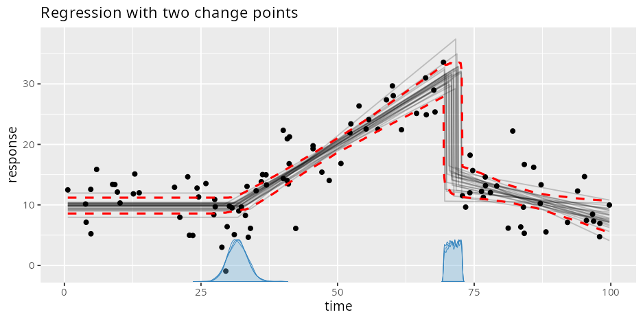
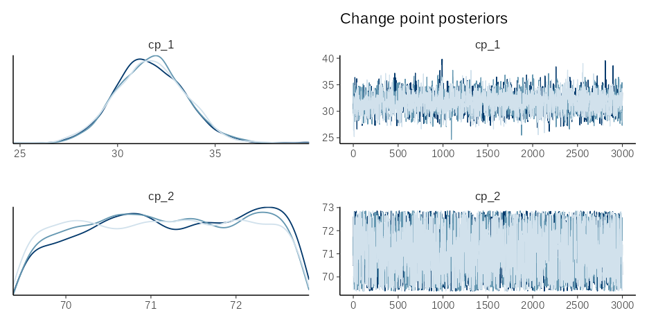
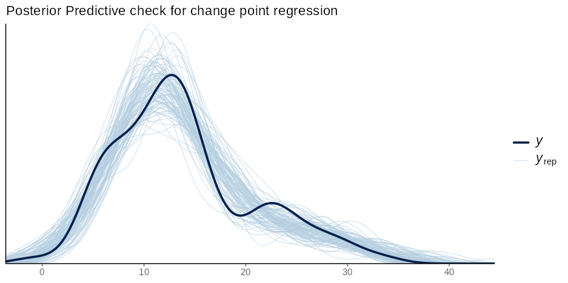

# mcp: Regression with Multiple Change Points

[](https://github.com/lindeloev/mcp/actions/workflows/check-standard.yaml?query=branch%3Adev)
[](https://app.codecov.io/gh/lindeloev/mcp/branch/dev)
[](https://CRAN.R-project.org/package=mcp)
[](https://cranlogs.r-pkg.org/badges/mcp)

`mcp` is regression with multiple change points, inferring full Bayesian
uncertainty for all parameters, including the change points themselves.
At its simplest, it feels like `lm()` with one formula per segment. At
its most flexible, it aims to be
[**`brms`**](https://paulbuerkner.com/brms/) **for change points**:

- *GLMM and distributional regression:* Gaussian, binomial, Bernoulli,
  Poisson, and Negative Binomial families. Group-level (random) effects,
  AR/MA, and regression on distributional parameters (e.g., `sigma`,
  `shape`).

- *Express expert knowledge:* Specify the number of change points, the
  form of each segment, and constrain coefficients via priors. Compare
  hypotheses using `loo()` and `hypothesis()`.

- *Native feel:* `summary()`, `plot_pars()`, `pp_check()`, and
  `as_draws_df()` follow the conventions of
  [`brms`](https://paulbuerkner.com/brms/),
  [`rstanarm`](https://mc-stan.org/rstanarm/), and
  [`posterior`](https://mc-stan.org/posterior/articles/posterior.html),
  adapted to change point regression. Inspect the sampled JAGS model in
  `fit$jags_code`.

`mcp` has [200+ academic
citations](https://scholar.google.com/scholar?cites=5590697509718421309)
across ecology, astronomy, neuroscience, epidemiology, and other
disciplines. You will find many aliases for change point regression in
the literature, including piecewise linear, discontinuity, segmented,
and broken stick regression.

# Install

Install `mcp` from CRAN:

``` r
install.packages("mcp")
```

or install the development version from GitHub:

``` r
if (!requireNamespace("remotes")) install.packages("remotes")
remotes::install_github("lindeloev/mcp@dev")
```

`mcp` uses JAGS through `rjags`. If installation of `rjags` reports that
JAGS headers or libraries are missing, install [JAGS
4.x](https://sourceforge.net/projects/mcmc-jags/files/JAGS/4.x/) and
rerun the `mcp` installation. JAGS 5 is supported when `rjags` 5 is
released.

# At a glance

`mcp` takes a list of formulas - one for each segment:

``` r
library(mcp)

model = list(
  response ~ 1,  # plateau (Intercept_1)
  ~ 0 + time,    # joined slope (time_2) at cp_1
  ~ 1 + time     # disjoined slope (Intercept_3, time_3) at cp_2
)

data = mcp_example_data("demo")
fit = mcp(model, data)
```

The change point(s) are the `x` at which data changes from being better
predicted by one formula to the next. The first formula is just
`response ~ predictors` and the most common formula for segment 2+ would
be `~ predictors` (more details
[here](https://lindeloev.github.io/mcp/articles/formulas.html)).

You can do change point regression for a large number of models in a
syntax that aligns with `lm()`/`glm()`/`brms`. E.g.:


# Brief worked example

The following model infers the two change points between three segments.
You can run this complete worked example (which fits the model and plots
by default) in one line:

``` r
library(mcp)
demo_fit = mcp_example("demo")  # Also check out other examples
```

See `demo_fit$example_code` for how it was generated, and explore more
demos in `mcp_example()`. But for now, let’s walk through the example
manually:

``` r
# Define the model
model = list(
  response ~ 1,  # plateau (Intercept_1)
  ~ 0 + time,    # joined slope (time_2) at cp_1.
  ~ 1 + time     # disjoined slope (Intercept_3, time_3) at cp_2
)

# Get example data and fit it: mcp(model, data, ...)
fit = mcp(model, demo_fit$data, sample = "both")
```

## Plot and summary

The default plot includes data, fitted lines drawn randomly from the
posterior, and change point(s) posterior density for each chain. Here we
also add fitted interval (`q_fit`):

``` r
plot(fit, q_fit = TRUE) + ggtitle("Regression with two change points")
```



Use `summary()` to summarise the posterior distribution as well as
sampling diagnostics:

``` r
summary(fit)
```

    ## Family: gaussian
    ## Links: mu = identity; sigma = identity
    ## Draws: 9000 (3 chains with iter = 3000)
    ## Segments:
    ##   1: response ~ 1
    ##   2: ~ 0 + time
    ##   3: ~ 1 + time
    ## 
    ## Change point parameters:
    ##    parameter  mean    sd lower  upper rhat ess_bulk ess_tail  sim match
    ##  cp_1        31.67 1.789 28.37 35.278 1.00     3301     4250 30.0    OK
    ##  cp_2        71.15 0.995 69.47 72.782 1.00     3649     6590 70.0    OK
    ## 
    ## Population-level parameters:
    ##    parameter  mean    sd lower  upper rhat ess_bulk ess_tail  sim match
    ##  Intercept_1  9.94 0.662  8.62 11.217 1.00     4835     6307 10.0    OK
    ##  time_2       0.55 0.047  0.46  0.642 1.00     5165     6622  0.5    OK
    ##  Intercept_3 13.95 1.334 11.36 16.574 1.00     2306     4675 15.0    OK
    ##  time_3      -0.21 0.082 -0.37 -0.045 1.00     1287     2440 -0.3    OK
    ##  sigma_1      3.87 0.279  3.36  4.463 1.00     4455     4623  3.5    OK

- `rhat` is the rank-normalized split-Rhat convergence diagnostic.
- `ess_bulk` and `ess_tail` are the effective sample sizes for the bulk
  and tails of the posterior. Warning thresholds can be changed with
  `mcp(..., diagnostics = list(rhat = 1.01, ess_bulk = 400, ess_tail = 400))`;
  `summary()` inherits these settings.
- In this case, we simulated data using `mcp` (see how in
  `demo_fit$example_code`) so the columns `sim` and `match` show true
  value and whether it was recovered.

`plot_pars(fit)` can be used to inspect the posteriors and convergence
of all parameters. See the documentation of `plot_pars()` for many other
plotting options. Here, we plot just the (population-level) change
points. They often have “strange” posterior distributions, highlighting
the need for a computational approach:

``` r
plot_pars(fit, regex_pars = "cp_") + ggtitle("Change point posteriors")
```



Do a posterior predictive check to see if the model recovers the
empirical distribution in the data:

``` r
pp_check(fit) + ggtitle("Posterior Predictive check for change point regression")
```



You can expect most generics from R, `posterior`, `tidybayes` to work on
mcpfits. E.g., use `fitted(fit)` and `predict(fit)` to get fits and
predictions for in-sample and out-of-sample data, use `as_draws(fit)` to
get draws (see `?as_draws.mcpfit` for all formats), etc.

## Tests and model comparison

We can test (joint) probabilities in the model using `hypothesis()`
([see more
here](https://lindeloev.github.io/mcp/articles/comparison.html)). For
example, what is the evidence (given priors) that the first change point
(`cp_1`) is later than 30 against it being earlier than 30?

``` r
hypothesis(fit, "cp_1 > 30")
```

    ## # A tibble: 1 × 7
    ##   hypothesis     mean    sd lower upper  prob    BF
    ##   <chr>         <dbl> <dbl> <dbl> <dbl> <dbl> <dbl>
    ## 1 cp_1 - 30 > 0  1.67  1.79 -1.63  5.28 0.826  4.92

For model comparisons, we can fit a null model and compare the
predictive performance of the two models using (approximate)
leave-one-out cross-validation ([see more
here](https://lindeloev.github.io/mcp/articles/comparison.html)). Let’s
specify a null model where the first two segments are reduced to one
straight line, i.e., removing the change point:

``` r
# Define the model
model_null = list(response ~ 1 + time)  # Intercept_1 and time_1

# Fit it
fit_null = mcp(model_null, demo_fit$data)
```

Leveraging the power of `loo::loo()`, we see that the two-change-points
model is preferred (it is on top), and both `p_worse` and the
`elpd_diff / se_diff` ratio indicate this preference is strong:

``` r
fit_loo = loo(fit)
fit_null_loo = loo(fit_null)

loo::loo_compare(fit_loo, fit_null_loo)
```

    ##   model elpd_diff se_diff p_worse diag_diff diag_elpd
    ##  model1       0.0     0.0      NA                    
    ##  model2     -58.2     9.0    1.00

# Highlights from in-depth guides

The articles on the [mcp website](https://lindeloev.github.io/mcp/) go
in-depth with the functionality of `mcp`. Here is an executive summary,
to give you a quick sense of what mcp can do.

[Understanding mcp
formulas](https://lindeloev.github.io/mcp/articles/formulas.html):

- Parameter names are `Intercept_i` (intercepts), `cp_i` (change
  points), `x_i` (slopes), `ar*`/`ma*` (autocorrelation), and `sigma_*`
  (Gaussian residual standard deviation).

- Only terms included in a segment get coefficients there. `~ 0 + ...`
  is joined: it continues from where the earlier intercept and
  [x-terms](https://lindeloev.github.io/mcp/articles/formulas.html#how-segments-connect)
  (`x`, `state:x`, `I(x^2)`) left off. `~ 1 + ...` is disjoined and
  starts afresh. Use `same(z)` to reuse a coefficient from the preceding
  segment.

- The change point model is basically an `ifelse` model with ordered
  change points.

- Generate data for all supported models using `fit$simulate()`. See
  examples in, e.g., `mcp_example("demo")$example_code`.

[Supported families and link
functions](https://lindeloev.github.io/mcp/articles/families.html):

- `mcp` currently supports specific combinations of families
  (`gaussian()`, `binomial()`, `bernoulli()`, `poisson()`, and
  `negbinomial()`) and link functions (`identity`, `logit`, `probit`,
  and `log`).

- On using informative priors to incorporate expert knowledge.

- Use `binomial(link = "logit")` for [binomial change points in
  mcp](https://lindeloev.github.io/mcp/articles/binomial.html). Also
  relevant for `bernoulli(link = "logit")`.

- Use `negbinomial(link = "log")` or `poisson(link = "log")`. Read more
  on [Poisson and negative binomial change points in
  mcp](https://lindeloev.github.io/mcp/articles/poisson.html).

- Get results on the linear-predictor (link) scale rather than the
  response scale using `plot(fit, scale = "linear")` or
  `fitted(fit, scale = "linear")`.

[Model comparison and hypothesis
testing](https://lindeloev.github.io/mcp/articles/comparison.html):

- Do Leave-One-Out Cross-Validation using `loo(fit)` and
  `loo::loo_compare(loo1, loo2)`.

- Compute Savage-Dickey density ratios using
  `hypothesis(fit, "cp_1 = 40")`.

[Group-level (random)
effects](https://lindeloev.github.io/mcp/articles/group_effects.html):

- Model group-level intercepts, slopes, and change points using
  `(1|id)`, `(0 + x||id)`, or `cp((1|id))`. Get posteriors using
  `ranef(fit)`.

- Plot using `plot(fit, facet_by = "my_group")` and
  `plot_pars(fit, pars = "group", type = "dens_overlay", ncol = 3)`.

- Group-specific change points are restricted to the observed range of
  `x` and ordered within each group.

Modeling
[autoregression](https://lindeloev.github.io/mcp/articles/arma.html) and
distributional parameters like [Gaussian residual standard
deviation](https://lindeloev.github.io/mcp/articles/dpar.html):

- `~ 0 + sigma(1)` models an intercept change in standard deviation.
  `~ 0 + sigma(0 + x)` models increasing/decreasing standard deviation.
  Explicit `sigma()` formulas use a log link, so their coefficients are
  on the log-SD scale.

- `~ ar(N)` models Nth order autoregression on residuals.
  `~ar(N, 0 + x)` models increasing/decreasing autocorrelation.

- `y | weights(w)` (and `y | trials(N) + weights(w)`) specifies
  observation log-likelihood weights (`w > 0`) across all families.

- You can provide complete models in distributional parameters
  (currently `sigma()`, `shape()`, and `mu()`) and time-series (`ar()`
  and `ma()`). For example, `~ x + sigma(1 + x:state)` models an abrupt
  change followed by by-state slopes in variance.

[Get fitted and predicted values and
intervals](https://lindeloev.github.io/mcp/articles/predict.html):

- `fitted(fit)` and `predict(fit)` take many arguments to predict
  in-sample and out-of-sample values and intervals.

- Forecasting with prior knowledge about future change points.

[Using priors](https://lindeloev.github.io/mcp/articles/priors.html):

- See priors in `fit$prior` or `prior_summary(fit)` and set priors using
  `mcp(..., prior = list(cp_1 = "dnorm(0, 1)", cp_2 = "dunif(0, 45)"))`.

- Default priors are the weakly informative, conventional defaults of
  `rstanarm` for intercepts and coefficients and of `brms` for scale
  parameters, with a few [documented
  deviations](https://lindeloev.github.io/mcp/articles/default_priors.html#deviations).

- The default prior on change points is a flat Dirichlet prior on the
  segment lengths ([read
  more](https://lindeloev.github.io/mcp/articles/default_priors.html#change-points)).

- Fix parameters to specific values using `cp_1 = 45`. To reuse a
  coefficient in a later segment, use `same()` in the model, e.g.,
  `~ 0 + same(x)`.

- Truncate priors using `T(lower, upper)`, e.g.,
  `Intercept_1 = "dnorm(0, 1) T(0, )"`. Change points are always
  ordered. Set a minimum segment length using, e.g.,
  `cp_2 = "dunif(cp_1 + 20, max(x))"`.

- Do prior predictive checks using
  `mcp(model, data, sample = "prior") |> plot(prior = TRUE)`.

[Missing responses and posterior
imputation](https://lindeloev.github.io/mcp/articles/missing.html):

- Missing responses are sampled in JAGS and retained with their matching
  posterior draws.

- Use `fitted(fit) |> filter(is.na(y))` for expected responses and
  `predict(fit) |> filter(is.na(y))` for posterior imputations.

- On plotting missing responses, asking probabilistic questions about
  them, etc.

[Tips, tricks, and
debugging](https://lindeloev.github.io/mcp/articles/tips.html)

- Speed up fitting using
  `future::plan(future::multisession, workers = 3)`, and/or fewer
  iterations, `mcp(..., warmup = 500)`.

- Help convergence along using
  `mcp(..., inits = list(Intercept_1 = 10, sigma_1 = 2))`.

- Most errors stem from impossible or circularly defined priors.

# Citation

[This preprint](https://osf.io/fzqxv) formally introduces `mcp`. Find
citation info at the link, call `citation("mcp")` or copy-paste this
into your reference manager:

      @Article{,
        title = {mcp: An R Package for Regression With Multiple Change Points},
        author = {Jonas Kristoffer Lindeløv},
        journal = {OSF Preprints},
        year = {2020},
        doi = {10.31219/osf.io/fzqxv},
        encoding = {UTF-8},
      }
