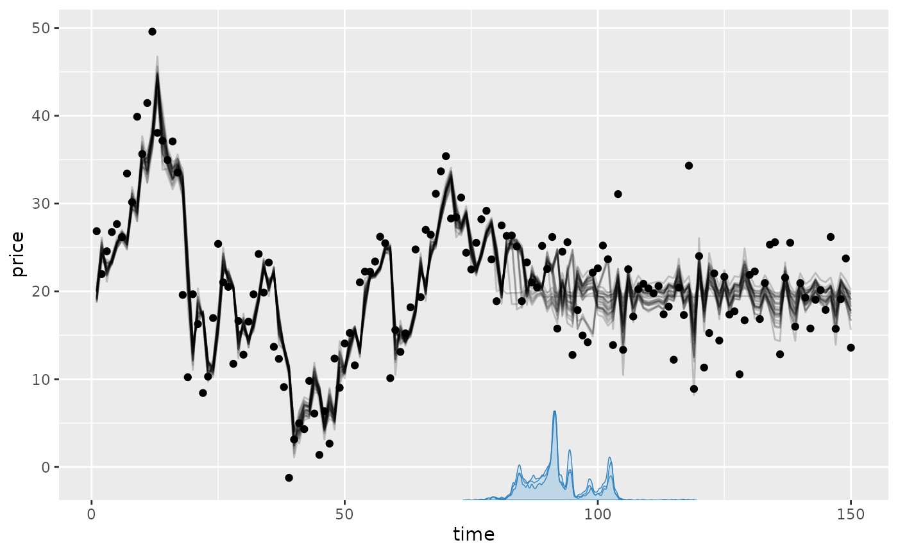
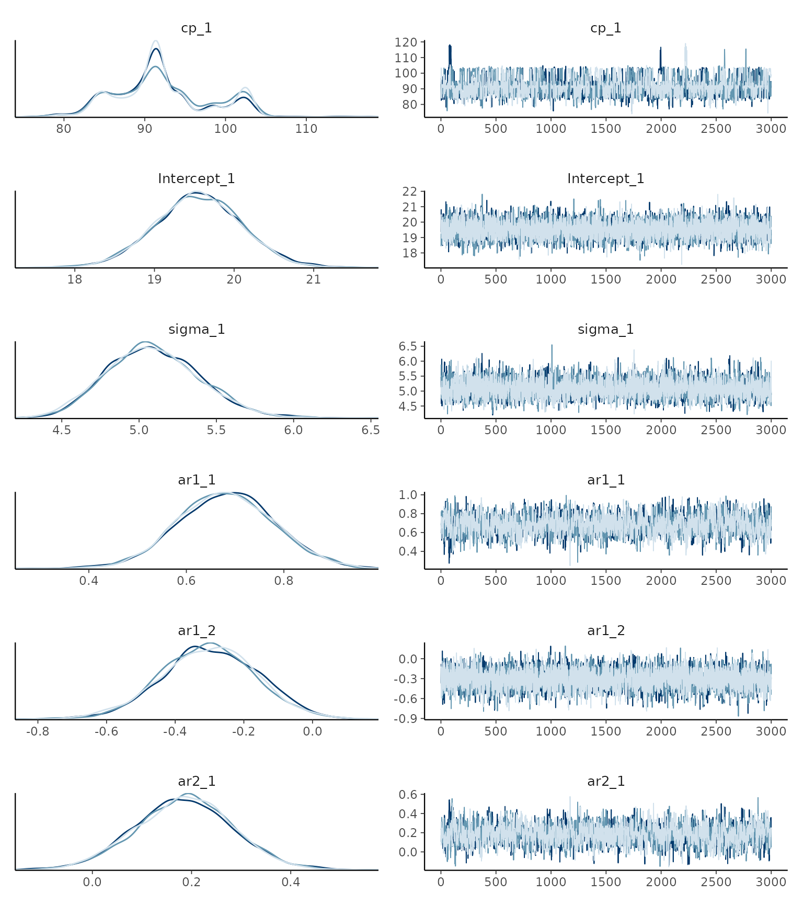
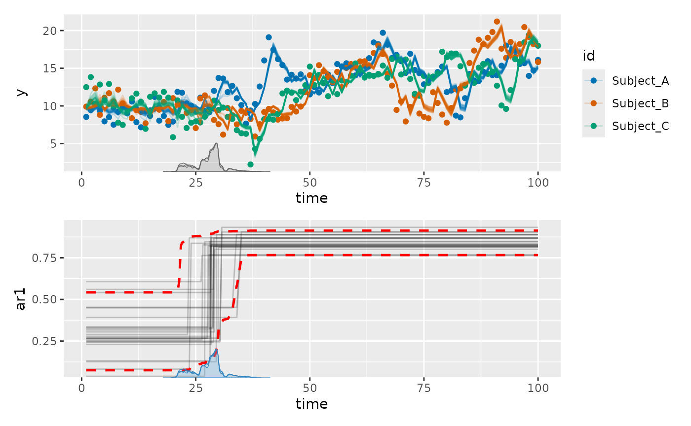
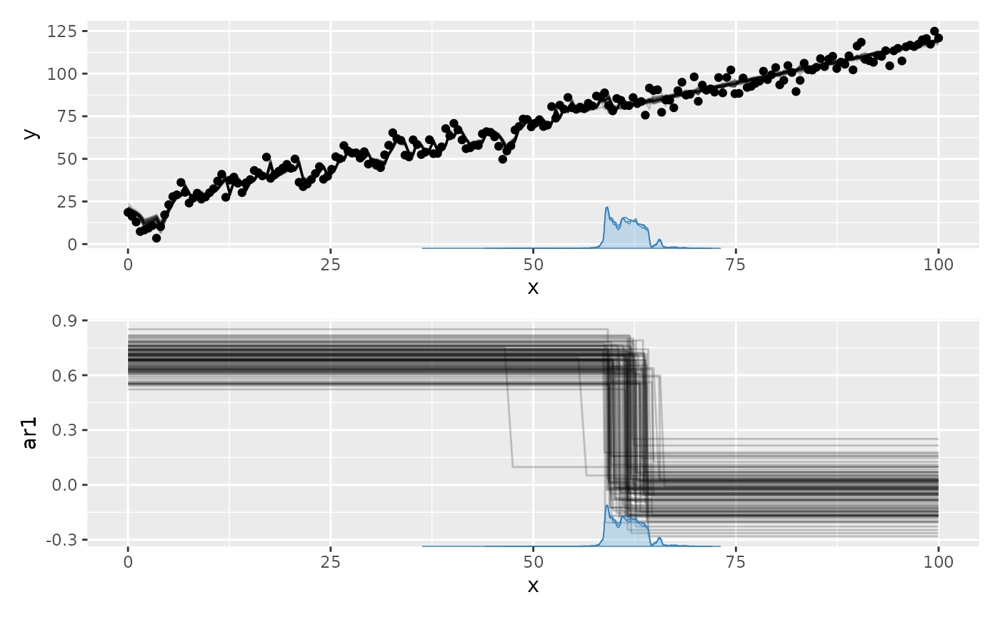
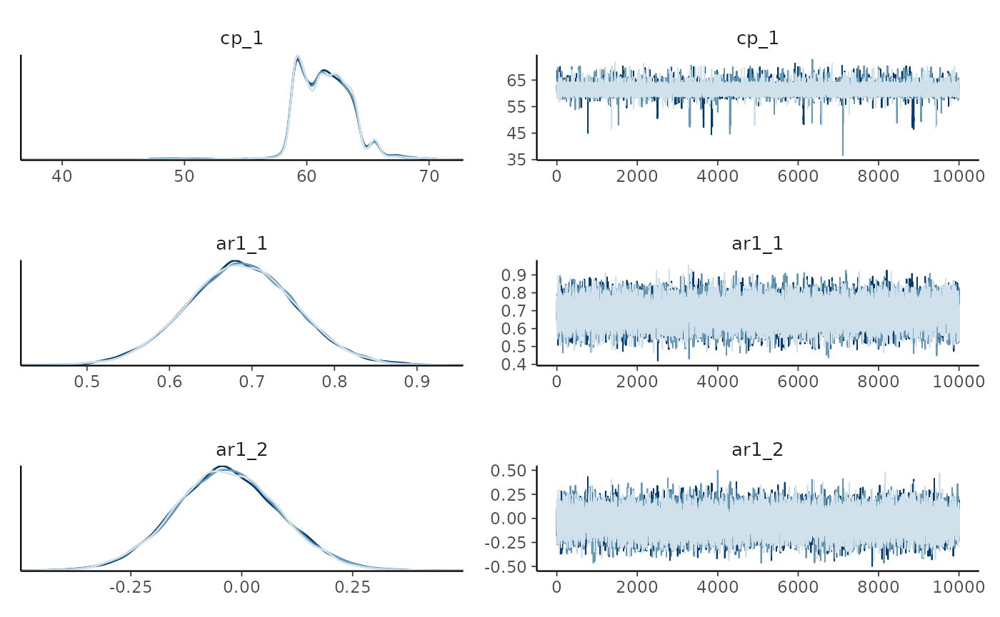
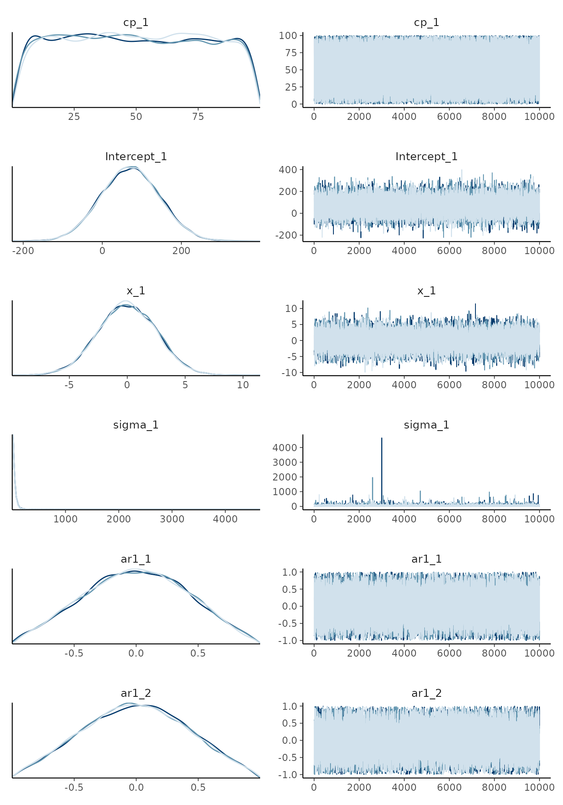

# Time series change points

Serial dependence is common in time series. Add autoregressive terms
with `ar(p)`, moving-average terms with `ma(q)`, or both in the segment
formulas:

``` r

model = list(y ~ 1 + x + ar(1) + ma(1))
```

The most common use case is still `ar(1)`. AR and MA follow the [rules
for how segments
connect](https://lindeloev.github.io/mcp/articles/formulas.html#how-segments-connect):
they apply only in segments that include them, so a segment without
[`ar()`](https://rdrr.io/r/stats/ar.html) has no AR component (`ar(0)`
and `ma(0)` also turn it off). A positive-order `ar(p, 0)` or `ma(q, 0)`
is joined: it continues from where the earlier intercept and x-terms
(e.g., the `x` in `ar(1, 1 + x)`) left off, for matching lags. Including
`ar(p)` or `ma(q)` replaces the whole component: if `ar(1)` follows
`ar(2)`, lag 2 is turned off in the later segment. Both accept a
regression formula, such as `ar(1, 1 + x)` or `ma(1, 0 + x)`.

### GARMA definition

`mcp` implements AR and MA as a generalized ARMA (GARMA) recurrence on
the response-family link scale. If \eta^{\text{reg}}\_t is the ordinary
linear predictor from the segment formulas and \eta_t is the linear
predictor including serial dependence, then

\begin{aligned} \text{AR}\_t &= \sum\_{j=1}^{p} \phi\_{j,t}
\left\[g(y^\*\_{t-j}) - \eta^{\text{reg}}\_{t-j}\right\] \\ \text{MA}\_t
&= \sum\_{k=1}^{q} \theta\_{k,t} \left\[g(y^\*\_{t-k}) -
\eta\_{t-k}\right\] \\ \eta_t &= \eta^{\text{reg}}\_t + \text{AR}\_t +
\text{MA}\_t \end{aligned}

where \phi\_{j,t} is the lag-j autoregressive (AR) coefficient at time
t, \theta\_{k,t} is the lag-k moving-average (MA) coefficient at time t,
g(\cdot) is the link function (g(\mu_t) = \eta_t, so \mu_t =
g^{-1}(\eta_t)), and y^\*\_t is the threshold-constrained observation
with threshold constant c (set via `threshold = 0.1` by default). Thus
[`ar()`](https://rdrr.io/r/stats/ar.html) uses lagged link-scale
residuals relative to the ordinary regression, while `ma()` uses lagged
one-step innovations.

**`mcp` does regression with change points on the coefficients**
\phi\_{j,t} **and** \theta\_{k,t}. See below for applied examples.

Unavailable lags at the beginning of the series contribute zero. This
same recurrence is used by JAGS, fitted values, predictions, log
likelihoods, and fresh-series simulation.

A key feature of this recurrence is that AR/MA memory flows continuously
across change points:

- For an order-N component in a new segment, the last N observations
  *before* the change point are input into the first \eta_t in the new
  segment, weighted by the new segment’s AR/MA parameters.

- The lagged residuals are not set to zero at change points; memory
  flows continuously from one segment into the next. Lags start at zero
  only at the very beginning of the dataset, or at the start of each
  independent series when using `series = "column_name"` (see [Multiple
  time series](#multiple-series)).

- Because change point locations \tau are estimated with posterior
  uncertainty, the change point where AR/MA parameters switch varies
  conditionally across MCMC draws.

GARMA currently supports only the default links for
[`gaussian()`](https://rdrr.io/r/stats/family.html) (identity),
[`binomial()`](https://rdrr.io/r/stats/family.html) (logit),
[`bernoulli()`](https://lindeloev.github.io/mcp/reference/bernoulli.md)
(logit), [`poisson()`](https://rdrr.io/r/stats/family.html) (log), and
[`negbinomial()`](https://lindeloev.github.io/mcp/reference/negbinomial.md)
(log). Non-default links are rejected for now.

**Warning:** The AR and MA coefficients are modeled directly and are not
jointly constrained to the stationary or invertible regions. With
higher-order terms such as `ar(2)`, independently bounded coefficients
can violate the usual root conditions. Coefficients that change across
predictors or segments, such as `ar(1, 1 + x)` or
`model = list(y ~ ar(1), ~ ar(1))`, instead define a time-varying
process to which the usual constant-coefficient conditions do not
directly apply. The same applies to `ma()`.

#### Observation threshold

The transformed observation y^\*\_t keeps log and logit residuals finite
when observations are 0 (log link) or 0 or 1 (logit link), where the
link function is infinite, using a threshold constant c (default
`threshold = 0.1`). For Poisson and negative-binomial models, zero
counts are replaced by c, so y^\*\_t = \max(y_t, c). For binomial
models, observed success counts are constrained to \[c, n_t - c\] before
conversion to a rate (n_t = 1 for
[`bernoulli()`](https://lindeloev.github.io/mcp/reference/bernoulli.md),
constraining y^\*\_t to \[0.1, 0.9\]). It has no effect for Gaussian
models.

The default should usually be left unchanged. If needed, set it on
either term, for example `ar(1, threshold = 0.01) + ma(1)`. Like
`series`, the threshold is set once and applies to all
[`ar()`](https://rdrr.io/r/stats/ar.html) and `ma()` terms in all
segments, since they transform the same response history. Supplying
different thresholds is an error.

## Simple example

Let’s simulate some data using the
[`mcp_example_data()`](https://lindeloev.github.io/mcp/reference/mcp_example.md)
function with the “ar” settings:

``` r

library(mcp)
future::plan(future::multisession, workers = 3)

ar_data = mcp_example_data("ar")
head(ar_data)
```

    ##      price time
    ## 1 26.85479    1
    ## 2 21.97486    2
    ## 3 24.56901    3
    ## 4 26.75759    4
    ## 5 27.66546    5
    ## 6 26.18671    6

See how this was generated in `mcp_example("ar")$example_code`. We model
this as a plateau (`1`) with a second-order autoregressive residual
(`ar(2)`) followed by a joined plateau (`0`) with a negative first-order
autoregressive residual (`ar(1)`):

``` r

model = list(
  price ~ 1 + ar(2),  # Intercept_1, ar1_1, ar2_1
  ~ 0 + ar(1)         # ar1_2; replaces AR(2) with AR(1)
)
fit = mcp(model, ar_data, par_x = "time")
```

Let’s plot it and we see that AR was strong in the first segment and
weaker-but-negative in the second:

``` r

plot(fit)
```



We can summarise the inferred coefficients:

``` r

summary(fit)
```

    ## Family: gaussian
    ## Links: mu = identity; sigma = identity
    ## Draws: 9000 (3 chains with iter = 3000)
    ## Segments:
    ##   1: price ~ 1 + ar(2)
    ##   2: ~ 0 + ar(1)
    ## 
    ## Change point parameters:
    ##    parameter   mean    sd  lower   upper rhat ess_bulk ess_tail    sim match
    ##  cp_1        92.1   6.0   82.6   103.0   1.00     1026     1841 90.0      OK
    ## 
    ## Population-level parameters:
    ##    parameter   mean    sd  lower   upper rhat ess_bulk ess_tail    sim match
    ##  Intercept_1 19.55  0.54  18.49   20.61  1.00     5811     6807 20.00     OK
    ##  sigma_1      5.10  0.30   4.55    5.72  1.00     4188     4412  5.00     OK
    ##  ar1_1        0.682 0.099  0.488   0.879 1.00     1552     3128  0.700    OK
    ##  ar1_2       -0.30  0.14  -0.58   -0.03  1.00     4688     6952 -0.30     OK
    ##  ar2_1        0.186 0.098 -0.008   0.377 1.00     1573     2921  0.200    OK

The naming syntax is `[component][order]_[segment]` for intercepts. For
example, `ar1_2` is the first-order autoregressive coefficient and
`ma1_2` the first-order moving-average coefficient in segment 2. Slopes
use the usual `mcp` parameter names, e.g., `ar1_x_3` for a slope on
AR(1) in segment 3.

Comparing the columns `mean` and `sim` we see that the AR coefficients
are reasonably recovered. In fact, the posterior means are typically
close to the estimates of `arima(data, order = c(N, 0, 0))` (see below),
so the non-perfect fits are mostly due to randomness in the simulation -
not in the fit.

For Gaussian GARMA models, `sigma` describes the *innovations*, i.e.,
the part of the residuals not explained by AR and MA coefficients.
`sd(fit$data$price)` is therefore generally higher. In this case, the SD
of raw data in the first segment (`time < 90`) is 9.9. As always, it is
good to assess posteriors and convergence more directly:

``` r

plot_pars(fit, npars = NULL)
```



Sometimes, the trace plot shows that the change point (`cp_1`) is not
well identified with this model and data. As discussed in the article on
[tips, tricks, and
debugging](https://lindeloev.github.io/mcp/articles/tips.md), you could
combine a more informative prior with more draws
(`mcp(..., warmup = 10000, iter = 10000)`), if this is a problem.

You can do hypothesis testing with GARMA models using
[`hypothesis()`](https://lindeloev.github.io/mcp/reference/hypothesis.md).
[Read more here](https://lindeloev.github.io/mcp/articles/comparison.md)
or scroll down for an applied example.

## Tips, comments, and warnings

AR/MA must be included in every segment where they apply. Repeating
`ar(2)` estimates new lag coefficients; `ar(2, same(1))` reuses both lag
intercepts from the preceding segment, and errors if that segment does
not include both lags. An explicit `as` can select an earlier segment,
e.g., across a segment without AR. `ar(2, 0)` is joined;
`ar(2, 0 + same(x))` also reuses the slope for each lag. In all cases,
the observation and innovation history continues across change points.

The AR and MA terms apply to link-scale *residuals* from the ordinary
regression. In time-series jargon, this is a *dynamic* regression model
where the ordinary regression parameters make up the *deterministic*
structure. See further comments in the section on priors below.

To control the *direction* of a change, put a one-sided prior on the
corresponding coefficient, e.g., `ar1_x_1 = "dnorm(0, 1) T(0, )"`. See
recommendations in [the section on priors](#ar_prior).

### Regression on AR/MA coefficients

You can specify how the coefficients change with x using
`ar(p, formula)` and `ma(q, formula)`. For example, `ar(1, 1 + time)`
models a steady change in AR(1) strength. These regression formulas use
an identity link, so slopes can easily produce non-stationary or
non-invertible coefficients. See [the section on priors](#ar_prior) for
ways to constrain them. The same formula is applied separately to every
order in the term.

Population-level [`mcp` formula
syntax](https://lindeloev.github.io/mcp/articles/formulas.md) is
available inside both terms, so you could use
`ar(3, 1 + I(x^2) + exp(z))` or `ma(1, 0 + group)`. Group-level terms
such as `(1|id)` are not supported inside
[`ar()`](https://rdrr.io/r/stats/ar.html) or `ma()`. Transformed
predictors must stay within the transformation’s domain; for example,
values passed to [`log()`](https://rdrr.io/r/base/Log.html) and
[`sqrt()`](https://rdrr.io/r/base/MathFun.html) must be non-negative.

### Combining ar(), ma(), and sigma()

You can combine [`ar()`](https://rdrr.io/r/stats/ar.html) and `ma()`
with any regression model and with [group-level change
points](https://lindeloev.github.io/mcp/articles/group_effects.md). For
Gaussian models, [`sigma()`](https://rdrr.io/r/stats/sigma.html)
controls the innovation standard deviation:

``` r

model = list(
  y ~ 1 + ar(1) + ma(1) + sigma(1),    # First order ARMA
  ~ 0 + x + ar(1) + ma(0) + sigma(1),  # New AR coefficient; ma(0) states that MA is not included
  ~ 1 + ar(0)                          # No ARMA in this segment. ~ 1 is identical but ar(0) is explicit.
)
```

### Row ordering and multiple time series (`series`)

AR and MA lags apply strictly to the *order of rows* in your data frame,
without taking into account the numerical distance between values of
`x`. This has two important implications:

- **Sort by time:** Adjacent rows are treated as lag-1 neighbors. Always
  ensure your data is sorted by time before fitting:
  `data = data[order(data$x), ]`.
- **Uneven spacing:** Points recorded seconds apart vs. months apart
  will be modeled with the exact same autocorrelation if they are placed
  in consecutive rows.

#### Panel and longitudinal data (`series`)

When data contains repeated measurements from multiple participants,
sessions, or locations, you do *not* want residual autocorrelation from
the end of one individual to carry over to the beginning of the next.
Use the `series` argument inside
[`ar()`](https://rdrr.io/r/stats/ar.html) or `ma()` to define where
independent series start and end:

``` r

# 1. Model: set series = id once
model = list(
  y ~ 1 + ar(1, series = id),  # Segment 1: AR(1) within series
    ~ 0 + time + ar(1)          # Segment 2: new AR(1); series = id applies globally
)

# 2. Simulate panel data for 3 subjects (must be contiguous and sorted by time)
df_panel = data.frame(
  id = rep(c("Subject_A", "Subject_B", "Subject_C"), each = 100),
  time = rep(1:100, times = 3),
  y = 0
)

empty = mcp(model, data = df_panel, sample = FALSE)
df_panel$y = empty$simulate(
  empty, df_panel,
  cp_1 = 30,         # Change point location
  Intercept_1 = 10,  # Intercept in segment 1
  time_2 = 0.1,      # Slope for the mean in segment 2
  ar1_1 = 0.3,       # First-order AR in segment 1
  ar1_2 = 0.8,       # First-order AR in segment 2
  sigma_1 = 1.5      # Residual sigma; joined in segment 2
)

# 3. Fit the model
fit = mcp(model, data = df_panel)
summary(fit)
```

    ## Family: gaussian
    ## Links: mu = identity; sigma = identity
    ## Draws: 9000 (3 chains with iter = 3000)
    ## Segments:
    ##   1: y ~ 1 + ar(1, series = id)
    ##   2: ~ 0 + time + ar(1)
    ## 
    ## Change point parameters:
    ##    parameter   mean    sd  lower  upper rhat ess_bulk ess_tail    sim match
    ##  cp_1        27.6   3.0   21.5   33.6   1.00     2030     1845 30.0      OK
    ## 
    ## Population-level parameters:
    ##    parameter   mean    sd  lower  upper rhat ess_bulk ess_tail    sim match
    ##  Intercept_1  9.76  0.25   9.27  10.27  1.00     8438     8424 10.00     OK
    ##  time_2       0.094 0.017  0.061  0.129 1.00     5847     7401  0.100    OK
    ##  sigma_1      1.563 0.064  1.444  1.696 1.00     5325     5557  1.500    OK
    ##  ar1_1        0.30  0.11   0.08   0.52  1.00     5752     7270  0.30     OK
    ##  ar1_2        0.842 0.038  0.768  0.917 1.00     7202     6583  0.800    OK

``` r

# Plot fit and ar(1) parameter
library(patchwork)
gg_trend = plot(fit, color_by = "id")
gg_dpar  = plot_dpar(fit, "ar1", interval = "fitted")
gg_trend / gg_dpar
```



Within each series, AR/MA memory flows continuously across change
points. Between series, the lags start at zero, so the residuals of
different series are independent.

## Simulating autocorrelated change point data

Assessing the correctness of autocorrelation is less intuitive than
seeing e.g. a mean fit. However, we can verify `mcp` up against more
tested-and-tried functions such as
[`arima()`](https://rdrr.io/r/stats/arima.html) in base R. Let us
simulate a single AR(3) segment, i.e., without change points, and see if
it fits:

``` r

# Model
model = list(response ~ 1 + ar(3))

# Simulate data
df = data.frame(time = 1:200, response = 0)
empty = mcp(model, df, sample = FALSE, par_x = "time")
df$response = empty$simulate(
    empty,
    df,
    Intercept_1 = 20,
    ar1_1 = 0.7, 
    ar2_1 = 0.2, 
    ar3_1 = -0.4, 
    sigma_1 = 8)

# Base arima AR(3)
arima(df$response, order = c(3, 0, 0))
```

    ## 
    ## Call:
    ## arima(x = df$response, order = c(3, 0, 0))
    ## 
    ## Coefficients:
    ##          ar1     ar2      ar3  intercept
    ##       0.7733  0.1799  -0.4214    20.2236
    ## s.e.  0.0644  0.0848   0.0648     1.2327
    ## 
    ## sigma^2 estimated as 66.41:  log likelihood = -704.07,  aic = 1418.14

OK, we can see that the `ar` coefficients and sigma
([`arima()`](https://rdrr.io/r/stats/arima.html) reports \sigma^2) are
simulated correctly, if taking
[`arima()`](https://rdrr.io/r/stats/arima.html) as ground truth.
Inferring with `mcp` is straightforward:

``` r

fit = mcp(model, df, par_x = "time")
```

The Bayesian parameter estimates closely match
[`arima()`](https://rdrr.io/r/stats/arima.html), even where they deviate
from the simulation parameters (due to the inherent randomness in
simulating data):

``` r

summary(fit)
```

    ## Family: gaussian
    ## Links: mu = identity; sigma = identity
    ## Draws: 9000 (3 chains with iter = 3000)
    ## Segments:
    ##   1: response ~ 1 + ar(3)
    ## 
    ## Population-level parameters:
    ##    parameter   mean    sd  lower  upper rhat ess_bulk ess_tail    sim match
    ##  Intercept_1 20.3   1.3   17.8   22.8   1.00     8529     8336 20.0      OK
    ##  sigma_1      8.27  0.42   7.51   9.13  1.00     5176     4420  8.00     OK
    ##  ar1_1        0.771 0.065  0.644  0.900 1.00     2473     4148  0.700    OK
    ##  ar2_1        0.182 0.085  0.014  0.348 1.00     1785     3470  0.200    OK
    ##  ar3_1       -0.418 0.065 -0.545 -0.287 1.00     2458     4463 -0.400    OK

## Inferring an autocorrelation-only change

One “side-effect” of the `mcp` implementation of autocorrelation using
[`ar()`](https://rdrr.io/r/stats/ar.html) *in the formulas* is that you
can infer when autocorrelation parameters and structures change.

Let’s simulate a change point in autocorrelation and see if we can infer
it later:

``` r

# The model
model = list(
  y ~ 1 + x + ar(1),
  ~ 0 + same(x) + ar(1)  # reuse the slope x_1
)

# Get predictions
df = data.frame(x = seq(0, 100, length.out = 200), y = 0)
empty = mcp(model, df, sample = FALSE)
df$y = empty$simulate(
  empty,
  df,
  cp_1 = 60,
  Intercept_1 = 20,
  x_1 = 1,
  ar1_1 = 0.8, ar1_2 = 0.2,
  sigma_1 = 5)
```

We use `same(x)` in segment 2 to keep the slope identical across
segments, so the change point is strictly in autocorrelation. We use
`sample = "both"` because we will do a Savage-Dickey test later.

``` r

fit = mcp(model, data = df, iter = 10000, sample = "both")
```

Let’s plot the full model prediction using `plot(fit)`. You could use
`plot(fit, geom_data = "line")` for a more classical line plot of the
time series data. Set `plot(fit, arma = FALSE)` to omit all AR and MA
effects.

We plot it together with the change in the `ar1` parameter using
`plot_dpar(fit)`. Each AR/MA lag has its own segmented linear predictor,
so `mcp` treats it as a distributional parameter (`dpar`; [read
more](https://lindeloev.github.io/mcp/articles/dpar.md)):

``` r

library(patchwork)
plot(fit) /  # Patchwork syntax to show on separate rows
  plot_dpar(fit, dpar = "ar1", lines = 100)
```



We recovered the parameters, including the change point (see `mean` but
also the helpful `sim` and `match` columns):

``` r

summary(fit)
```

    ## Family: gaussian
    ## Links: mu = identity; sigma = identity
    ## Draws: 30000 (3 chains with iter = 10000)
    ## Segments:
    ##   1: y ~ 1 + x + ar(1)
    ##   2: ~ 0 + same(x) + ar(1)
    ## 
    ## Change point parameters:
    ##    parameter   mean    sd  lower  upper rhat ess_bulk ess_tail    sim match
    ##  cp_1        61.4   2.3   58.4   65.8   1.00     7650     6251 60.0      OK
    ## 
    ## Population-level parameters:
    ##    parameter   mean    sd  lower  upper rhat ess_bulk ess_tail    sim match
    ##  Intercept_1 20.5   1.8   17.0   24.0   1.00     2358     4498 20.0      OK
    ##  x_1          0.985 0.023  0.939  1.030 1.00     2486     4774  1.000    OK
    ##  sigma_1      4.72  0.24   4.27   5.22  1.00    17354    16283  5.00     OK
    ##  ar1_1        0.687 0.066  0.558  0.816 1.00    20342    26114  0.800    OK
    ##  ar1_2       -0.03  0.12  -0.27   0.21  1.00    19655    17850  0.20     OK

We can also plot some of the parameters. As usual, we see that the
change point is not well defined by any known distribution. The fact
that the posterior mean is around 61 does not (necessarily) mean that
there is a high credence in this value. Usually, I find that any bi- or
N-modality on the posterior matches well with what you would guess from
looking at the raw data. As they say: Bayesian inference is common sense
applied to data.

``` r

plot_pars(fit, regex_pars = "^cp_1|^ar1_")
```



As usual, we can test hypotheses ([read more
here](https://lindeloev.github.io/mcp/articles/comparison.md)). We can
also ask how much more likely it is (relative to the prior) that the two
autocorrelations are equal compared to them differing. Because we
sampled both the prior and posterior (`mcp(..., sample = "both")`), we
can do a Savage-Dickey density ratio test:

``` r

hypothesis(fit, "ar1_1 = ar1_2")
```

    ## Warning: Savage-Dickey Bayes factor was computed using default prior(s) for `ar1_1` and `ar1_2`. Point Bayes factors are sensitive to the prior distribution; consider specifying informed priors.

    ## Warning: The tested value is in a sparse tail of the prior or posterior draws; the Savage-Dickey estimate may be unreliable.

    ## # A tibble: 1 × 7
    ##   hypothesis         mean    sd lower upper  prob    BF
    ##   <chr>             <dbl> <dbl> <dbl> <dbl> <dbl> <dbl>
    ## 1 ar1_1 - ar1_2 = 0 0.720 0.136 0.452 0.982    NA     0

Notice the warning. We used default priors, so the Savage-Dickey ratio
is quite meaningless because the prior does not represent our actual
pre-likelihood beliefs. In any case, if it did, we would conclude that
the evidence for equality is very small. The posterior density at
equality is low, so few draws are near it, and the estimate is imprecise
(as the second warning shows).

Of course, we can also do directional tests. For example, what is the
evidence that `ar1_1` is more than 0.3 greater than `ar1_2`? Answer:
More than 100 to one.

``` r

hypothesis(fit, "ar1_1 - 0.3 > ar1_2")
```

    ## # A tibble: 1 × 7
    ##   hypothesis               mean    sd lower upper  prob    BF
    ##   <chr>                   <dbl> <dbl> <dbl> <dbl> <dbl> <dbl>
    ## 1 ar1_1 - 0.3 - ar1_2 > 0 0.420 0.136 0.152 0.682 0.999 1490.

## Priors on AR and MA coefficients

*[Brief overview of all default
priors](https://lindeloev.github.io/mcp/articles/default_priors.html#summary-reference-table)*

The default prior on each AR and MA intercept is a truncated normal
distribution:

``` r
dnorm(0, 0.5) T(-1, 1)
```

It is symmetric around zero and gently shrinks away from the \[-1, 1\]
bounds: its central 95% interval is approximately \[-0.84, 0.84\]. This
is a regularizing prior on each direct coefficient, not a joint
stationarity or invertibility constraint for orders above one.

`brms` also models AR and MA coefficients directly within \[-1, 1\], but
uses flat default priors over that range. Thus `mcp` keeps the familiar
parameter interpretation while adding mild regularization toward zero;
fits should generally be similar when the likelihood is informative.

Categorical contrasts default to `dnorm(0, 0.25)`. Slopes are also
normal and scaled by the predictor’s SD, `dnorm(0, 0.25 / sd(column))`.
Thus approximately 95% of the prior change per SD of the predictor lies
within \pm 0.5.

The defaults express no assumption about the sign. For a time series
where positive first-order autocorrelation is expected, alternatives
include `ar1_1 = "dunif(0, 1)"` or `ar1_1 = "dnorm(0.5, 0.5) T(0, 1)"`.
[Read more about specifying and checking
priors](https://lindeloev.github.io/mcp/articles/priors.md).

Here is a complete list of the (default) priors in the model above:

``` r

prior_summary(fit)
```

    ## # A tibble: 6 × 5
    ##   parameter   segment dpar  prior                  bounds           
    ##   <chr>         <int> <chr> <chr>                  <chr>            
    ## 1 cp_1              2 NA    dunif(0, 100)          [0, 100], ordered
    ## 2 Intercept_1       1 mu    dnorm(70.055, 74.062)  none             
    ## 3 x_1               1 mu    dnorm(0, 2.5464)       none             
    ## 4 sigma_1           1 sigma dt(0, 35.6, 3) T(0, )  [0, Inf]         
    ## 5 ar1_1             1 ar1   dnorm(0, 0.5) T(-1, 1) [-1, 1]          
    ## 6 ar1_2             2 ar1   dnorm(0, 0.5) T(-1, 1) [-1, 1]

We can also visualize the priors because we sampled the prior.
`prior = TRUE` works in most `mcp` functions, including
[`plot()`](https://lindeloev.github.io/mcp/reference/plot.mcpfit.md) and
[`summary()`](https://lindeloev.github.io/mcp/reference/summary.mcpfit.md).

``` r

plot_pars(fit, prior = TRUE, npars = NULL)
```



Notice that the density estimates are smoothed at sharp cutoffs, such as
the `T(-1, 1)` bounds, slightly misrepresenting the true distribution.

Let’s inspect the priors for a more advanced AR model, since you would
often have to inform these:

``` r

model = list(
  y ~ 1 + ar(2, 1 + x),
  ~ 0 + ar(1, 1 + I(x^2))
)
empty = mcp(model, data = data.frame(y = 1:10, x = 1:10), sample = FALSE)
prior_summary(empty)
```

    ## # A tibble: 9 × 5
    ##   parameter   segment dpar  prior                  bounds          
    ##   <chr>         <int> <chr> <chr>                  <chr>           
    ## 1 cp_1              2 NA    dunif(1, 10)           [1, 10], ordered
    ## 2 Intercept_1       1 mu    dnorm(5.5, 7.5691)     none            
    ## 3 sigma_1           1 sigma dt(0, 3.7, 3) T(0, )   [0, Inf]        
    ## 4 ar1_1             1 ar1   dnorm(0, 0.5) T(-1, 1) [-1, 1]         
    ## 5 ar1_x_1           1 ar1   dnorm(0, 0.082572)     none            
    ## 6 ar1_2             2 ar1   dnorm(0, 0.5) T(-1, 1) [-1, 1]         
    ## 7 ar1_xE2_2         2 ar1   dnorm(0, 0.0088324)    none            
    ## 8 ar2_1             1 ar2   dnorm(0, 0.5) T(-1, 1) [-1, 1]         
    ## 9 ar2_x_1           1 ar2   dnorm(0, 0.082572)     none

AR and MA coefficient regressions use an identity link, while their
residual inputs use the supported response-family link described above.
Careful priors become especially important with higher orders or
coefficient slopes, where individual values in \[-1, 1\] do not ensure a
stable recurrence. After fitting,
[`mcp()`](https://lindeloev.github.io/mcp/reference/mcp.md) checks up to
500 posterior draws at up to 100 observed predictor rows and warns if
the checked-draw violation rate exceeds the corresponding `ar` or `ma`
threshold in `diagnostics` (10% by default). `fit$simulate()` checks the
supplied coefficient trajectory before generating a fresh series. For
predictor- or segment-varying coefficients these are local smoke tests,
not proofs of global stationarity or invertibility.

Here are a few ways in which you may want to inform the AR or MA
parameters:

- For a constant AR(2) process, stationarity requires -1 \< \phi_2 \< 1
  and \phi_2 - 1 \< \phi_1 \< 1 - \phi_2. One dependent-prior
  construction that stays in this region is `ar2_1 = "dunif(-1, 1)"`
  together with `ar1_1 = "dunif(ar2_1 - 1, 1 - ar2_1)"`. The simpler
  suggestion `ar2_1 = "dunif(0, ar1_1)"` is not sufficient. Higher
  orders require the corresponding joint root condition.
- Slopes can quickly make AR coefficients non-stationary or MA
  coefficients non-invertible. Set their prior scale relative to a
  plausible change over the observed range of x. For example, a shallow
  negative change over the observed range could use
  `"dnorm(0, 0.1 / (max(x) - min(x))) T(, 0)"`.

## Notes on observed data vs simulated data

JAGS,
[`fitted()`](https://lindeloev.github.io/mcp/reference/execute-mcp-model.md),
[`predict()`](https://lindeloev.github.io/mcp/reference/execute-mcp-model.md),
and
[`log_lik()`](https://lindeloev.github.io/mcp/reference/execute-mcp-model.md)
evaluate a finite, conditional recurrence: the response history supplies
earlier residuals, and unavailable residuals before the start of the
series are set to zero.

- [`fitted()`](https://lindeloev.github.io/mcp/reference/execute-mcp-model.md)
  and
  [`predict()`](https://lindeloev.github.io/mcp/reference/execute-mcp-model.md)
  use posterior imputations only to complete missing response histories.
  [`predict()`](https://lindeloev.github.io/mcp/reference/execute-mcp-model.md)
  generates fresh outcomes at all rows, even where the original response
  was missing.
- [`log_lik()`](https://lindeloev.github.io/mcp/reference/execute-mcp-model.md)
  is unavailable if the data has missingness before some observed data.
- `predict(..., arma = "replicate")`,
  `posterior_predict(..., arma = "replicate")`, and
  [`pp_check()`](https://lindeloev.github.io/mcp/reference/pp_check.md)
  (where it is the default) generate each series recursively from the
  model posteriors without conditioning on the original response
  history. This makes serial summaries of posterior replications, such
  as their autocorrelation and run lengths, meaningful. Use
  `pp_check(fit, arma = TRUE)` to check the one-step-ahead predictions
  instead.

## JAGS code

Here is the JAGS code for the autocorrelation-only change above, i.e.,
the one with a reused slope going from one AR(1) coefficient to another.
[`fitted()`](https://lindeloev.github.io/mcp/reference/execute-mcp-model.md),
[`predict()`](https://lindeloev.github.io/mcp/reference/execute-mcp-model.md),
etc. evaluate the same formulas in R; see [the model in
R](https://lindeloev.github.io/mcp/articles/implementation.html#the-model-in-r).

``` r

fit$jags_code
```

    ## model {
    ##   # Change points
    ##   cp_0 = min(x)
    ##   cp_1 ~ dunif(cp_0, cp_2)  # Uniform within the observed range of x
    ##   cp_2 = max(x)
    ## 
    ##   # Priors for population-level effects
    ##   ar1_1 ~ dnorm(0, 1/(0.5)^2) T(-1, 1)  # Zero-centered regularizing dependence coefficient
    ##   ar1_2 ~ dnorm(0, 1/(0.5)^2) T(-1, 1)  # Zero-centered regularizing dependence coefficient
    ##   Intercept_1_mid_ ~ dnorm(70.05488308241101 + x_1 * (25), 1/(74.061610437431241)^2)  # Mean intercept (rstanarm default); sampled as the value at the expected midpoint of segment 1
    ##   Intercept_1 = Intercept_1_mid_ - (x_1 * (25))
    ##   x_1 ~ dnorm(0, 1/(2.5463835748232295)^2)  # Autoscaled mean coefficient (rstanarm default)
    ##   sigma_1 ~ dt(0, 1/(35.6)^2, 3) T(0, )  # Positive residual SD calibrated on the response scale
    ## 
    ##   # Apply GARMA recursion to link-scale residuals
    ##   resid_garma_[1] = 0
    ##   for (i_ in 2:length(x)) {
    ##     resid_garma_[i_] = ar1_[i_] * resid_abs_[i_ - 1]
    ##   }
    ##   # Model and likelihood
    ##   for (i_ in 1:length(x)) {
    ##     # x measured from each segment's change point
    ##     x_local_1_[i_] = min(x[i_], cp_1)
    ##     x_local_2_[i_] = min(x[i_], cp_2) - cp_1
    ##     
    ##     # GARMA observation threshold
    ##     garma_threshold_[i_] = 0.1
    ##     
    ##     # Formula for ar1
    ##     ar1_[i_] =
    ##       (x[i_] >= cp_0) * (x[i_] < cp_1) * inprod(rhs_matrix_[i_, c(1)], c(ar1_1)) * 1 + 
    ##       (x[i_] >= cp_1) * inprod(rhs_matrix_[i_, c(2)], c(ar1_2)) * 1
    ##     
    ##     # Formula for mu
    ##     link_mu_[i_] =
    ##       (x[i_] >= cp_0) * inprod(rhs_matrix_[i_, c(3)], c(Intercept_1)) * 1 + 
    ##       (x[i_] >= cp_0) * inprod(rhs_matrix_[i_, c(4)], c(x_1)) * x_local_1_[i_] + 
    ##       (x[i_] >= cp_1) * inprod(rhs_matrix_[i_, c(5)], c(x_1)) * x_local_2_[i_]
    ##     
    ##     # Formula for sigma
    ##     link_sigma_[i_] =
    ##       (x[i_] >= cp_0) * inprod(rhs_matrix_[i_, c(6)], c(sigma_1)) * 1
    ## 
    ##     # Likelihood for family = gaussian()
    ##     mu_[i_] = link_mu_[i_] + resid_garma_[i_]
    ##     sigma_[i_] = max(1e-05, link_sigma_[i_])
    ##     y[i_] ~ dnorm(mu_[i_], 1 / sigma_[i_]^2)
    ##     garma_y_[i_] = y[i_]
    ##     garma_link_y_[i_] = garma_y_[i_]
    ##     resid_abs_[i_] = garma_link_y_[i_] - link_mu_[i_]
    ##   }
    ## }
