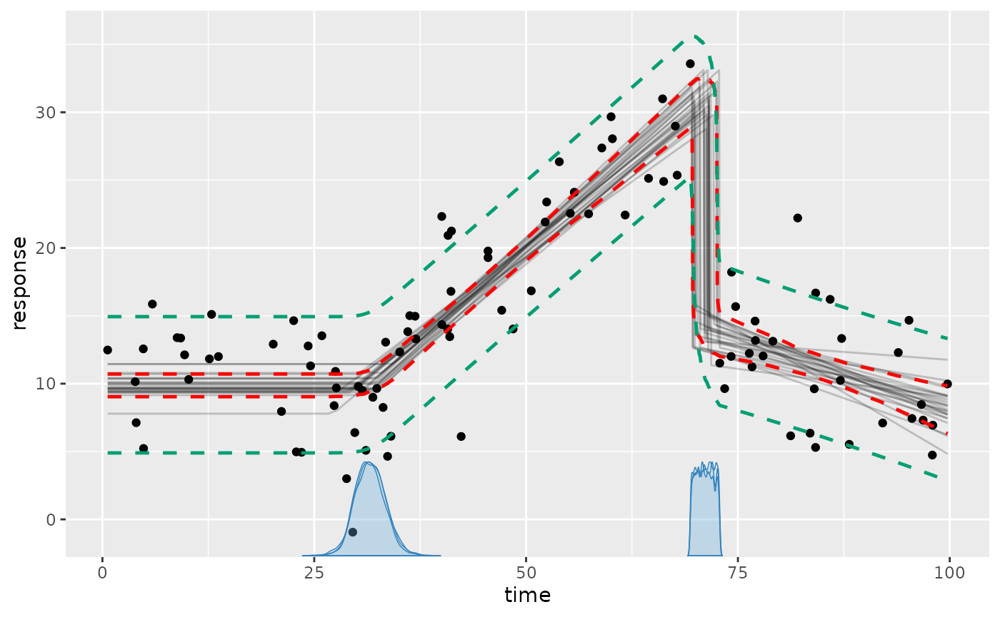
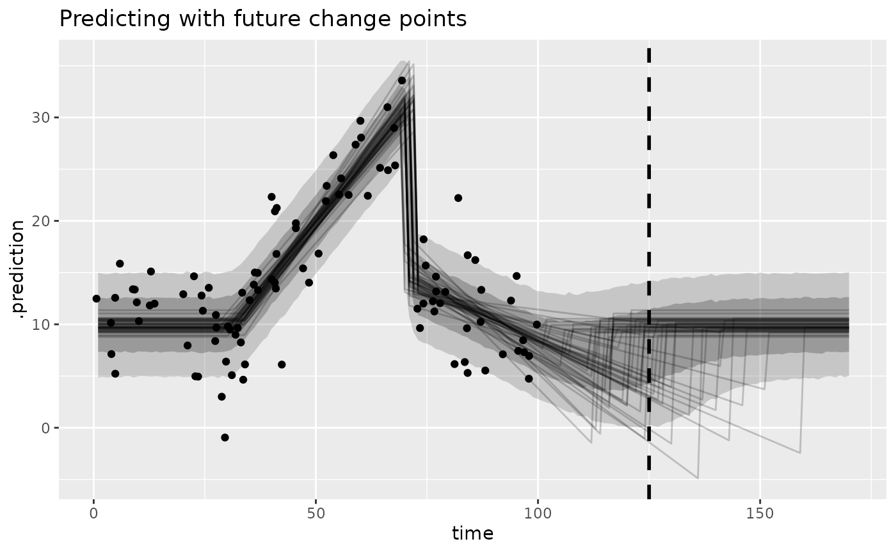

# Fits and predictions

This article introduces
[`predict()`](https://lindeloev.github.io/mcp/reference/execute-mcp-model.md),
[`fitted()`](https://lindeloev.github.io/mcp/reference/execute-mcp-model.md),
[`residuals()`](https://lindeloev.github.io/mcp/reference/execute-mcp-model.md)
for in-sample and out-of-sample data. I will also show how to get
creative with `mcp`, including how to make predictions around future
change points.

## Preparation: an example model

We need an `mcpfit` to get started. We take the “demo” dataset:

``` r

library(mcp)
future::plan(future::multisession, workers = 3)

data = mcp_example_data("demo")
head(data)
```

    ##    response     time
    ## 1 12.235516 76.33986
    ## 2  6.351706 83.51711
    ## 3 28.049953 60.18529
    ## 4 15.681983 74.72964
    ## 5 16.213643 85.88256
    ## 6 22.322824 40.05069

… and model it as three segments, i.e., two change points:

``` r

# Define the model
model = list(
  response ~ 1,  # plateau (Intercept_1)
  ~ 0 + time,    # joined slope (time_2) at cp_1
  ~ 1 + time     # disjoined slope (Intercept_3, time_3) at cp_2
)

# Fit it
fit = mcp(model, data = data)
```

This is what the data and inferred fit look like with 80% central
intervals for the expected response and for the posterior predictive:

``` r

plot(fit, interval = c("fitted", "predict"), width = 0.8)
```



To review what we see here:

- The black dots are the data from `data`.
- The gray lines are 25 posterior draws (control using
  `plot(fit, lines = 100)`).
- The dashed red lines are the 10% and 90% quantiles of the fitted
  (expected) values.
- The green lines are the 10% and 90% quantiles of the predicted values.
- The blue curves on the x-axis are the posterior distributions of the
  change point locations (better viewed using
  `plot_pars(fit, pars = c("cp_1", "cp_2"))`).

Behind the scenes,
[`plot()`](https://lindeloev.github.io/mcp/reference/plot.mcpfit.md)
merely calls
[`predict()`](https://lindeloev.github.io/mcp/reference/execute-mcp-model.md)
and
[`fitted()`](https://lindeloev.github.io/mcp/reference/execute-mcp-model.md)
to show these inferences.

## Extracting `fitted()` values

To get the fitted values for each data point, simply do `fitted(fit)`:

``` r

head(fitted(fit))
```

    ## # A tibble: 6 × 6
    ##   response  time .mean   .sd .lower .upper
    ##      <dbl> <dbl> <dbl> <dbl>  <dbl>  <dbl>
    ## 1    12.2   76.3  12.9 0.991  10.9    14.8
    ## 2     6.35  83.5  11.4 0.711  10.0    12.8
    ## 3    28.0   60.2  25.4 0.886  23.7    27.2
    ## 4    15.7   74.7  13.2 1.09   11.1    15.3
    ## 5    16.2   85.9  10.9 0.703   9.59   12.3
    ## 6    22.3   40.1  14.5 0.647  13.1    15.7

In general, this output contains:

- A column for each predictor column in the data. Here, `time` is the
  only predictor and you see the values in the same order as in `data`
  (which is copied to `fit$data`). Models with [group-level
  effects](https://lindeloev.github.io/mcp/articles/group_effects.md)
  additionally have the relevant grouping columns,
  [`binomial()`](https://rdrr.io/r/stats/family.html) models have the
  number of trials, etc.

- **.mean:** The fitted value (posterior mean). When `summary = FALSE`,
  you instead get one row per draw with the value in `.epred`, matching
  [`tidybayes::add_epred_draws()`](https://mjskay.github.io/tidybayes/reference/add_predicted_draws.html)
  conventions.

- **.sd:** The posterior standard deviation of the expected response. In
  [`predict()`](https://lindeloev.github.io/mcp/reference/execute-mcp-model.md)
  output, `.sd` is instead the posterior predictive standard deviation.

- **.lower** and **.upper:** The lower and upper ends of the central
  interval. It is 95% by default, but you can set it using, e.g.,
  `fitted(fit, width = 0.8)`. Use `summary = FALSE` to compute other
  quantiles from the draws.

The columns computed by `mcp` are prefixed with a dot, so they never
collide with columns in your data.

If you compare these values to the plot, you will see that they
correspond.
[`plot()`](https://lindeloev.github.io/mcp/reference/plot.mcpfit.md)
merely calls
[`fitted()`](https://lindeloev.github.io/mcp/reference/execute-mcp-model.md)
behind the scenes.

### Expected responses for out-of-sample data

To predict out-of-sample data, you can simply use the `newdata`
argument.

``` r

newdata = data.frame(time = c(data$time[1], 25, -20, 200))
fitted(fit, newdata = newdata)
```

    ## # A tibble: 4 × 5
    ##    time  .mean   .sd .lower .upper
    ##   <dbl>  <dbl> <dbl>  <dbl>  <dbl>
    ## 1  76.3  12.9  0.991  10.9   14.8 
    ## 2  25     9.93 0.659   8.65  11.2 
    ## 3 -20     9.93 0.659   8.65  11.2 
    ## 4 200   -12.1  9.29  -30.4    6.01

Note that:

- We get one row per value of `time`.
- The first value for `time` is in the dataset. The values correspond to
  the same row in `fitted(fit)` because that’s merely a shortcut to do
  `fitted(fit, newdata = fit$data)`.
- The second value (`time = 25`) is within the observed region, but not
  in the dataset.
- The third value (`time = -20`) is outside the observed region, but
  `mcp` merely extends the first segment backwards in time. Because it’s
  a plateau, we see approximately the same values as for `time = 25`.
- The fourth value (`time = 200`) is way outside the observed region.
  Because it is the extrapolation of the slope in the third segment of
  which we’ve only observed the first tiny bit, the posterior
  distribution is very wide because even a small uncertainty in the
  slope results in very large differences further out.

### Arguments

If you look at the documentation for
[`predict()`](https://lindeloev.github.io/mcp/reference/execute-mcp-model.md),
[`fitted()`](https://lindeloev.github.io/mcp/reference/execute-mcp-model.md),
and
[`residuals()`](https://lindeloev.github.io/mcp/reference/execute-mcp-model.md),
you’ll see that they are quite versatile, taking many different
arguments. To mention a few, you can set `fitted(fit, dpar = "sigma")`
to get fitted values for `sigma` ([more on modeling
sigma](https://lindeloev.github.io/mcp/articles/dpar.md)),
`prior = TRUE` to predict using only the prior, and `arma = FALSE` to
exclude AR/MA effects. For group-level effects, use
`group_effects = TRUE` (all), `FALSE` or `NA` (none), `"cp"` or
`"predictor"` (a formula part), or group-level parameter names with
optional `*` wildcards, e.g., `"cp_*"`.

## Predictions

[`predict()`](https://lindeloev.github.io/mcp/reference/execute-mcp-model.md)
draws from the posterior predictive distribution and takes almost the
same arguments as
[`fitted()`](https://lindeloev.github.io/mcp/reference/execute-mcp-model.md).
This supports predictions for in-sample and out-of-sample data.
[`plot()`](https://lindeloev.github.io/mcp/reference/plot.mcpfit.md)
uses
[`predict()`](https://lindeloev.github.io/mcp/reference/execute-mcp-model.md)
under the hood for posterior predictive intervals. The values below
correspond to the dashed green lines in the plot (the 80% posterior
predictive interval):

``` r

set.seed(42)
head(predict(fit, width = 0.8))
```

    ## # A tibble: 6 × 6
    ##   response  time .mean   .sd .lower .upper
    ##      <dbl> <dbl> <dbl> <dbl>  <dbl>  <dbl>
    ## 1    12.2   76.3  12.9  4.00   7.76   18.0
    ## 2     6.35  83.5  11.4  3.94   6.39   16.5
    ## 3    28.0   60.2  25.4  3.97  20.4    30.5
    ## 4    15.7   74.7  13.2  4.02   8.05   18.3
    ## 5    16.2   85.9  10.9  3.94   5.92   16.0
    ## 6    22.3   40.1  14.5  3.93   9.46   19.5

Note that
[`predict()`](https://lindeloev.github.io/mcp/reference/execute-mcp-model.md)
uses random sampling under the hood, so these values will differ
slightly from call to call. You can make it replicable using
[`set.seed()`](https://rdrr.io/r/base/Random.html) as above. In general,
the more posterior draws, the less the call-to-call variance will be.
Conversely, fewer draws means more call-to-call variation, e.g., if you
do `predict(fit, ndraws = 10)`. The interval (`.lower` and `.upper`) is
the exception: It is computed exactly from the posterior predictive
distribution, so it is deterministic for a given set of posterior draws.

To get custom quantiles, get the draws using `summary = FALSE` and
summarise them yourself. These quantiles are computed from simulated
responses, so they are subject to the call-to-call variation described
above:

``` r

predict(fit, summary = FALSE) |>
  dplyr::group_by(.row, time) |>  # Group by original data row. Keep time as column in reframe().
  dplyr::reframe(quantile = c(0.1, 0.5, 0.9), .prediction = quantile(.prediction, quantile)) |>
  head()
```

    ## # A tibble: 6 × 4
    ##    .row  time quantile .prediction
    ##   <int> <dbl>    <dbl>       <dbl>
    ## 1     1  76.3      0.1        7.80
    ## 2     1  76.3      0.5       12.9 
    ## 3     1  76.3      0.9       18.0 
    ## 4     2  83.5      0.1        6.47
    ## 5     2  83.5      0.5       11.4 
    ## 6     2  83.5      0.9       16.5

See the [plotting
article](https://lindeloev.github.io/mcp/articles/plotting.md) for
adding custom quantiles to
[`plot()`](https://lindeloev.github.io/mcp/reference/plot.mcpfit.md).

## Residuals

[`residuals()`](https://lindeloev.github.io/mcp/reference/execute-mcp-model.md)
is simply `data$response - fitted()`. It may be useful for model
checking, but the typical needs are covered using posterior predictive
checking (`pp_check(fit)`) and visual inspection of
`plot(fit, interval = c("fitted", "predict"))`.

## Forecasting with future change points

Bayesian inference is the principled updating of prior knowledge using
data. Where there is little or no data, the prior speaks louder.
Sometimes, we can learn surprising stuff simply by inspecting the prior
predictive, e.g., how the priors combine when “put through” the model.
In `mcp`, most functions come with a `prior = FALSE` default, but you
can simply do `plot(fit, prior = TRUE)`, `fitted(fit, prior = TRUE)`, or
`predict(fit, prior = TRUE)`.

Say you want to forecast at `time = 125` and you know that a change
point to the baseline level (an intercept change to `Intercept_1`) will
occur approximately after the same interval as between `cp_1` and `cp_2`
(i.e., at `cp_2 + (cp_2 - cp_1)`). We can model this by adding the
future segment to the model and putting an informative prior on its
change point.

### Step 1: add the unobserved segment(s) and fit

First, we extend the model with the future segment of which we have
prior knowledge:

``` r

model_forecast = c(model, list(
  ~ same(1, as = 1)  # Return to Intercept_1 after cp_3
))
```

Then we set a prior on the new change point `cp_3`. `mcp` uses change
point bounds that you set unchanged, also beyond the data (without
bounds, it uses the observed range of `time`), so `T(max(time), 170)`
places `cp_3` after the last observation and before the end of our
forecasting horizon at `time = 170`. All other parameters keep their
default priors. It may be helpful to review [priors on change
points](https://lindeloev.github.io/mcp/articles/priors.html#cp_prior).

``` r

prior_forecast = list(
  cp_3 = "dnorm(cp_2 + (cp_2 - cp_1), 20) T(max(time), 170)"  # In the future at the same interval
)
```

Now let’s fit it.

``` r

old = options(mcp_reparam = FALSE)
fit_forecast = mcp(model_forecast, data = data, prior = prior_forecast)
options(old)
```

*Side note on the [`options()`](https://rdrr.io/r/base/options.html)
step: We turned off `mcp` reparameterization which usually increases
ESS/s but in this case lowers it. One of the reparam tricks sets the
intercept of a disjoined segment as the value at the end of that segment
([read
more](https://lindeloev.github.io/mcp/articles/implementation.html#reparameterizations)).
Here, segment 3 ends at the future `cp_3`, far from the data, so this
sampling trick causes poor mixing.*

### Step 2: predict!

We can now compute the 80% posterior predictive interval at
`time = 125`:

``` r

predict(fit_forecast, newdata = data.frame(time = 125), width = 0.8)
```

    ## # A tibble: 1 × 5
    ##    time .mean   .sd .lower .upper
    ##   <dbl> <dbl> <dbl>  <dbl>  <dbl>
    ## 1   125  7.64  5.48 0.0925   14.1

To really understand what’s going on here, it may be helpful to
visualize the model.
[`plot()`](https://lindeloev.github.io/mcp/reference/plot.mcpfit.md)
shows only the observed range of `time`, so we make the plot ourselves:

``` r

# Get expected-response and posterior predictive draws
newdata = data.frame(time = 1:170)
fitted_forecast = fitted(fit_forecast, newdata = newdata, summary = FALSE, ndraws = 50)
predict_forecast = predict(fit_forecast, newdata = newdata, summary = FALSE)

# Plot it
library(ggplot2)
library(tidybayes)  # Optional package for summarizing and plotting draws
ggplot(predict_forecast, aes(x = time, y = .prediction)) +
  # Posterior predictive intervals and line at x = 125
  stat_summary(fun.data = median_qi, fun.args = list(.width = 0.8), geom = "ribbon", alpha = 0.2) +
  stat_summary(fun.data = median_qi, fun.args = list(.width = 0.5), geom = "ribbon", alpha = 0.3) +
  geom_vline(xintercept = 125, lty = 2, lwd = 1) +

  # Lines for fitted draws
  geom_line(aes(y = .epred, group = .draw), data = fitted_forecast, alpha = 0.2) +

  # Observed data
  geom_point(aes(x = time, y = response), data = data) +
  labs(title = "Predicting with future change points")
```



You can read the predicted values from above at `x = 125` off this
graph. We literally just predicted for all values between 1 and 170, and
visualized it using a ribbon. This means that you can also predict
further into the future, if you’d like.

You can extend this approach to an arbitrary number of future segments,
even using the posterior from the “unobserved” segment 4 in the priors
for parameters in future segments. In Bayesian inference, it really does
not make much of a difference whether credence in some parameter values
has been updated using data or not - it’s all credence.

Without doing this formal model of the future change point, one may have
thought that the change point should occur around `time = 110` since
that’s the expected value of `cp_2 + (cp_2 - cp_1)`. However, we set the
lower bound of the prior on the future change point (`cp_3`) to the last
data point (`max(time)`), so that it occurs *after* it, i.e., at
`time > 100`. This is knowledge that the third change point had not yet
been observed at `time = 100`, and this pushes the distribution further
into the future (actually around 120; see `summary(fit_forecast)`).
