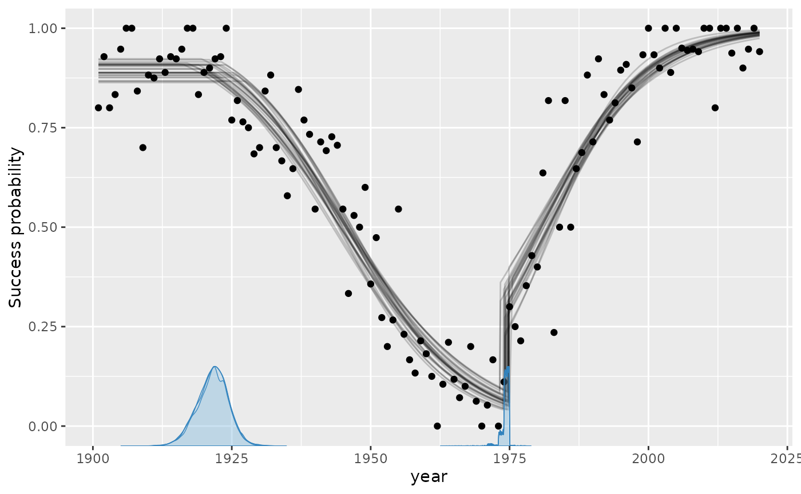
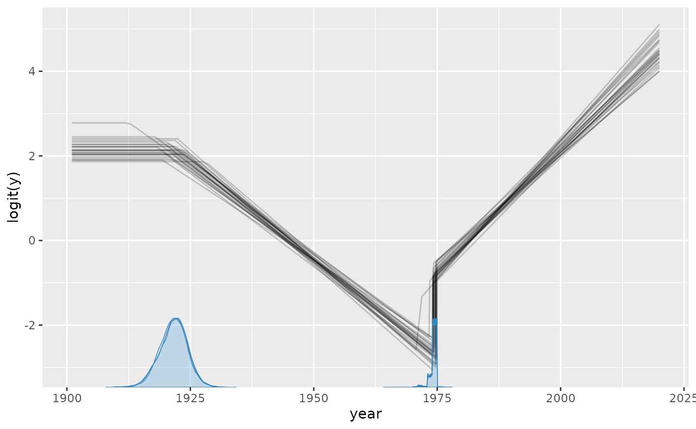
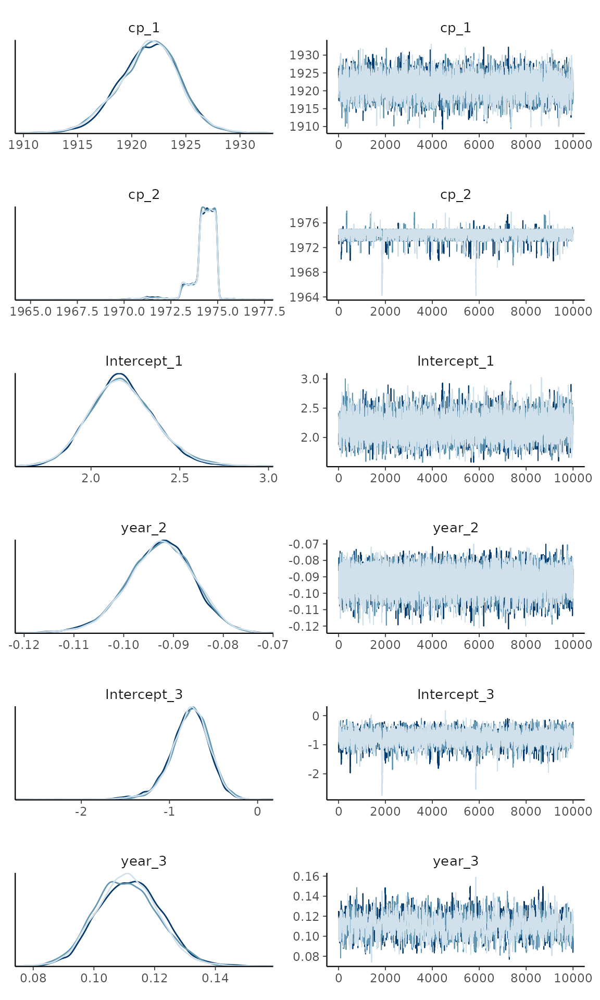
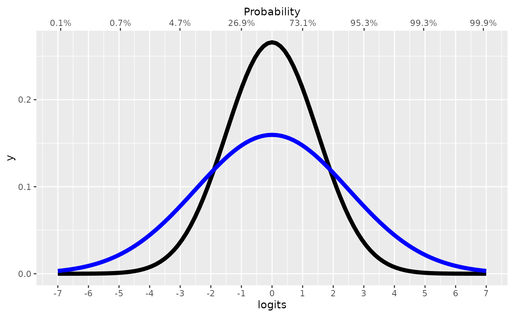

# Binomial change point analysis

`mcp` aims to implement Generalized Linear Models in a way that closely
mimics that of [brms::brm](https://github.com/paul-buerkner/brms). You
can set the family and link functions using the `family` argument.

First, let us specify a toy model with three segments:

``` r

model = list(
  y | trials(N) ~ 1,  # constant success probability
  ~ 0 + year,  # joined changing success probability
  ~ 1 + year  # disjoined changing success probability
)
```

## Simulate data

If you already have data, you can safely skip this section.

We run `mcp` with `sample = FALSE` to get what we need to simulate data.

``` r

library(mcp)
future::plan(future::multisession, workers = 3)

df = data.frame(
  year = 1901:2020,  # evaluate for each of these
  N = sample(10:20, size = 120, replace = TRUE),  # number of trials
  y = 1
)

empty = mcp(model, data = df, family = binomial(), sample = FALSE)
```

Now we can simulate. First, let us see the model parameters.

``` r

mcp_pars(empty)
```

    ## # A tibble: 6 × 8
    ##   parameter   part      scope      role         segment dpar  group_col population_parameter
    ##   <chr>       <chr>     <chr>      <chr>          <int> <chr> <chr>     <chr>               
    ## 1 cp_1        cp        population change_point       2 NA    NA        NA                  
    ## 2 cp_2        cp        population change_point       3 NA    NA        NA                  
    ## 3 Intercept_1 predictor population coefficient        1 mu    NA        NA                  
    ## 4 year_2      predictor population coefficient        2 mu    NA        NA                  
    ## 5 Intercept_3 predictor population coefficient        3 mu    NA        NA                  
    ## 6 year_3      predictor population coefficient        3 mu    NA        NA

- It takes two intercepts (`Intercept_*`), for segments 1 and 3.
- It takes two slopes (`year_*`), for segment 2 and 3.
- It takes two change points (`cp_*`) - one between each pair of
  adjacent segments.

`empty$simulate` is now a function that can predict data given these
parameters (signature: `empty$simulate(fit, newdata, ...)`). If you are
in a reasonable R editor, type `empty$simulate(` and press TAB to see
the required arguments. I came up with some values below, including
change points at year = 1925 and year = 1975. Because
[`binomial()`](https://rdrr.io/r/stats/family.html) defaults to
`link = "logit"`, the intercept and slopes are on the [logit
scale](https://en.wikipedia.org/wiki/Logit), which maps success
probabilities between 0 and 1 to the real line. This will be important
later when we set priors.

``` r

df$y = empty$simulate(
  empty, df, 
  cp_1 = 1925, cp_2 = 1975, 
  Intercept_1 = 2, Intercept_3 = -0.5, 
  year_2 = -0.1, year_3 = 0.1)

head(df)
```

    ##   year  N  y
    ## 1 1901 10  8
    ## 2 1902 14 13
    ## 3 1903 10  8
    ## 4 1904 18 15
    ## 5 1905 19 18
    ## 6 1906 13 13

Visually:

``` r

plot(df$year, df$y)
```


## Check parameter recovery

The next sections go into more detail, but let us quickly see if we can
recover the parameters used to simulate the data.

``` r

fit = mcp(model, data = df, family = binomial(), iter = 10000)
```

We can use `summary` to see that it recovered the parameters to a pretty
good precision. Again, recall that intercepts and slopes are on a
`logit` scale.

``` r

summary(fit)
```

    ## Family: binomial
    ## Links: mu = logit
    ## Draws: 30000 (3 chains with iter = 10000)
    ## Segments:
    ##   1: y | trials(N) ~ 1
    ##   2: ~ 0 + year
    ##   3: ~ 1 + year
    ## 
    ## Change point parameters:
    ##    parameter      mean     sd     lower     upper rhat ess_bulk ess_tail       sim match
    ##  cp_1        1921.5    2.8    1915.6    1926.8    1.00     3888     6842 1925.0       OK
    ##  cp_2        1974.27   0.81   1972.19   1974.98   1.00     3462     1549 1975.00      OK
    ## 
    ## Population-level parameters:
    ##    parameter      mean     sd     lower     upper rhat ess_bulk ess_tail       sim match
    ##  Intercept_1    2.18   0.19      1.84      2.58   1.00     4564     7680    2.00      OK
    ##  year_2        -0.0928 0.0067   -0.1065   -0.0803 1.00     7275    11366   -0.1000    OK
    ##  Intercept_3   -0.76   0.23     -1.26     -0.36   1.00     1665     1643   -0.50      OK
    ##  year_3         0.110  0.010     0.091     0.131  1.01     1125     2155    0.100     OK

`summary` uses 95% central posterior intervals by default, but you can
change it using `summary(fit, width = 0.80)`. If you have [group-level
effects](https://lindeloev.github.io/mcp/dev/articles/group_effects.md),
use `ranef(fit)` to see their deviations.

Plotting the fit confirms good fit to the data, and we see the
discontinuities at the two change points:

``` r

plot(fit)
```



These lines are just `fit$simulate` applied to random posterior draws.
In other words, they represent the joint distribution of the parameters.
You can change the number of draws (lines) using
`plot(fit, lines = 50)`.

Speaking of alternative visualizations, you can also plot this on the
logit scale, where the linear trends are modeled:

``` r

plot_dpar(fit, scale = "linear")
```

    ## Not showing 17 data point(s) with infinite values on the linear scale.



Data points with zero or all successes (`y = 0` or `y = N`) are at
\pm\infty on the logit scale, so they are not shown, as the message
says.

These plots work with [group-level
effects](https://lindeloev.github.io/mcp/dev/articles/group_effects.md)
as well.

## Model diagnostics and sampling options

Already in the default `plot` as used above, it will be obvious if there
was poor convergence. A more direct assessment is to look at the
posterior distributions and trace plots:

``` r

plot_pars(fit, npars = NULL)
```



Convergence looks good here as evidenced by the overlapping trace plots
that look like fat caterpillars (Bayesians love fat caterpillars).
Notice that the posterior distribution of change points can be quite
non-normal and sometimes even bimodal. Therefore, one should be careful
not to interpret the interval as if it was normal.

[`plot()`](https://lindeloev.github.io/mcp/dev/reference/plot.mcpfit.md)
and
[`plot_pars()`](https://lindeloev.github.io/mcp/dev/reference/plot_pars.md)
can do a lot more than this, so check out the [plotting
article](https://lindeloev.github.io/mcp/dev/articles/plotting.md).

## Priors for binomial models

*[Brief overview of all default
priors](https://lindeloev.github.io/mcp/dev/articles/default_priors.html#summary-reference-table)*

`mcp` uses priors to achieve a lot of its functionality. See [how to set
priors](https://lindeloev.github.io/mcp/dev/articles/priors.md),
including how to fix values. Here, I post a few notes about the
binomial-specific default priors.

All priors are stored in `fit$prior` (also `empty$prior`). We did not
specify `prior` above, so it ran with the [default
priors](https://lindeloev.github.io/mcp/dev/articles/default_priors.md):

``` r

cbind(fit$prior)  # Raw view
prior_summary(fit)  # Richer view. Try adding verbose = TRUE
```

    ##             [,1]                            
    ## cp_1        "dunif(min(year), max(year))"   
    ## cp_2        "dunif(min(year), max(year))"   
    ## Intercept_1 "dnorm(0, 1.5)"                 
    ## year_2      "dnorm(0, 0.043121968093205169)"
    ## Intercept_3 "dnorm(0, 1.5)"                 
    ## year_3      "dnorm(0, 0.043121968093205169)"
    ## # A tibble: 6 × 5
    ##   parameter   segment dpar  prior              bounds               
    ##   <chr>         <int> <chr> <chr>              <chr>                
    ## 1 cp_1              2 NA    dunif(1901, 2020)  [1901, 2020], ordered
    ## 2 cp_2              3 NA    dunif(1901, 2020)  [1901, 2020], ordered
    ## 3 Intercept_1       1 mu    dnorm(0, 1.5)      none                 
    ## 4 year_2            2 mu    dnorm(0, 0.043122) none                 
    ## 5 Intercept_3       3 mu    dnorm(0, 1.5)      none                 
    ## 6 year_3            3 mu    dnorm(0, 0.043122) none

The priors on change points are discussed extensively in the [prior
article](https://lindeloev.github.io/mcp/dev/articles/priors.html#cp_prior).
With the default logit link, intercepts use `dnorm(0, 1.5)`, which is
approximately uniform on the probability scale: its central 95% interval
is approximately -2.9 to 2.9 logits, corresponding to probabilities from
0.05 to 0.95. The probit link uses `dnorm(0, 1)`, which is exactly
uniform on the probability scale. The figure compares normal priors with
SD 1.5 (black, the `mcp` default) and 2.5 (blue, the `rstanarm`
default), together with their correspondence to probabilities.

``` r

inverse_logit = function(x) exp(x) / (1 + exp(x))

# Start the plot
library(ggplot2)
ggplot(data.frame(logits = 0), aes(x = logits)) + 
  
  # Plot normal priors. Set SD in "args"
  stat_function(fun = dnorm, args = list(sd = 1.5), lwd = 2, col = "black") +
  stat_function(fun = dnorm, args = list(sd = 2.5), lwd = 2, col = "blue") +
  
  # Set the secondary axis
  scale_x_continuous(
    breaks = -7:7, limits = c(-7, 7), 
    sec.axis = sec_axis(
      ~ inverse_logit(.), 
      name = "Probability",
      labels = scales::percent_format(),
      breaks = round(inverse_logit(seq(-7, 7, by = 2)), 3)
    )
  )
```



Please keep in mind that when these priors combine through the model,
the joint probability may be quite different.

Coefficients and categorical contrasts use the same scales, [autoscaled
as in
`rstanarm`](https://lindeloev.github.io/mcp/dev/articles/default_priors.html#default-priors-on-regression-parameters):
`dnorm(0, 1.5 / sd(column))` for logit links and
`dnorm(0, 1 / sd(column))` for probit links.

## JAGS code

Here is the JAGS code for the model used in this article.

``` r

fit$jags_code
```

    ## model {
    ##   # Change points
    ##   cp_0 = min(year)
    ##   cp_1 ~ dunif(cp_0, cp_3)  # Flat Dirichlet on the segment lengths
    ##   cp_2 ~ dunif(cp_0, cp_3)  # Flat Dirichlet on the segment lengths
    ##   cp_3 = max(year)
    ##   cp_order_ ~ dbern(step(cp_2 - cp_1))  # Ordered change points
    ## 
    ##   # Priors for population-level effects
    ##   Intercept_1 ~ dnorm(0, 1/(1.5)^2)   # Link-scale intercept, approximately uniform on the probability scale
    ##   year_2_end_ ~ dnorm(Intercept_1, 1/(0.043121968093205169*(cp_2-cp_1))^2)   # Autoscaled link-scale coefficient (rstanarm autoscaling); sampled as the value at the segment end
    ##   year_2 = (year_2_end_ - (Intercept_1)) / (cp_2 - cp_1)
    ##   Intercept_3_end_ ~ dnorm(year_3 * (cp_3 - cp_2), 1/(1.5)^2)   # Link-scale intercept, approximately uniform on the probability scale; sampled as the value at the segment end
    ##   Intercept_3 = Intercept_3_end_ - (year_3 * (cp_3 - cp_2))
    ##   year_3 ~ dnorm(0, 1/(0.043121968093205169)^2)   # Autoscaled link-scale coefficient (rstanarm autoscaling)
    ## 
    ##   # Model and likelihood
    ##   for (i_ in 1:length(year)) {
    ##     # year measured from each segment's change point
    ##     x_local_1_[i_] = min(year[i_], cp_1)
    ##     x_local_2_[i_] = min(year[i_], cp_2) - cp_1
    ##     x_local_3_[i_] = min(year[i_], cp_3) - cp_2
    ##     
    ##     # Formula for mu
    ##     link_mu_[i_] =
    ##       (year[i_] >= cp_0) * (year[i_] < cp_2) * inprod(rhs_matrix_[i_, c(1)], c(Intercept_1)) * 1 + 
    ##       (year[i_] >= cp_1) * (year[i_] < cp_2) * inprod(rhs_matrix_[i_, c(2)], c(year_2)) * x_local_2_[i_] + 
    ##       (year[i_] >= cp_2) * inprod(rhs_matrix_[i_, c(3)], c(Intercept_3)) * 1 + 
    ##       (year[i_] >= cp_2) * inprod(rhs_matrix_[i_, c(4)], c(year_3)) * x_local_3_[i_]
    ## 
    ##     # Likelihood for family = binomial()
    ##     mu_[i_] = ilogit(link_mu_[i_])
    ##     y[i_] ~ dbin(mu_[i_], N[i_])
    ##   }
    ## }
