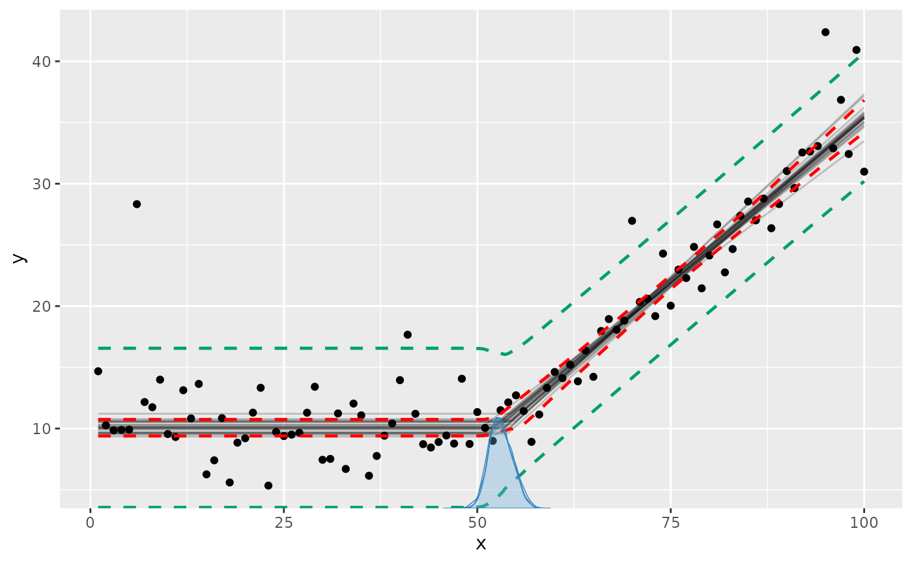
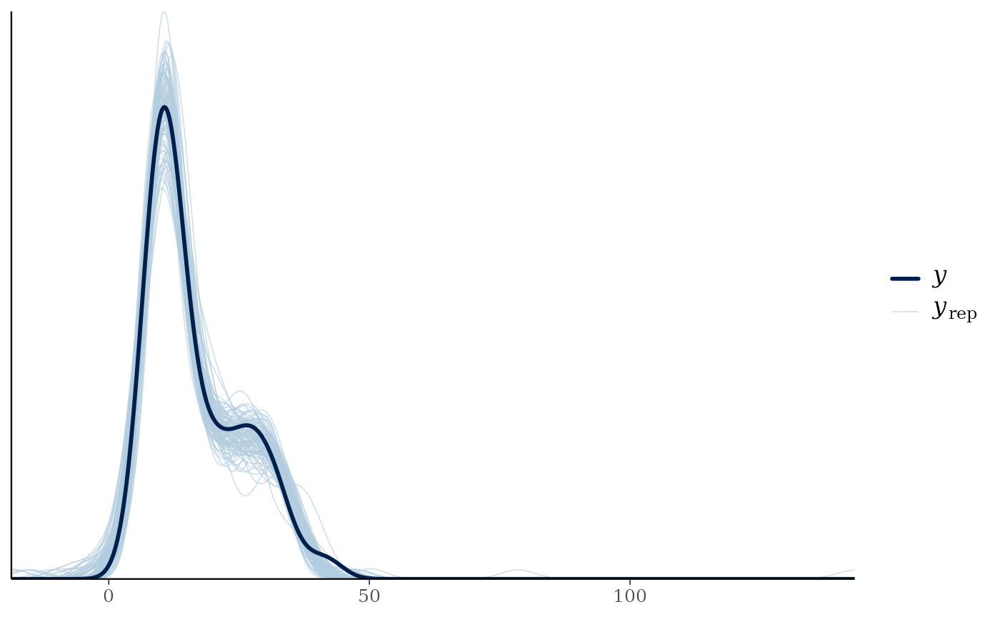
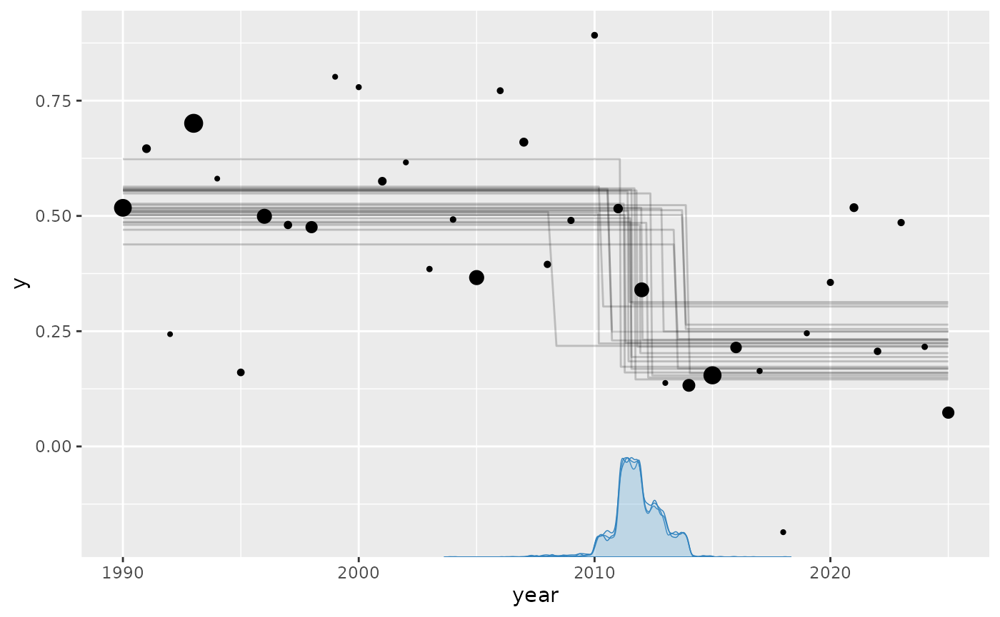

# Custom families

`mcp` ships with the [families listed
here](https://lindeloev.github.io/mcp/dev/articles/families.md),
including gaussian, binomial, Poisson, etc. These are built using
[`mcpfamily()`](https://lindeloev.github.io/mcp/dev/reference/mcpfamily.md).
This article shows how you can use
[`mcpfamily()`](https://lindeloev.github.io/mcp/dev/reference/mcpfamily.md)
to build your own response families so they work with the full `mcp`
machinery for inference, plots and predictions, hypothesis testing, etc.

We start with a minimal
[`mcpfamily()`](https://lindeloev.github.io/mcp/dev/reference/mcpfamily.md).
Then show how specifying more parts of the `mcpfamily` enables using
more `mcp` functionality.

[`mcpfamily()`](https://lindeloev.github.io/mcp/dev/reference/mcpfamily.md)
is currently experimental, so its arguments may change in future
releases.

## Example: A Student-t family

We will make a Student-t family for robust regression. It has three
dpars: the location `mu`, the scale `sigma`, and the degrees of freedom
`nu`, where small `nu` gives heavy tails. Here is some data with a
joined slope after the change point and heavy-tailed residuals:

``` r

data_t = data.frame(x = 1:100)
data_t$y = ifelse(data_t$x < 50, 10, 10 + 0.5 * (data_t$x - 50)) + 2 * rt(100, df = 3)
```

### The minimal family

A family needs only what is required to fit the model:

``` r

student = mcpfamily(
  family = "student",  # Display name
  links = c(mu = "identity", sigma = "log", nu = "log"),  # A link function for each dpar
  lower = c(sigma = 0, nu = 1),  # See tip-box below

  # JAGS likelihood: y ~ dt(mu, 1/sigma^2, nu). Run as_jags(fit, family = student) to see it.
  jags = list(likelihood = function(context) {
    paste0(context$y, " ~ dt(", context$dpar("mu"), ", 1 / ", context$dpar("sigma"), "^2, ", context$dpar("nu"), ")")
  })
)
```

- `links`: The link function of each dpar. `mu` is required. The other
  dpars are always part of the model. When the dpar is not included in a
  segment, they use identity-link, e.g., `sigma_1` is the scale itself.
  With a formula, e.g., `sigma(1 + x)`, their link applies, so
  `sigma_Intercept_1` is the log-scale.
- `jags$likelihood`: Returns the JAGS code for one observation.
  `context$y` is the response and `context$dpar("sigma")` is `sigma` on
  its response scale. JAGS’s
  [`dt()`](https://rdrr.io/r/stats/TDist.html) takes the precision
  1/\sigma^2, not the scale.
- `lower`: The lower bounds of `sigma` and `nu`. Priors on the constant
  `sigma_1` and `nu_1` are truncated to these bounds. `lower` does not
  apply to dpars included in a formula, where the link function sets the
  bounds instead. For example, the log link of `nu(1 + x)` ensures
  `nu > 0`, but not `nu > 1`.

**Tip on `lower`:** `lower` only applies to identity-links, not other
link functions where the link function instead has an inherent `lower`.
`mcp` (and `brms`) use *identity-links* for dpars not explicitly
mentioned in the formula. So `y ~ 1 + x` has identity-link on `sigma`
whereas `y ~ 1 + x + sigma(1)` has log-link.

### Priors for custom families

The minimal family has no default priors, so `mcp` asks for them:

``` r

model_t = list(
  y ~ 1,     # Plateau
  ~ 0 + x    # Joined slope
)
fit = mcp(model_t, data = data_t, family = student)
```

    ## Error:
    ## ! family = student() has no default prior for `Intercept_1` and `x_2` and `nu_1` and `sigma_1`. Specify it in `prior`, e.g., `prior = list(Intercept_1 = "dnorm(0, 10)")`.

We run [`mcp()`](https://lindeloev.github.io/mcp/dev/reference/mcp.md)
with explicit priors:

``` r

prior_t = list(
  Intercept_1 = "dnorm(0, 20)",
  x_2 = "dnorm(0, 2)",
  sigma_1 = "dt(0, 5, 3)",
  nu_1 = "dgamma(2, 0.1)"
)
fit_t = mcp(model_t, data = data_t, family = student, prior = prior_t)
summary(fit_t)
```

    ## Family: student
    ## Links: mu = identity; sigma = identity; nu = identity
    ## Draws: 9000 (3 chains with iter = 3000)
    ## Segments:
    ##   1: y ~ 1
    ##   2: ~ 0 + x
    ## 
    ## Change point parameters:
    ##    parameter   mean    sd  lower  upper rhat ess_bulk ess_tail
    ##  cp_1        53.3   1.5   50.4   56.4   1.00      497     1079
    ## 
    ## Population-level parameters:
    ##    parameter   mean    sd  lower  upper rhat ess_bulk ess_tail
    ##  Intercept_1 10.10  0.35   9.43  10.80  1.00     1125     2127
    ##  x_2          0.546 0.028  0.495  0.602 1.00      566     1241
    ##  sigma_1      1.88  0.25   1.42   2.41  1.00     1757     2670
    ##  nu_1         3.7   1.5    1.9    7.5   1.00     1728     2085

Violá, we have just fitted a t-regression with change points. We can now
verify that the priors of `sigma_1` and `nu_1` were truncated to the
bounds in `lower`:

``` r

prior_summary(fit_t)
```

    ## # A tibble: 5 × 5
    ##   parameter   segment dpar  prior                 bounds           
    ##   <chr>         <int> <chr> <chr>                 <chr>            
    ## 1 cp_1              2 NA    dunif(1, 100)         [1, 100], ordered
    ## 2 Intercept_1       1 mu    dnorm(0, 20)          none             
    ## 3 x_2               2 mu    dnorm(0, 2)           none             
    ## 4 sigma_1           1 sigma dt(0, 5, 3) T(0, )    [0, Inf]         
    ## 5 nu_1              1 nu    dgamma(2, 0.1) T(1, ) [1, Inf]

### The complete family

Methods that need additional R functions raise an error if they are
missing. For example,
[`fitted()`](https://lindeloev.github.io/mcp/dev/reference/execute-mcp-model.md)
needs the expected response (`r$epred`) and
[`predict()`](https://lindeloev.github.io/mcp/dev/reference/execute-mcp-model.md)
needs random draws (`r$simulate`). Let’s add these, so we have the
complete family:

``` r

student = mcpfamily(
  # Minimally required (same as above)
  family = "student",
  links = c(mu = "identity", sigma = "log", nu = "log"),
  lower = c(sigma = 0, nu = 1),  # Only applies for non-included terms. See tip-box above.

  # JAGS code
  jags = list(likelihood = function(context) {
    paste0(context$y, " ~ dt(", context$dpar("mu"), ", 1 / ", context$dpar("sigma"), "^2, ", context$dpar("nu"), ")")
  }),

  # R functions for post-processing
  r = list(
    log_lik = function(y, dpars, data) dt((y - dpars$mu) / dpars$sigma, dpars$nu, log = TRUE) - log(dpars$sigma),
    epred = function(dpars, data, rate = FALSE) dpars$mu,
    simulate = function(n, dpars, data, rate = FALSE) dpars$mu + dpars$sigma * rt(n, dpars$nu),
    variance = function(dpars, data, rate = FALSE) ifelse(dpars$nu > 2, dpars$sigma^2 * dpars$nu / (dpars$nu - 2), Inf),

    # Only improves precision, e.g., in plot(, intervals = "predict")
    cdf = function(q, dpars, data) pt((q - dpars$mu) / dpars$sigma, dpars$nu),
    quantile = function(p, dpars, data) dpars$mu + dpars$sigma * qt(p, dpars$nu)
  ),

  # Default priors
  default_prior = tibble::tribble(
    ~dpar,   ~par_type,   ~prior,                                       ~condition,
    "mu",    "Intercept", "dnorm(mean(.y), 2.5 * sd(.y))",              "always",
    "mu",    "dummy",     "dnorm(0, 2.5 * sd(.y) / predictor_scale())", "always",
    "mu",    "slope",     "dnorm(0, 2.5 * sd(.y) / predictor_scale())", "always",
    "sigma", "Intercept", "dt(0, sd(.y), 3) T(0, )",                    "not_included",
    "sigma", "Intercept", "dt(0, 2.5, 3)",                              "included",
    "sigma", "slope",     "dt(0, 2.5 / predictor_scale(), 3)",          "always",
    "nu",    "Intercept", "dgamma(2, 0.1) T(1, )",                      "not_included"
  ),

  # AR/MA: ar() and ma() act on y before the link function (here, identity)
  garma = list(
    observed_r = function(y, data, threshold) y,
    observed_jags = function(context) context$y
  )
)
```

The prior for constant `nu` follows
[`brms`](https://paulbuerkner.com/brms/reference/set_prior.html):
`Gamma(2, 0.1)` (shape and rate), restricted to `nu > 1` so that the
expected response exists.

`garma` adds support for `ar(...)` and `ma(...)`. Its two functions are
matching response transformations in R and JAGS for the GARMA
recurrence, before applying the link function. Here, the identity.

**Tip:** The default priors for `mu` and `sigma` above are similar to
those for the Gaussian family, but use `sd(.y)` for the constant `sigma`
prior instead of `max(2.5, round(mad(.y), 1))`. To reuse the Gaussian
defaults exactly, including group-level SD priors, start with
`default_prior = family(demo_fit)$default_prior` and add the prior for
`nu`. The [meta-regression
example](#auxiliary-response-columns-a-meta-regression-example) below
reuses priors this way. The [default
priors](https://lindeloev.github.io/mcp/dev/articles/default_priors.md)
of the built-in families are good starting points when building custom
families.

Each default prior applies to one `dpar` and `par_type`: intercepts
(`"Intercept"`), coefficients of categorical predictors (`"dummy"`), and
other coefficients (`"slope"`), as listed by `mcp_pars(fit)`.
`condition` selects priors for dpars not explicitly included
(`"not_included"`) or explicitly included (`"included"`) in any formula,
e.g., `sigma_1` vs. `sigma_Intercept_1` in `sigma(1)`. Priors use the
syntax of `mcp(..., prior)`, where `.y` is the response and
`predictor_scale()` is the SD of the predictor of each coefficient.

Now we can plot fitted curves, check predictions, and everything else:

``` r

model_t2 = list(
  y ~ 1,
  ~ 0 + x + sigma(1)  # Joined slope; change scale (models sigma with log-link)
)

# Note: no `prior` argument needed since family has default_prior now
fit_t2 = mcp(model_t2, data = data_t, family = student)

# Plot and predict
plot(fit_t2, interval = c("fitted", "predict"))
```



``` r

# Posterior predictive check
pp_check(fit_t2)
```



## Adding functionality step by step

Here is what each `family$r` function enables:

| Task | What to define | What you can do |
|----|----|----|
| Fit the model | `family`, `links`, `jags$likelihood`, `lower`, (`default_prior`) | [`summary()`](https://lindeloev.github.io/mcp/dev/reference/summary.mcpfit.md), [`plot_pars()`](https://lindeloev.github.io/mcp/dev/reference/plot_pars.md), [`hypothesis()`](https://lindeloev.github.io/mcp/dev/reference/hypothesis.md), [`fitted()`](https://lindeloev.github.io/mcp/dev/reference/execute-mcp-model.md) and [`plot_dpar()`](https://lindeloev.github.io/mcp/dev/reference/plot.mcpfit.md) for a dpar, e.g., `dpar = "sigma"`. |
| Evaluate the likelihood | `r$log_lik()` | [`log_lik()`](https://lindeloev.github.io/mcp/dev/reference/execute-mcp-model.md), [`loo()`](https://lindeloev.github.io/mcp/dev/reference/loo.mcpfit.md), [`waic()`](https://lindeloev.github.io/mcp/dev/reference/loo.mcpfit.md), JAGS-R consistency check. |
| Plot fitted curves | `r$epred()` | [`fitted()`](https://lindeloev.github.io/mcp/dev/reference/execute-mcp-model.md), [`posterior_epred()`](https://lindeloev.github.io/mcp/dev/reference/posterior_epred.mcpfit.md), [`residuals()`](https://lindeloev.github.io/mcp/dev/reference/execute-mcp-model.md), [`plot()`](https://lindeloev.github.io/mcp/dev/reference/plot.mcpfit.md). |
| Simulate responses | `r$simulate()` | [`predict()`](https://lindeloev.github.io/mcp/dev/reference/execute-mcp-model.md), [`posterior_predict()`](https://lindeloev.github.io/mcp/dev/reference/posterior_epred.mcpfit.md), [`pp_check()`](https://lindeloev.github.io/mcp/dev/reference/pp_check.md), `fit$simulate()`, [`plot(fit, interval = "predict")`](https://lindeloev.github.io/mcp/dev/reference/plot.mcpfit.md). |
| AR/MA | `garma$observed_r` and `garma$observed_jags` | `ar(...)` and `ma(...)` everywhere. |
| Predictive estimates | `r$variance()` | Less simulation noise in the predictive mean and SD from [`predict()`](https://lindeloev.github.io/mcp/dev/reference/execute-mcp-model.md). |
| Predictive intervals | `r$cdf()` and `r$quantile()`. | Less simulation noise in [`predict()`](https://lindeloev.github.io/mcp/dev/reference/execute-mcp-model.md) and [`plot(fit, interval = "predict")`](https://lindeloev.github.io/mcp/dev/reference/plot.mcpfit.md). |

## Custom likelihood and weights: Gumbel with change point

For distributions that JAGS does not have, pass the negative log-density
of the response as a string to `context$zeros_trick()`. This uses the
“zeros trick”: an observed 0 from a Poisson distribution with mean \phi
has log-likelihood -\phi, so setting \phi to the negative log-density
adds the log-density to the model.

For example, the right-skewed Gumbel distribution has the negative
log-density \log\sigma + z + e^{-z} where z = (y - \mu) / \sigma:

``` r

gumbel = mcpfamily(
  family = "gumbel",
  links = c(mu = "identity", sigma = "log"),
  lower = c(sigma = 0),  # Only applies for non-included terms. See tip-box for t-example.

  # JAGS code
  jags = list(likelihood = function(context) {
    z = context$local("z")  # Define intermediate node
    c(
      paste0(z, " = (", context$y, " - ", context$dpar("mu"), ") / ", context$dpar("sigma")),
      context$zeros_trick(paste0("log(", context$dpar("sigma"), ") + ", z, " + exp(-", z, ") + 100"))
    )
  }),

  # R functions for post-processing
  r = list(
    log_lik = function(y, dpars, data) {
      z = (y - dpars$mu) / dpars$sigma
      -(log(dpars$sigma) + z + exp(-z))  # Negative log-density for zero-trick
    },

    # Functions to enable more mcp post-processing
    epred = function(dpars, data, rate = FALSE) dpars$mu - digamma(1) * dpars$sigma,
    simulate = function(n, dpars, data, rate = FALSE) dpars$mu - dpars$sigma * log(rexp(n)),
    variance = function(dpars, data, rate = FALSE) pi^2 / 6 * dpars$sigma^2
  )
)
```

`context$local("z")` names a node for the intermediate value, and the
likelihood returns one string per line. The resulting JAGS code is
(`response_observed_` is 0 when sampling the prior):

``` r

z_[i_] = (y[i_] - mu_[i_]) / sigma_[i_]
likelihood_phi_[i_] = response_observed_[i_] * w[i_] * (log(sigma_[i_]) + z_[i_] + exp(-z_[i_]) + 100)
likelihood_zero_[i_] ~ dpois(likelihood_phi_[i_])
```

\phi must be non-negative, so we add a constant (100). This multiplies
the likelihood by a constant, so the posterior is unchanged. Because the
response is now data rather than a node in JAGS, missing responses are
not supported.

`context$zeros_trick()` also applies weights, so this family supports
`y | weights(w)`. `mcp` applies the weights to `r$log_lik` too. Without
the zeros trick, a family supports weights only if `jags$likelihood`
uses `context$aux("weights", "1")`, which returns `"1"` when the model
has no weights. Let’s down-weight every other observation:

``` r

# Update data with weights
data_gumbel = data_t
data_gumbel$w = rep(c(1, 0.5), length.out = nrow(data_gumbel))

model_gumbel = list(
  y | weights(w) ~ 1,  # Plateau
  ~ 0 + x              # Joined slope
)

fit_gumbel = mcp(model_gumbel, data = data_gumbel, family = gumbel, prior = prior_t[c("Intercept_1", "x_2", "sigma_1")])
summary(fit_gumbel)
```

    ## Family: gumbel
    ## Links: mu = identity; sigma = identity
    ## Draws: 9000 (3 chains with iter = 3000)
    ## Segments:
    ##   1: y | weights(w) ~ 1
    ##   2: ~ 0 + x
    ## 
    ## Change point parameters:
    ##    parameter   mean    sd  lower  upper rhat ess_bulk ess_tail
    ##  cp_1        52.5   1.8   48.9   56.3   1.01      473      897
    ## 
    ## Population-level parameters:
    ##    parameter   mean    sd  lower  upper rhat ess_bulk ess_tail
    ##  Intercept_1  8.96  0.39   8.18   9.73  1.00     1044     2298
    ##  x_2          0.544 0.031  0.487  0.609 1.00      552      979
    ##  sigma_1      2.27  0.21   1.90   2.71  1.00     3226     4000

`plot(fit)` scales the area of the data points by their weights.

## Auxiliary response columns: meta-regression with change point

A random-effects meta-analysis pools effect sizes y_i with known
standard errors s_i from many studies. The true effects vary between
studies with SD \tau, so y_i \sim N(\mu_i, \sqrt{\tau^2 + s_i^2}). This
is `y | se(s, sigma = TRUE)` in
[`brms`](https://paulbuerkner.com/brms/reference/addition-terms.html).
With a change point, we can ask whether the effect size changed at some
publication year:

``` r

studies = data.frame(year = 1990:2025)
studies$s = runif(nrow(studies), 0.05, 0.3)
studies$y = rnorm(nrow(studies), ifelse(studies$year < 2012, 0.5, 0.15), sqrt(0.1^2 + studies$s^2))
```

The family adds the `se()` column and the `tau` dpar, and reuses the
`mu` priors of the Student-t family:

``` r

meta = mcpfamily(
  family = "meta",
  links = c(mu = "identity", tau = "log"),
  lower = c(tau = 0),  # See tip-box for t-example

  # JAGS code
  jags = list(likelihood = function(context) {
    paste0(context$y, " ~ dnorm(", context$dpar("mu"), ", 1 / (", context$dpar("tau"), "^2 + ", context$aux("se"), "^2))")
  }),

  # R functions for post-processing
  r = list(
    log_lik = function(y, dpars, data) dnorm(y, dpars$mu, sqrt(dpars$tau^2 + data$se^2), log = TRUE),
    epred = function(dpars, data, rate = FALSE) dpars$mu,
    simulate = function(n, dpars, data, rate = FALSE) rnorm(n, dpars$mu, sqrt(dpars$tau^2 + data$se^2))
  ),

  # Note: you can reuse objects from other mcpfamilies
  default_prior = dplyr::bind_rows(
    subset(student$default_prior, dpar == "mu"),
    data.frame(dpar = "tau", par_type = "Intercept", prior = "dnorm(0, sd(.y)) T(0, )", condition = "not_included")
  ),
  response = list(
    auxiliary = list(se = list(required = TRUE, operations = c("log_lik", "simulate")))
  ),
  glm_family = gaussian()
)
```

- **Auxiliary response columns**: Built-in families use `trials()` and
  [`weights()`](https://rdrr.io/r/stats/weights.html).
  `response$auxiliary` adds `se()`, available as `context$aux("se")` in
  JAGS and `data$se` in R. `operations` lists the R functions that need
  the column: `"epred"`, `"log_lik"`, `"simulate"`, and/or `"garma"`.
- **Reuse**: Parts of other families can be reused, e.g.,
  `student$default_prior` or `student$r`.
- **Initial values**: `glm_family` lets `mcp` find initial change points
  by fitting the `mu` model with
  [`glm.fit()`](https://rdrr.io/r/stats/glm.html). It is not used for
  models with weights or AR/MA terms. Otherwise, initial change points
  are equally spaced.

The auxiliary column is included in the formula like
[`weights()`](https://rdrr.io/r/stats/weights.html):

``` r

model_meta = list(
  y | se(s) ~ 1,  # Effect size before
  ~ 1             # Effect size after
)
fit_meta = mcp(model_meta, data = studies, family = meta, par_x = "year")
summary(fit_meta)
```

    ## Family: meta
    ## Links: mu = identity; tau = identity
    ## Draws: 9000 (3 chains with iter = 3000)
    ## Segments:
    ##   1: y | se(s) ~ 1
    ##   2: ~ 1
    ## 
    ## Change point parameters:
    ##    parameter     mean    sd    lower    upper rhat ess_bulk ess_tail
    ##  cp_1        2011.8   1.0   2010.0   2013.8   1.00     3500     3163
    ## 
    ## Population-level parameters:
    ##    parameter     mean    sd    lower    upper rhat ess_bulk ess_tail
    ##  Intercept_1    0.529 0.037    0.456    0.603 1.00     7616     7557
    ##  Intercept_2    0.219 0.048    0.124    0.317 1.00     6364     6694
    ##  tau_1          0.087 0.032    0.027    0.156 1.00     4581     4444

[`plot()`](https://lindeloev.github.io/mcp/dev/reference/plot.mcpfit.md)
returns a `ggplot`, so we can scale the area of each study by its
precision 1/s_i^2, as in a forest plot:

``` r

gg = plot(fit_meta)
gg$layers[[1]]$mapping = ggplot2::aes(size = 1 / s^2)  # The first layer is the data points
gg + ggplot2::scale_size_area(max_size = 4)
```



Add `tau(1)` to the second segment to let the between-study
heterogeneity change too. For a fixed-effect meta-analysis, fix it to
(almost) zero: `prior = list(tau_1 = 1e-6)`.

See
[`?mcpfamily`](https://lindeloev.github.io/mcp/dev/reference/mcpfamily.md)
for more options, e.g., `response = list(is_discrete = TRUE)` for
integer-valued responses.

## Custom JAGS code: Sampling the model directly in JAGS

If you need to customize other parts of the mcp-like model, you can run
the mcp model yourself, breaking out of the “mcp contract”.

[`as_jags()`](https://lindeloev.github.io/mcp/dev/reference/as_jags.md)
returns the JAGS code, data, and initial values of a model, e.g., to
change the JAGS code or to monitor other nodes. Here, we won’t be
changing the code, but instead just continue the meta-regression example
to demonstrate that it replicates:

``` r

jags = as_jags(fit_meta)
cbind(jags)  # List overview
```

    ##                jags       
    ## code           mcptext,1  
    ## data           list,4     
    ## inits          list,3     
    ## variable.names character,4
    ## modules        character,0
    ## levels         list,0

You can verify that the fitted values match the `summary(fit_meta)`
above:

``` r

model = rjags::jags.model(textConnection(jags$code), jags$data, jags$inits, n.chains = length(jags$inits))
draws = rjags::coda.samples(model, jags$variable.names, n.iter = 3000)
summary(draws)  # {coda} summary of draws
```

`mcp` methods cannot use draws sampled this way. Use
[`mcpfamily()`](https://lindeloev.github.io/mcp/dev/reference/mcpfamily.md)
to fit a different likelihood in `mcp`. This replaces the deprecated
`mcp(..., jags_code)`.
