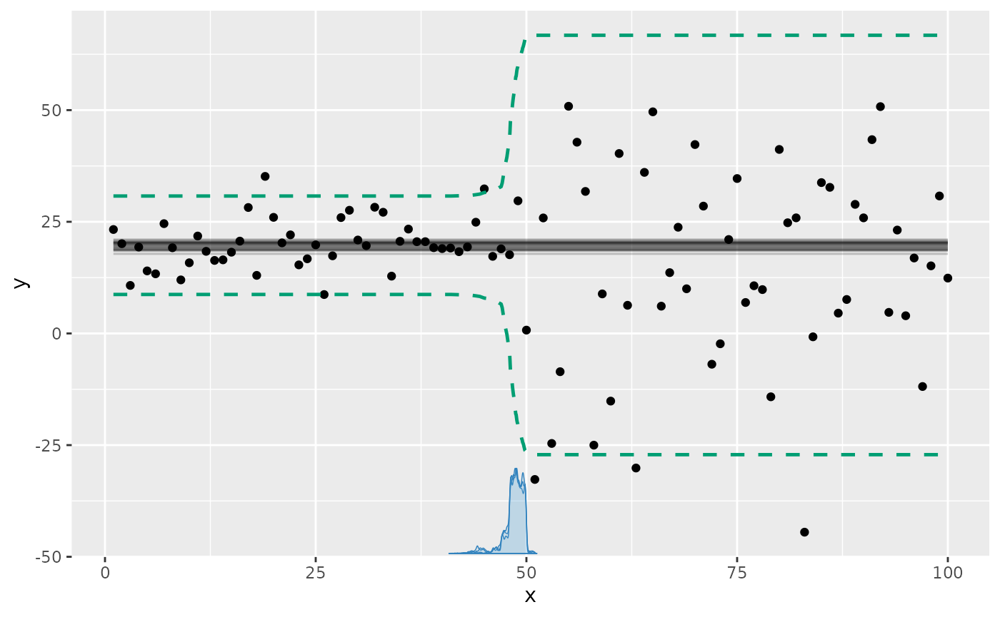
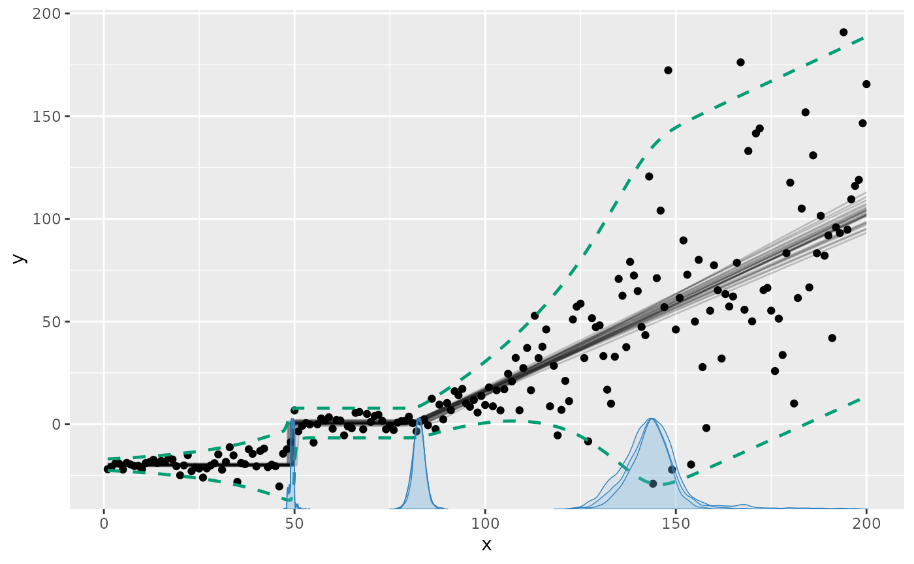
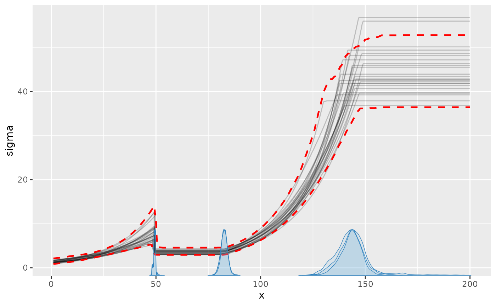
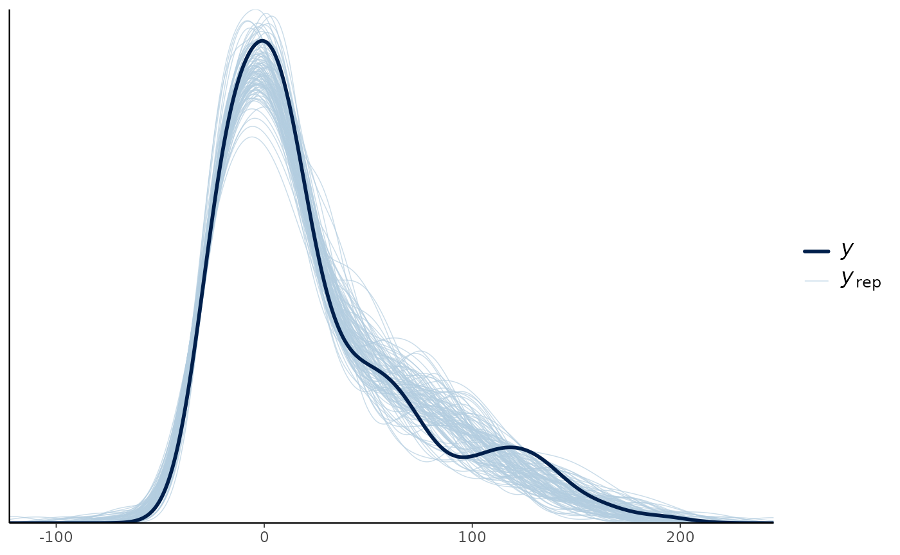
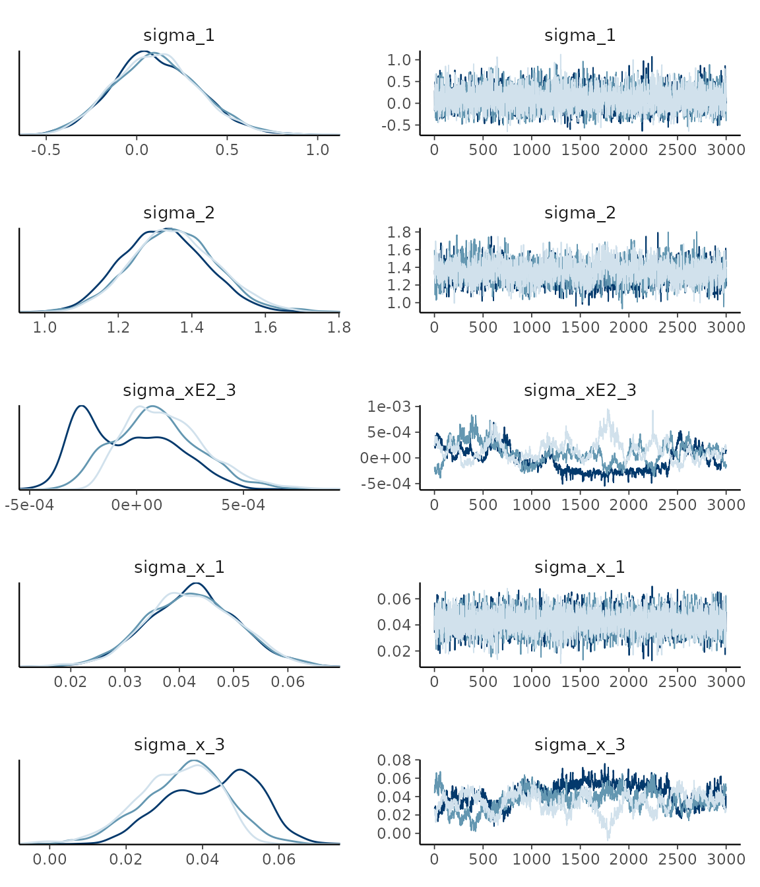
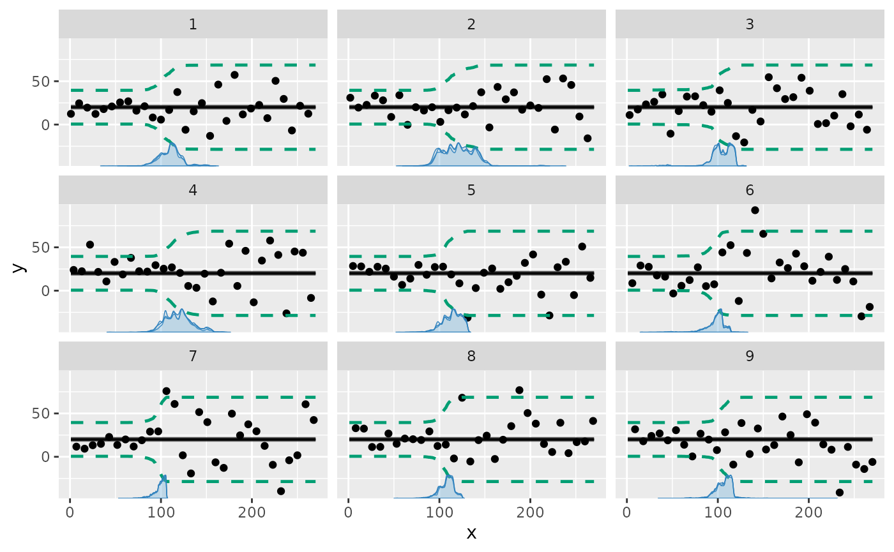
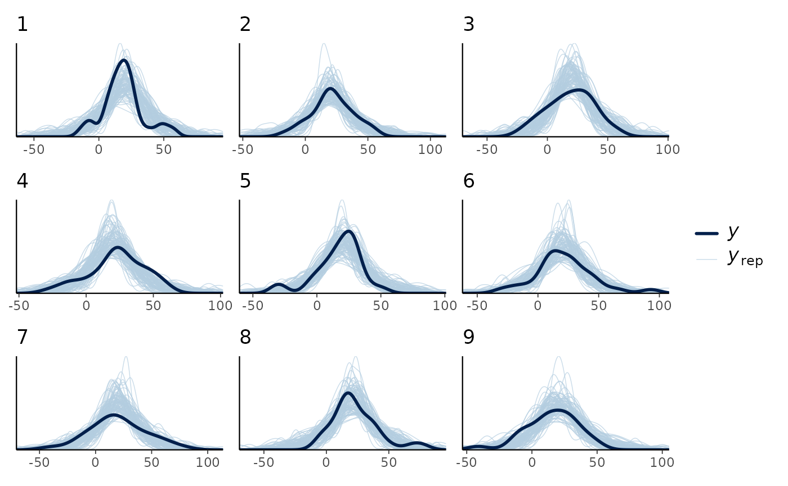

# Variance change points and other distributional parameters

`mcp` supports **distributional regression**, where any parameter of a
response distribution can be regressed on predictors and have change
points across segments. In standard regression, formulas model only the
conditional mean `mu()`, where the expected response on the response
scale relates to the linear predictor via link function g(\mu_i) =
\eta_i (\mu_i = g^{-1}(\eta_i)). Distributional regression extends this
by allowing formulas for distributional parameters such as residual
standard deviation (`sigma`), negative-binomial overdispersion
(`shape`) - and auxiliary parameters for time-series autocorrelation
(`ar` / `ma`) - on their respective link scales.

In `mcp`, a **distributional parameter (`dpar`)** is anything with its
own segmented linear predictor: `mu`, `sigma`, `shape`, and each AR/MA
lag (`ar1`, `ar2`, `ma1`, …). Strictly, AR/MA lags are not parameters of
the response distribution, but they are modeled the same way. This is
what the `dpar` argument and column refer to throughout `mcp`, e.g.,
`fitted(fit, dpar = "sigma")`, `plot_dpar(fit, "ar1")`,
`fixef(fit, dpar = "ar1")`, and `mcp_pars(fit)$dpar`.

Here, we exemplify regression on the standard deviation `sigma`. A
plateau mean with an increasing standard deviation can be written as
`y ~ 1 + sigma(1 + x)`. Read more about mcp formulas
[here](https://lindeloev.github.io/mcp/dev/articles/formulas.md).

## Priors for distributional parameters

Aligning with `brms` convention, without an explicit
[`sigma()`](https://rdrr.io/r/stats/sigma.html) formula, the default is
the intercept-only prior `dt(0, max(2.5, round(mad(y), 1)), 3) T(0, )`
directly on the residual SD, i.e., an **identity link**. The
response-calibrated scale adapts to the units of `y`, with a minimum of
2.5 to avoid an accidentally narrow prior. This matches `brms`.

With an explicit [`sigma()`](https://rdrr.io/r/stats/sigma.html)
formula, the intercept instead defaults to `dt(0, 2.5, 3)` on
**log-SD**, as in `brms`. Contrasts use the same prior, and slopes are
scaled by the predictor’s SD, `dt(0, 2.5 / sd(column), 3)`. [Read
more](https://lindeloev.github.io/mcp/dev/articles/default_priors.html#deviations).

## Simple example: a change in standard deviation

Let us model a simple change in residual standard deviation with a
plateau mean:

``` r

library(mcp)
future::plan(future::multisession, workers = 3)

model = list(
  y ~ 1,  # sigma(1) is implicit in the first segment
  ~ 0 + sigma(1)  # a new intercept on sigma, but not on the mean
)
```

We can simulate data with an abrupt change from a low to a high residual
standard deviation at x = 50:

``` r

df = data.frame(x = 1:100, y = 1)
empty = mcp(model, data = df, sample = FALSE, par_x = "x")

df$y = empty$simulate(
  empty, df, 
  cp_1 = 50, Intercept_1 = 20, 
  sigma_Intercept_1 = log(5), sigma_Intercept_2 = log(20))

head(df)
```

    ##   x        y
    ## 1 1 26.85479
    ## 2 2 17.17651
    ## 3 3 21.81564
    ## 4 4 23.16431
    ## 5 5 22.02134
    ## 6 6 19.46938

Now we fit the model to the simulated data.

``` r

fit = mcp(model, data = df, par_x = "x")
```

We plot a posterior predictive interval to show the effect of the
changing standard deviation, which is not immediately visible in the
default plot of the expected response:

``` r

plot(fit, q_predict = TRUE)
```



We can see all parameters are well recovered (compare `sim` to `mean`).
Like the other parameters, the `sigma`s are named after the segment
where they were instantiated. There will always be a `sigma_Intercept_1`
because `sigma` is required by the likelihood.

``` r

summary(fit)
```

    ## Family: gaussian
    ## Links: mu = identity; sigma = log
    ## Draws: 9000 (3 chains with iter = 3000)
    ## Segments:
    ##   1: y ~ 1
    ##   2: ~ 0 + sigma(1)
    ## 
    ## Change point parameters:
    ##          parameter mean   sd lower upper rhat ess_bulk ess_tail  sim match
    ##  cp_1              49.7 1.64  46.1  52.2 1.00     3277     3827 50.0    OK
    ## 
    ## Population-level parameters:
    ##          parameter mean   sd lower upper rhat ess_bulk ess_tail  sim match
    ##  Intercept_1       20.1 0.82  18.5  21.7 1.00     7972     8574 20.0    OK
    ##  sigma_Intercept_1  1.8 0.11   1.6   2.0 1.00     4639     4599  1.6    OK
    ##  sigma_Intercept_2  2.9 0.10   2.7   3.1 1.00     5458     5230  3.0    OK

## Advanced example

We can model changes in `sigma` alone or together with changes in the
mean. The following deliberately complex model demonstrates that
flexibility:

``` r

model = list(
  # 1. Increasing standard deviation.
  y ~ 1 + sigma(1 + x),  # Intercept_1, sigma_Intercept_1, sigma_x_1
  
  # 2. Abrupt change in mean and standard deviation.
  ~ 1 + sigma(1),  # At cp_1: Intercept_2, sigma_Intercept_2
  
  # 3. Joined slope on mean; log-SD changes as a second-order polynomial.
  ~ 0 + x + sigma(0 + x + I(x^2)),  # At cp_2: x_3, sigma_x_3, sigma_xE2_3
  
  # 4. Continue slope on mean, but plateau standard deviation (no sigma() term).
  ~ 0 + same(x)  # At cp_3: reuse x_3; sigma joined
)
```

Notice a few things here:

- `same(x)` ensures that the mean slope remains constant between segment
  3 and 4. So only `sigma` changes there. Sharing the slope effectively
  removes the change point in the mean (read more about [formulas in
  mcp](https://lindeloev.github.io/mcp/dev/articles/formulas.md)).
- Segment 4: `sigma` is required by the likelihood, so it cannot be
  turned off. A segment that does not include
  [`sigma()`](https://rdrr.io/r/stats/sigma.html) is joined, so the
  log-SD plateaus here.

In general, the log-SD parameters are named `sigma_[normalname]`, where
“normalname” is the usual parameter names in mcp (see more
[here](https://lindeloev.github.io/mcp/dev/articles/formulas.md)). For
example, the log-SD intercept in segment 2 is `sigma_Intercept_2` and
the log-SD slope on `x` in segment 3 is `sigma_x_3`. In models without
[`sigma()`](https://rdrr.io/r/stats/sigma.html), the residual SD itself
is simply `sigma_1`.

### Simulate data

We simulate some data from this model, setting all parameters. As
always, we can fit an empty model to get `fit$simulate`, which is useful
for simulation and predictions from this model.

``` r

# Set up model
df = data.frame(x = 1:200, y = 1)
empty = mcp(model, data = df, sample = FALSE)

# Simulate data
df$y = empty$simulate(
  empty, df,
  cp_1 = 50, cp_2 = 80, cp_3 = 140,
  Intercept_1 = -20, Intercept_2 = 0,
  sigma_Intercept_1 = log(1), sigma_x_1 = log(2) / 15,
  sigma_Intercept_2 = log(4),
  sigma_x_3 = 0.03,
  sigma_xE2_3 = 0.00015,
  x_3 = 0.8
)
```

### Fit it and inspect results

Fit it:

``` r

fit = mcp(model, data = df, diagnostics = FALSE)
```

Plotting a posterior predictive interval is an intuitive way to see how
the residual standard deviation is estimated:

``` r

plot(fit, q_predict = TRUE)
```



We can also plot the `sigma_` parameters directly. Now the y-axis is
`sigma`:

``` r

plot_dpar(fit, dpar = "sigma", q_fit = TRUE)
```



`summary(fit)` shows that the parameters are well recovered and a
posterior predictive check (`pp_check(fit)`) looks good too. The last
change point is estimated with greater uncertainty than the others
because its only signal is a stop in standard-deviation growth.

``` r

summary(fit)
```

    ## Family: gaussian
    ## Links: mu = identity; sigma = log
    ## Draws: 9000 (3 chains with iter = 3000)
    ## Segments:
    ##   1: y ~ 1 + sigma(1 + x)
    ##   2: ~ 1 + sigma(1)
    ##   3: ~ 0 + x + sigma(0 + x + I(x^2))
    ##   4: ~ 0 + same(x)
    ## 
    ## Change point parameters:
    ##          parameter     mean      sd    lower    upper rhat ess_bulk ess_tail      sim match
    ##  cp_1               4.9e+01 4.4e-01  4.8e+01  5.0e+01 1.00     4143     2544  5.0e+01    OK
    ##  cp_2               8.1e+01 2.0e+00  7.7e+01  8.4e+01 1.01     2039     3133  8.0e+01    OK
    ##  cp_3               1.5e+02 1.4e+01  1.3e+02  1.9e+02 1.13       16       13  1.4e+02    OK
    ## 
    ## Population-level parameters:
    ##          parameter     mean      sd    lower    upper rhat ess_bulk ess_tail      sim match
    ##  Intercept_1       -2.0e+01 3.5e-01 -2.1e+01 -1.9e+01 1.00     8424     8362 -2.0e+01    OK
    ##  Intercept_2        4.8e-01 6.9e-01 -8.5e-01  1.8e+00 1.00     4199     5557  0.0e+00    OK
    ##  x_3                7.8e-01 6.3e-02  6.5e-01  9.0e-01 1.01     1527     4773  8.0e-01    OK
    ##  sigma_Intercept_1  1.1e-01 2.4e-01 -3.3e-01  5.9e-01 1.00     4984     5447  0.0e+00    OK
    ##  sigma_x_1          4.2e-02 8.4e-03  2.6e-02  5.9e-02 1.00     4842     4880  4.6e-02    OK
    ##  sigma_Intercept_2  1.3e+00 1.2e-01  1.1e+00  1.6e+00 1.01      319     1718  1.4e+00    OK
    ##  sigma_x_3          3.7e-02 1.2e-02  1.4e-02  5.9e-02 1.12       19       30  3.0e-02    OK
    ##  sigma_xE2_3        6.4e-05 2.2e-04 -3.2e-04  5.1e-04 1.14       16       20  1.5e-04    OK

``` r

pp_check(fit)
```



The low ESS for sigma in segment 3 reveal some unidentifiability
concerning whether the variance increase is driven by a linear
(`sigma_x_3`) or quadratic term (`sigma_xE2_3`). This spills over to a
lower ESS for `cp_3` too. Other coefficients seem to be reasonably
recovered. This is why I set `diagnostics = FALSE` to quiet warnings
since this is just a demonstration.

Let us verify this by taking a look at the posteriors and trace. For
now, we just look at the sigmas:

``` r

plot_pars(fit, regex_pars = "sigma_")
```



This confirms the impression from `rhat`, `ess_bulk`, and `ess_tail`.
Read more about [tips, tricks, and
debugging](https://lindeloev.github.io/mcp/dev/articles/tips.md).

## JAGS code for distributional parameters

Printing the underlying JAGS code, you can see that the regression model
is the same for the mean `mu` (see under “# Formula for mu”) and the
standard deviation `sigma` (see under “# Formula for sigma”).

This is explained more in [Understanding mcp
formulas](https://lindeloev.github.io/mcp/dev/articles/formulas.md).

``` r

fit$jags_code
```

    ## model {
    ##   # Change points
    ##   cp_0 = min(x)
    ##   for (cp_i_ in 1:3) {
    ##     cp_unit_[cp_i_] ~ dunif(0, 1)
    ##   }
    ##   cp_sorted_ = sort(cp_unit_)  # Uniform order statistics
    ##   cp_1 = cp_0 + cp_sorted_[1] * (cp_4 - cp_0)
    ##   cp_2 = cp_0 + cp_sorted_[2] * (cp_4 - cp_0)
    ##   cp_3 = cp_0 + cp_sorted_[3] * (cp_4 - cp_0)
    ##   cp_4 = max(x)
    ## 
    ##   # Priors for population-level effects
    ##   Intercept_1 ~ dnorm(24.911544437719712, 1/(117.52798194134313)^2)   # Mean intercept (rstanarm default)
    ##   Intercept_2 ~ dnorm(24.911544437719712, 1/(117.52798194134313)^2)   # Mean intercept (rstanarm default)
    ##   x_3_end_ ~ dnorm(Intercept_2, 1/(2.0305742544284522*(cp_3-cp_2))^2)   # Autoscaled mean coefficient (rstanarm default); sampled as the value at the segment end
    ##   x_3 = (x_3_end_ - (Intercept_2)) / (cp_3 - cp_2)
    ##   sigma_Intercept_1_mid_ ~ dt(-sigma_x_1 * 1 + sigma_x_1 * (25.875), 1/(2.5)^2, 3)   # Weakly regularizing modeled log-SD intercept; on the value at min(x); sampled as the value at the expected midpoint of segment 1
    ##   sigma_Intercept_1 = sigma_Intercept_1_mid_ - (sigma_x_1 * (25.875))
    ##   sigma_x_1 ~ dt(0, 1/(0.043193421279068007)^2, 3)   # Regularizing log-SD coefficient scaled by the predictor SD
    ##   sigma_Intercept_2 ~ dt(0, 1/(2.5)^2, 3)   # Weakly regularizing modeled log-SD intercept
    ##   sigma_x_3_end_ ~ dt(sigma_Intercept_2, 1/(0.043193421279068007*(cp_3-cp_2))^2, 3)   # Regularizing log-SD coefficient scaled by the predictor SD; sampled as the value at the segment end
    ##   sigma_x_3 = (sigma_x_3_end_ - (sigma_Intercept_2)) / (cp_3 - cp_2)
    ##   sigma_xE2_3_rise_ ~ dt(0, 1/(0.0002100945749551876*(cp_3-cp_2)^2)^2, 3)   # Regularizing log-SD coefficient scaled by the predictor SD; sampled as the rise over the segment
    ##   sigma_xE2_3 = sigma_xE2_3_rise_ / (cp_3 - cp_2)^2
    ## 
    ##   # Model and likelihood
    ##   for (i_ in 1:length(x)) {
    ##     # par_x local to each segment
    ##     x_local_1_[i_] = min(x[i_], cp_1)
    ##     x_local_2_[i_] = min(x[i_], cp_2) - cp_1
    ##     x_local_3_[i_] = min(x[i_], cp_3) - cp_2
    ##     x_local_4_[i_] = min(x[i_], cp_4) - cp_3
    ##     
    ##     # Formula for mu
    ##     link_mu_[i_] =
    ##       (x[i_] >= cp_0) * (x[i_] < cp_1) * inprod(rhs_matrix_[i_, c(1)], c(Intercept_1)) * 1 + 
    ##       (x[i_] >= cp_1) * inprod(rhs_matrix_[i_, c(2)], c(Intercept_2)) * 1 + 
    ##       (x[i_] >= cp_2) * inprod(rhs_matrix_[i_, c(3)], c(x_3)) * x_local_3_[i_] + 
    ##       (x[i_] >= cp_3) * inprod(rhs_matrix_[i_, c(4)], c(x_3)) * x_local_4_[i_]
    ##     
    ##     # Formula for sigma
    ##     link_sigma_[i_] =
    ##       (x[i_] >= cp_0) * (x[i_] < cp_1) * inprod(rhs_matrix_[i_, c(5)], c(sigma_Intercept_1)) * 1 + 
    ##       (x[i_] >= cp_0) * (x[i_] < cp_1) * inprod(rhs_matrix_[i_, c(6)], c(sigma_x_1)) * x_local_1_[i_] + 
    ##       (x[i_] >= cp_1) * inprod(rhs_matrix_[i_, c(7)], c(sigma_Intercept_2)) * 1 + 
    ##       (x[i_] >= cp_2) * inprod(rhs_matrix_[i_, c(8)], c(sigma_x_3)) * x_local_3_[i_] + 
    ##       (x[i_] >= cp_2) * inprod(rhs_matrix_[i_, c(9)], c(sigma_xE2_3)) * x_local_3_[i_]^2
    ## 
    ##     # Likelihood for family = gaussian()
    ##     mu_[i_] = link_mu_[i_]
    ##     sigma_[i_] = max(1e-05, exp(link_sigma_[i_]))
    ##     y[i_] ~ dnorm(mu_[i_], 1 / sigma_[i_]^2)
    ##   }
    ## }

## Group-level change points and standard deviation

The standard-deviation model also applies with group-level change-point
deviations. Here we model a by-person change in `sigma` on a flat mean.

``` r

model = list(
  # intercept mean. sigma(1) is implicit in first segment if not specified
  y ~ 1,
  
  # Changed standard deviation, with a group-level change point.
  ~ cp((1|id)) + 0 + sigma(1)
)
```

Simulate data:

``` r

# Set up model
df = data.frame(
  x = 1:270,
  id = rep(1:9, times = 30),
  y = 1
)
empty = mcp(model, data = df, par_x = "x", sample = FALSE)

# Simulate data
df$y = empty$simulate(
  empty, df, 
  cp_1 = 130, cp_1_id_sd = 40,
  Intercept_1 = 20,
  sigma_Intercept_1 = log(10), sigma_Intercept_2 = log(25))
```

Fit it:

``` r

fit = mcp(model, data = df, par_x = "x")
```

    ## Warning: Some parameters may not have converged well:
    ##   * rhat > 1.01 or ess_bulk < 400 or ess_tail < 400: cp_1_id_sd and cp_1_id[3]
    ## Inspect `summary(fit)` and `plot_pars(fit)`, and consider increasing `iter`/`warmup` or simplifying the model before trusting these results.

Plot it:

``` r

plot(fit, q_predict = TRUE, facet_by = "id")
```



As usual, we can get the individual change points:

``` r

ranef(fit)
```

    ## # A tibble: 9 × 10
    ##   parameter    mean    sd lower upper  rhat ess_bulk ess_tail   sim match
    ##   <chr>       <dbl> <dbl> <dbl> <dbl> <dbl>    <dbl>    <dbl> <dbl> <chr>
    ## 1 cp_1_id[1]   1.06  12.3 -23.7 26.3   1.00     2769     1831 -26.9 ""   
    ## 2 cp_1_id[2]  12.1   16.4 -14.0 44.9   1.00      701      763  11.4 "OK" 
    ## 3 cp_1_id[3]  -4.30  12.9 -32.7 14.5   1.01      823      276 -42.5 ""   
    ## 4 cp_1_id[4]  10.4   13.9 -12.5 42.0   1.00      938     1372  11.6 "OK" 
    ## 5 cp_1_id[5]   5.01  11.3 -17.6 25.8   1.00     1871     1560 -26.6 ""   
    ## 6 cp_1_id[6] -11.2   12.7 -40.2  5.58  1.00      633      857 -30.0 "OK" 
    ## 7 cp_1_id[7] -10.3   10.5 -32.8  5.36  1.00      699     1196 -24.8 "OK" 
    ## 8 cp_1_id[8]  -1.02  10.4 -22.8 17.0   1.00     2107     1345 -28.5 ""   
    ## 9 cp_1_id[9]  -2.10  12.1 -25.7 16.8   1.00     1553     1234 -18.3 "OK"

… and verify via posterior predictive checks:

``` r

pp_check(fit, facet_by = "id")
```



## Generalizing to other distributional parameters (dpars)

`sigma` is just one instance of a distributional parameter in `mcp`. In
general, every response family defines a set of supported `dpars`
(distributional parameters). The default linear predictor in any segment
formula models the location parameter `mu` (or probability/rate under
the family’s link function). Other `dpars` can be regressed on
predictors or given change points using wrapper functions named after
the `dpar`.

Here is an overview of standard distributional parameters across
response families:

- **`mu`**: Conditional mean or location (e.g. mean for
  [`gaussian()`](https://rdrr.io/r/stats/family.html), success
  probability for [`binomial()`](https://rdrr.io/r/stats/family.html),
  event rate for [`poisson()`](https://rdrr.io/r/stats/family.html)).
  Modeled by default without any wrapper.
- **`sigma`**: Residual standard deviation for
  [`gaussian()`](https://rdrr.io/r/stats/family.html) (modeled on the
  log-SD scale via `sigma(...)`).
- **`shape`**: Overdispersion / shape parameter for
  [`negbinomial()`](https://lindeloev.github.io/mcp/dev/reference/negbinomial.md)
  (modeled on the log-shape scale via `shape(...)`).
- **[`ar()`](https://rdrr.io/r/stats/ar.html) / `ma()`**: Autoregressive
  and moving-average serial dependence terms for time-series models
  ([read more
  here](https://lindeloev.github.io/mcp/dev/articles/arma.md)). Each lag
  is a dpar named `ar1`, `ar2`, `ma1`, etc. (see the definition above).

#### Inspecting and working with dpars

You can inspect the parameters in a fitted model or family object using
`mcp_pars(fit)` or `print(fit$prior)`.

Many core `mcp` functions take a `dpar` argument to extract or visualize
specific distributional parameters:

- **`fitted(fit, dpar = "sigma")` or `fitted(fit, dpar = "shape")`**:
  Returns fitted values for the target `dpar` evaluated on the response
  scale.
- **`predict(fit, dpar = "sigma")`**: Generates posterior predictive
  draws for the specified distributional parameter.
- **`plot_dpar(fit, dpar = "sigma")` or
  `plot_dpar(fit, dpar = "shape")`**: Plots the trajectory of the
  distributional parameter over x, complete with credible intervals
  across segments.
