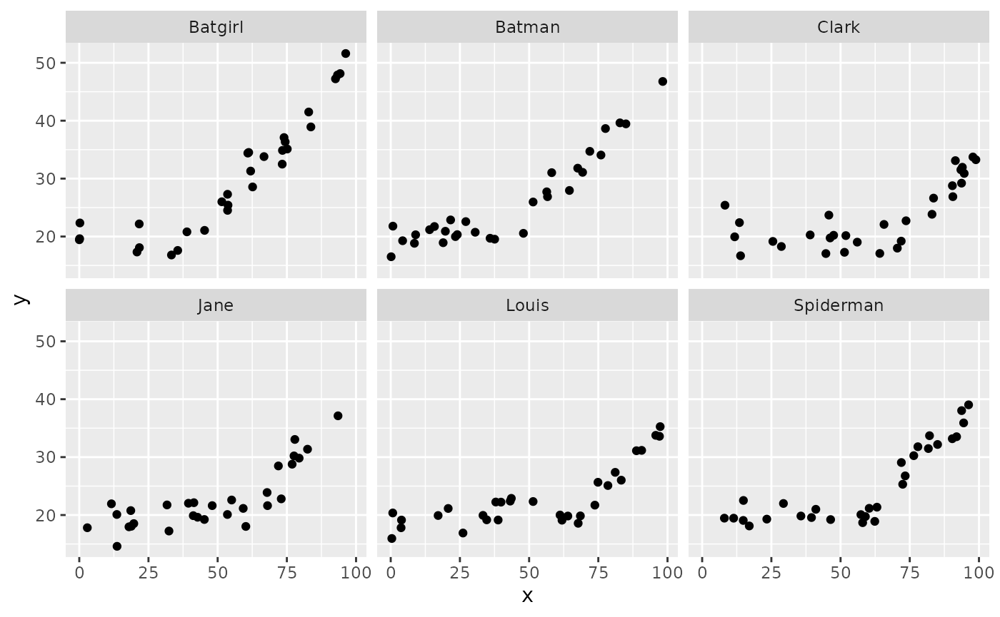
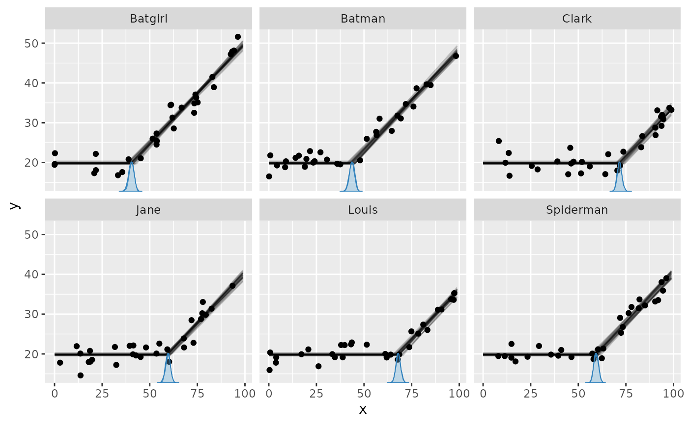
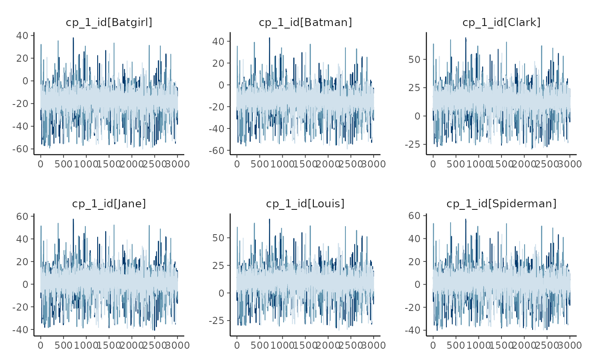
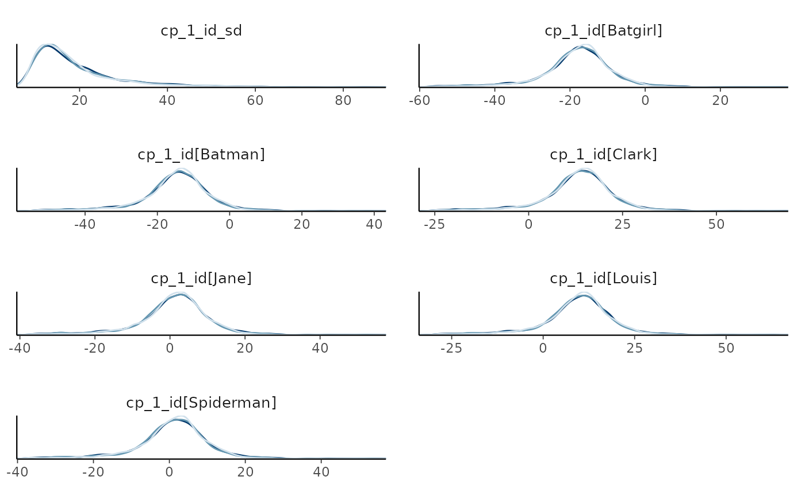

# Group-level (random) effects in mcp

`mcp` supports group-level effects (also called random effects) in both
the predictor and change-point parts of a formula. The syntax follows
`lme4` and `brms`: `(1|group)` specifies a group-level intercept,
`(factor||group)` specifies independent group coefficients,
[`fixef()`](https://lindeloev.github.io/mcp/dev/reference/summary.mcpfit.md)
reports population-level coefficients, and
[`ranef()`](https://lindeloev.github.io/mcp/dev/reference/summary.mcpfit.md)
reports group-level deviations.

This article in brief:

- Predictor and change-point group-level effects
- How group-level effects apply across segments
- How to simulate group-level change-point deviations
- Get posteriors using `ranef(fit)`
- Plot using `plot(fit, facet_by="my_group")` and
  `plot_pars(fit, pars = "group", type = "dens_overlay", ncol = 3)`
  ([more on
  plotting](https://lindeloev.github.io/mcp/dev/articles/plotting.md)).
- How group-specific change points are bounded and ordered.
- The article on modeling standard deviation via
  [`sigma()`](https://rdrr.io/r/stats/sigma.html) contains [another
  group-level change-point
  example](https://lindeloev.github.io/mcp/dev/articles/dpar.md).

``` r

library(mcp)
future::plan(future::multisession, workers = 3)
```

## Specifying group-level change points

You specify group-level effects using the familiar
[`lmer`](https://www.rdocumentation.org/packages/lme4/versions/1.1-21/topics/lmer)
and `brms` syntax `(1|group)`. Inside `cp()`, this models a
group-specific deviation from the population-level change point. For
example:

``` r

model = list(
  y ~ 1,                  # Intercept_1
    ~ cp((1|id)) + 0 + x  # cp_1, cp_1_id_sd, cp_1_id[i]
)
```

You can have multiple group-level change points, but they must use the
same grouping factor so their group-specific change points can be
ordered within each group:

``` r

model = list(
  y ~ 1,                   # Intercept_1
    ~ cp((1|id)) + 0 + x,  # cp_1, cp_1_id_sd, cp_1_id[i]
    ~ cp((1|id)) + 0,      # cp_2, cp_2_id_sd, cp_2_id[i]
    ~ cp((1|id)) + 1       # cp_3, cp_3_id_sd, cp_3_id[i]
)
```

For change point i and group g, the hierarchy is

\kappa\_{ig} \sim \operatorname{Normal}(cp_i, cp\_{i,\mathrm{sd}}),
\qquad cp\_{i,\mathrm{id}\[g\]} = \kappa\_{ig} - cp_i,

where \kappa\_{ig} is the group-specific location. Thus `cp_i_id[g]` is
the reported deviation and `cp_i_id_sd` is the SD of the normal
distribution *before truncation* (see below). The deviations are not
forced to sum to zero.

The hierarchy is subject to x\_{\min} \< \kappa\_{1g} \< \cdots \<
\kappa\_{Kg} \< x\_{\max}. Thus, if adjacent change points both vary,
their group-specific locations are ordered against each other—not
against the adjacent population-level change point. Internally, JAGS
samples \kappa\_{ig} directly for efficiency.

Because of this truncation, the realized SD of the group-specific change
points is smaller than `cp_i_id_sd`, and their mean is pulled away from
cp_i when cp_i is near a boundary. When `cp_i_id_sd` is large relative
to the distance between these bounds, the truncated normal approaches a
uniform distribution, so the data carry little information about how
large `cp_i_id_sd` is. Its posterior then has a long upper tail that
mostly reflects the prior.

Unlike predictor group-level effects, a change-point group-level effect
applies only at the change point where it is included.

## Predictor group-level effects

The same syntax in the predictor part gives each group a deviation from
the population-level intercept:

``` r

model = list(
  y ~ 1 + (1|id),  # Starts group-level intercept
  ~ 0 + x,         # (1|id) not included, so group intercepts end at cp_1
  ~ 1 + (0|id),    # (0|id) turns it off
  ~0 + same((1|id), as = 1)  # Reuse group-level intercept from segment 1
)
```

Group-level terms follow the [rules for how segments
connect](https://lindeloev.github.io/mcp/dev/articles/formulas.html#how-segments-connect),
separately for each grouping factor and distributional parameter. Group
intercepts apply only in segments that include them, so each group can
jump at a joined change point; use `same((1|id))` to keep them. Group
slopes on `x`, such as `(0 + x||id)`, are x-terms: they join until a
disjoined segment (`~ 1 + ...`), a later group intercept for the same
grouping factor, or `(0|id)`, which ends all group terms for `id`.

Notice `same()` above. It reuses the complete group-level term from the
source segment (deviations and SD), never a subset of it. Reused group
slopes are still measured from the current change point. The same syntax
works inside [`sigma()`](https://rdrr.io/r/stats/sigma.html) and other
distributional parameters. See `mcp_example("group_mu")`.

Use `||` for independent group-level slopes and factor coefficients:

``` r

model = list(
  y ~ 1 + state + (state||id),
  ~ 0 + x
)
```

With the default treatment coding, `(state||id)` contains a group-level
intercept and one group-level deviation for each non-reference contrast
of `state`. `(0 + state||id)` instead gives each factor level its own
group-level coefficient. Similarly, `(1 + z||id)` specifies independent
group-level intercepts and slopes on a numeric predictor `z`. Each
coefficient has its own population-level SD.

The population-level and group-level formulas need not contain the same
coefficients. For example, `y ~ 1 + (0 + state||id)` has a
population-level intercept but only group-specific state coefficients.

Group-level intercepts also work inside distributional formulas:

``` r

model = list(
  y ~ 1 + (1|id) + sigma(1 + (1|id))
)
```

This model has group-level deviations in both the conditional mean and
log-SD. The `||` syntax works inside distributional formulas too, for
example `sigma(1 + (state||id))`.

A later group intercept starts the group terms afresh. Thus, if
`(state||id)` is followed in a later segment by `(1||id)`, only the new
intercept deviations apply from that segment onward. In a joined
segment, a group-level term without an intercept, such as `(0 + x||id)`,
joins earlier group slopes, while `(0|id)` ends all group terms for
`id`.

Multi-coefficient terms with `|`, such as `(1 + x|id)`, would imply
correlated group coefficients and are not yet supported; use
`(1 + x||id)` for independent coefficients. Group-level terms inside
[`ar()`](https://rdrr.io/r/stats/ar.html) and `ma()` are also not
supported.

Like change-point deviations, predictor deviations are not constrained
to sum to zero. They have an ordinary mean-zero hierarchical normal
distribution, matching multilevel regression in `lme4` and `brms`. For
example, `(1|id)` in segment 1 creates the deviation vector
`Intercept_1_id` and its population-level SD parameter
`Intercept_1_id_sd`. `(state||id)` additionally creates names such as
`stateB_1_id` and `stateB_1_id_sd`; inside
[`sigma()`](https://rdrr.io/r/stats/sigma.html), the corresponding names
start with `sigma`.

## Simulating group-level change points

Let us simulate group-specific deviations in the change point between a
plateau and a slope:

``` r

model = list(
  y ~ 1,                  # Intercept_1
    ~ cp((1|id)) + 0 + x  # cp_1, cp_1_id_sd, cp_1_id[i]
)
```

This follows the same interface as predictor group-level effects: supply
the population-level SD and `fit$simulate()` draws one deviation per
group from the same truncated normal hierarchy as the JAGS model (see
above), keeping each group-specific change point within its bounds. The
deviations are therefore not centered exactly on zero.

``` r

library(dplyr, warn.conflicts = FALSE)
group_levels = c("Clark", "Louis", "Batman", "Batgirl", "Spiderman", "Jane")
df = data.frame(
  x = runif(length(group_levels) * 30, 0, 100),  # 30 data points for each
  id = rep(group_levels, each = 30),  # the group names
  y = 1
)
empty = mcp(model, data = df, sample = FALSE)

df$y = empty$simulate(empty, df,
  # Population-level:
  Intercept_1 = 20, x_2 = 0.5, cp_1 = 50, sigma = 2,
  
  # Draw group-level deviations with this SD
  cp_1_id_sd = 15)

head(df)
```

    ##          x    id        y
    ## 1 91.48060 Clark 33.10525
    ## 2 93.70754 Clark 29.21492
    ## 3 28.61395 Clark 18.27841
    ## 4 83.04476 Clark 23.84163
    ## 5 64.17455 Clark 17.08157
    ## 6 51.90959 Clark 20.15997

For models with multiple group-level change points, `fit$simulate()`
draws the deviations in change-point order, truncated so each
group-specific change point lies after its preceding one, just like the
JAGS model. The result:

``` r

library(ggplot2)
ggplot(df, aes(x=x, y=y)) + 
  geom_point() +
  facet_wrap(~id)
```



## Summarise and plot group-level effects

Fitting the model is simple:

``` r

fit = mcp(model, data = df)
```

If we just use `plot(fit)`, we would see all points in one plot. We want
to facet by `id`, so:

``` r

plot(fit, facet_by = "id")
```



It seems that `mcp` recovered the group-specific change points well.
There is a lot of information in these data because the population-level
intercept and slopes on either side of the change point are common to
all participants (`id`).

`summary(fit)` returns posterior summaries for the population-level
parameters, and `fixef(fit)` for the population-level coefficients. To
get the group-level deviations (random effects), use:

``` r

mcp::ranef(fit)
```

    ## # A tibble: 6 × 10
    ##   parameter             mean    sd lower  upper  rhat ess_bulk ess_tail   sim match
    ##   <chr>                <dbl> <dbl> <dbl>  <dbl> <dbl>    <dbl>    <dbl> <dbl> <chr>
    ## 1 cp_1_id[Batgirl]   -18.1    10.3 -44.5  0.388  1.00     3480     2398 -9.68 OK   
    ## 2 cp_1_id[Batman]    -14.9    10.3 -41.0  3.72   1.00     3458     2403 -7.14 OK   
    ## 3 cp_1_id[Clark]      13.2    10.3 -13.3 31.9    1.00     3402     2343 20.8  OK   
    ## 4 cp_1_id[Jane]        1.04   10.3 -25.3 19.7    1.00     3477     2429  9.98 OK   
    ## 5 cp_1_id[Louis]       9.47   10.3 -16.9 28.1    1.00     3420     2425 16.4  OK   
    ## 6 cp_1_id[Spiderman]   0.834  10.3 -25.9 19.5    1.00     3524     2475  9.74 OK

Inspecting the `sim` and `match` columns, we see that the simulated
deviations lie within the intervals. However, the intervals are wide
because the deviations trade off against the population-level `cp_1`,
which is informed by only six groups. The group-specific locations
(`cp_1 + cp_1_id[g]`) are much more precise, as seen in the plot above.

Prediction methods include all group-level effects by default. Set
`group_effects = FALSE` (or `NA`, as in `brms`) for population-level
predictions, `group_effects = "cp"` for the group-level effects in the
change-point part, `group_effects = "predictor"` for those in the
predictor part, or supply parameter names such as
`group_effects = "cp_1_id"`. Use `*` as a wildcard, e.g., `"cp_*"` or
`"*_id"`. `ranef(fit)` deliberately remains simple and returns all
group-level deviations.

Good convergence is not always as obvious as in this example. While
`plot_pars(fit)` shows population-level parameters only, you can select
the group-level deviations with `"group"`:

``` r

plot_pars(fit, pars = "group", type = "trace", ncol = 3, npars = NULL)
```


The `ncol` argument controls the number of columns. Group-level effects
often have many levels, so this is useful for viewing all deviations.

Using `pars = "group"` plots all group-level deviations. To select one
group-level effect, use a regular expression in `regex_pars`; for
example, `^` anchors the start of a parameter name:

``` r

plot_pars(fit, regex_pars = "^cp_1_id", type = "dens_overlay", ncol = 2, npars = NULL)
```



You can also do posterior predictive checks with facets. For a
single-response model like this, it adds little over
`plot(fit, facet_by = "id")`, but it is a standard check that many will
be familiar with:

``` r

pp_check(fit, facet_by = "id")
```



## Priors for group-level effects

*[Brief overview of all default
priors](https://lindeloev.github.io/mcp/dev/articles/default_priors.html#summary-reference-table)*

You can see the priors of the model like this:

``` r

prior_summary(fit)
```

    ## # A tibble: 6 × 5
    ##   parameter   segment dpar  prior                                                 bounds                         
    ##   <chr>         <int> <chr> <chr>                                                 <chr>                          
    ## 1 cp_1              2 NA    dunif(0.02389, 98.889)                                [0.02389, 98.889], ordered     
    ## 2 cp_1_id_sd        2 NA    dnorm(0, 24.716) T(0, )                               [0, Inf]                       
    ## 3 cp_1_id           2 NA    dnorm(0, cp_1_id_sd) T(0.02389 - cp_1, 98.889 - cp_1) [0.02389 - cp_1, 98.889 - cp_1]
    ## 4 Intercept_1       1 mu    dnorm(25.186, 18.621)                                 none                           
    ## 5 x_2               2 mu    dnorm(0, 0.64588)                                     none                           
    ## 6 sigma_1           1 sigma dt(0, 5.3, 3) T(0, )                                  [0, Inf]

`cp_1_id_sd` is the SD of the normal distribution, before truncation,
governing the `cp_1_id` deviations. Unlike predictor group-level
effects, change-point locations are also bounded by the observed range
of x and ordered within each group.

For predictor group-level effects (e.g., `(state || id)`), the SDs
default to the `brms` half-Student-t prior on the response scale,
`dt(0, max(2.5, mad(y)), 3) T(0, )`, with slope SDs divided by
`sd(column)`. Log, logit, and probit links and distributional parameters
use other scales; see [default priors on group-level
effects](https://lindeloev.github.io/mcp/dev/articles/default_priors.html#default-priors-on-group-level-effects).

## JAGS code

Here is the JAGS code for the model used in this article:

``` r

fit$jags_code
```

    ## model {
    ##   # Change points
    ##   cp_0 = min(x)
    ##   cp_1 ~ dunif(cp_0, cp_2)  # Uniform within the observed range of x
    ##   cp_1_id_sd ~ dnorm(0, 1/(24.716320808511227)^2) T(0,)  # Group-level change-point SD before truncation
    ##   for (id_ in 1:n_unique_id) {
    ##     cp_1_id_location[id_] ~ dnorm(cp_1, 1/(cp_1_id_sd)^2) T(cp_0, cp_2)  # Group-level change-point deviations, truncated between the neighbouring change points
    ##     cp_1_id[id_] = cp_1_id_location[id_] - cp_1  # deviation from population change point
    ##   }
    ##   cp_2 = max(x)
    ## 
    ##   # Priors for population-level effects
    ##   Intercept_1 ~ dnorm(25.186470821654748, 1/(18.620544312604412)^2)   # Mean intercept (rstanarm default)
    ##   x_2 ~ dnorm(0, 1/(0.64588420009064662)^2)   # Autoscaled mean coefficient (rstanarm default)
    ##   sigma_1 ~ dt(0, 1/(5.3)^2, 3) T(0,)  # Positive residual SD calibrated on the response scale
    ## 
    ##   # Model and likelihood
    ##   for (i_ in 1:length(x)) {
    ##     # x measured from each segment's change point
    ##     x_local_1_[i_] = min(x[i_], (cp_1_id_location[id_index_[i_]]))
    ##     x_local_2_[i_] = min(x[i_], cp_2) - (cp_1_id_location[id_index_[i_]])
    ##     
    ##     # Formula for mu
    ##     link_mu_[i_] =
    ##       (x[i_] >= cp_0) * inprod(rhs_matrix_[i_, c(1)], c(Intercept_1)) * 1 + 
    ##       (x[i_] >= (cp_1_id_location[id_index_[i_]])) * inprod(rhs_matrix_[i_, c(2)], c(x_2)) * x_local_2_[i_]
    ##     
    ##     # Formula for sigma
    ##     link_sigma_[i_] =
    ##       (x[i_] >= cp_0) * inprod(rhs_matrix_[i_, c(3)], c(sigma_1)) * 1
    ## 
    ##     # Likelihood for family = gaussian()
    ##     mu_[i_] = link_mu_[i_]
    ##     sigma_[i_] = max(1e-05, link_sigma_[i_])
    ##     y[i_] ~ dnorm(mu_[i_], 1 / sigma_[i_]^2)
    ##   }
    ## }
