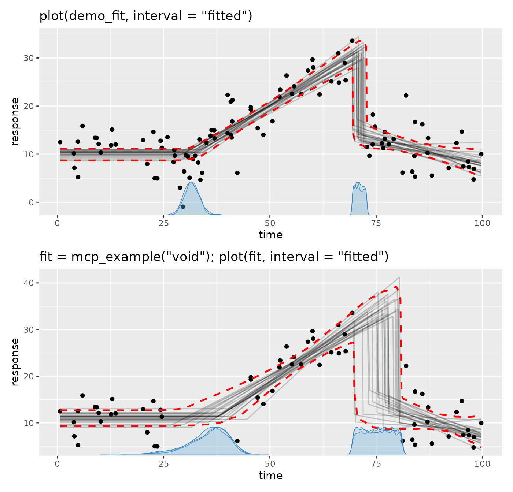
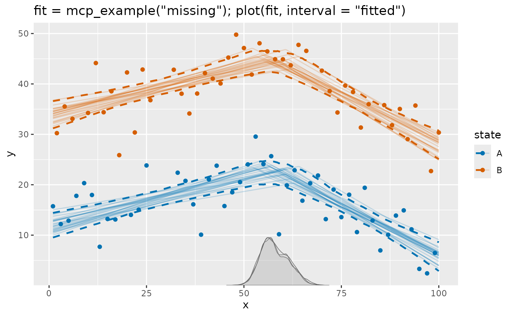
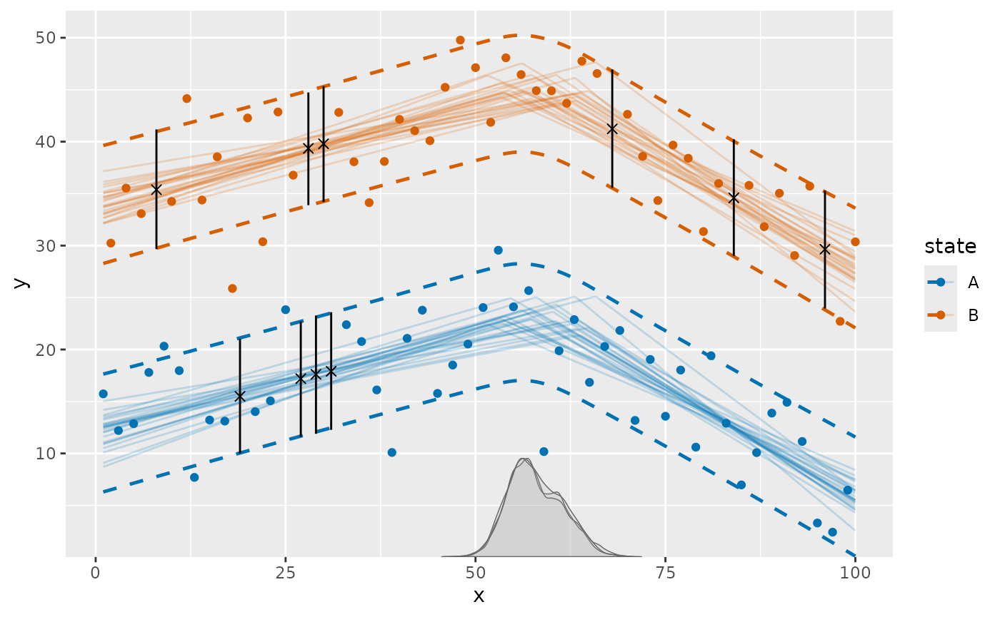
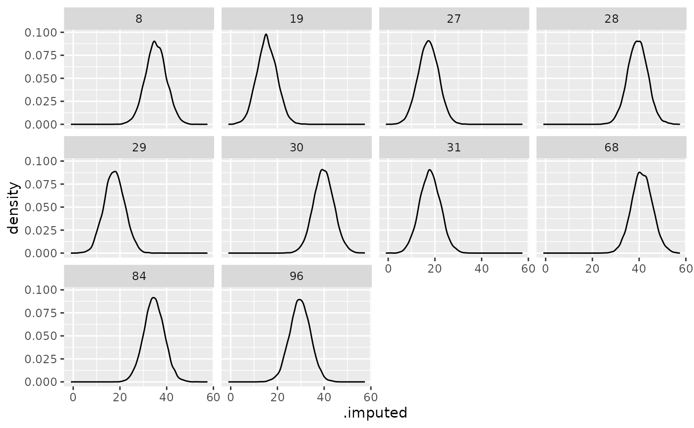

# Missing data

`mcp` allows missing values (`NA`) in the response. This article covers
two consequences of that:

1.  **Change points in voids:** Change points can be inferred in regions
    with no observed responses.
2.  **Imputing missing responses:**
    [`imputed()`](https://lindeloev.github.io/mcp/dev/reference/imputed.md)
    gives you the missing responses sampled jointly with the model
    parameters. Use it to inspect a gap or complete your data.

``` r

library(mcp)
library(dplyr)
library(ggplot2)
```

## Inferring change points in voids

Sometimes the interest is not in recovering individual missing
responses, but in how gaps in the data affect inference about the change
points. To demonstrate this, `mcp_example("void")` takes the data from
`mcp_example("demo")` and sets the responses near both change points to
`NA` (`25 < time < 42` and `70 < time < 80`). The top panel shows the
fit to the full data and the bottom panel the fit with the voids:

``` r

fit_void = mcp_example("void", sample = "both")
```

    ## NA values detected in 'response'. JAGS will treat them as latent responses and impute them during sampling.



The message confirms that `mcp` detected the missing responses.

Notice that `mcp` can infer change points in regions with no observed
data. The first change point joins a plateau to a slope. Its location in
the void is mostly informed by extrapolating the two segments until they
meet, and the uncertainty is greater than in the full data because fewer
data inform these trends. In principle, it could be known to great
precision if the segments’ trends were very well defined.

The second change point is different because segment 3 is disjoined from
segment 2. There is nothing in the void that tells where the jump
happened, so the change point posterior is roughly uniform across the
void. This is true for any gap between data: the narrow gap between two
neighboring data points (top panel) also yields a uniform-like
posterior, just on a much smaller range.

We can quantify how much of each change point posterior is within its
void using
[`hypothesis()`](https://lindeloev.github.io/mcp/dev/reference/hypothesis.md).
Because we sampled the prior too (`sample = "both"`), it also returns a
Bayes factor (`BF`) for each interval, i.e., how much the data shifted
the odds of the change point being in the void:

``` r

hypothesis(fit_void, c(
  "cp_1 > 25 & cp_1 < 42",
  "cp_2 > 70 & cp_2 < 80"
))
```

    ## # A tibble: 2 × 7
    ##   hypothesis             mean    sd lower upper  prob    BF
    ##   <chr>                 <dbl> <dbl> <dbl> <dbl> <dbl> <dbl>
    ## 1 cp_1 > 25 & cp_1 < 42    NA    NA    NA    NA 0.933  45.1
    ## 2 cp_2 > 70 & cp_2 < 80    NA    NA    NA    NA 0.848  30.2

## Imputing missing responses

The built-in example has a change in slope, a difference between two
states, and several missing responses. Use
[`imputed()`](https://lindeloev.github.io/mcp/dev/reference/imputed.md)
to see the mean and an 80% interval for each missing response. `.row`
gives its row number in `fit$data`.

``` r

# Fits model and plots it. See code in fit$example_code.
fit = mcp_example("missing")
```

    ## NA values detected in 'y'. JAGS will treat them as latent responses and impute them during sampling.

``` r

# Get imputations
imputations = imputed(fit, width = 0.8)
imputations
```

    ## # A tibble: 10 × 8
    ##        y     x state  .row .mean   .sd .lower .upper
    ##    <dbl> <int> <fct> <int> <dbl> <dbl>  <dbl>  <dbl>
    ##  1    NA     8 B         8  35.4  4.45  29.7    41.2
    ##  2    NA    19 A        19  15.5  4.30   9.99   21.0
    ##  3    NA    27 A        27  17.2  4.34  11.6    22.7
    ##  4    NA    28 B        28  39.4  4.30  33.9    44.7
    ##  5    NA    29 A        29  17.6  4.40  11.9    23.3
    ##  6    NA    30 B        30  39.8  4.39  34.2    45.3
    ##  7    NA    31 A        31  17.9  4.43  12.3    23.6
    ##  8    NA    68 B        68  41.2  4.45  35.6    46.9
    ##  9    NA    84 B        84  34.6  4.37  29.0    40.2
    ## 10    NA    96 B        96  29.6  4.44  23.9    35.3



Use
[`fitted()`](https://lindeloev.github.io/mcp/dev/reference/execute-mcp-model.md)
for the expected response at each row and
[`predict()`](https://lindeloev.github.io/mcp/dev/reference/execute-mcp-model.md)
for a fresh response. Both return all rows, so you can use
`filter(is.na(y))` to inspect the missing responses. For this model,
predictions and imputations at the gaps have the same distribution. In a
[time series](#imputations-in-time-series), they can differ, and
[`imputed()`](https://lindeloev.github.io/mcp/dev/reference/imputed.md)
use more available information.

### Visualizing imputations

Add the imputation summaries to
[`plot()`](https://lindeloev.github.io/mcp/dev/reference/plot.mcpfit.md)
with
[`geom_linerange()`](https://ggplot2.tidyverse.org/reference/geom_linerange.html)
for the interval and an `×` for the mean.

``` r

# Start with mcp plot with prediction interval
plot(fit, color_by = "state", interval = "predict", width = 0.8) +

  # Add imputation interval
  geom_linerange(
    data = imputations,
    aes(x = x, ymin = .lower, ymax = .upper),
    inherit.aes = FALSE,
    color = "black"
  ) +

  # Add "x" at posterior mean
  geom_point(
    data = imputations,
    aes(x = x, y = .mean),
    inherit.aes = FALSE,
    shape = 4,  # an "x"
    size = 2
  )
```



Use `summary = FALSE` to plot the distribution of each missing response
from its draws, which is richer than just the interval plotted above.

``` r

missing_draws = imputed(fit, summary = FALSE)

ggplot(missing_draws, aes(x = .imputed)) +
  geom_density() +
  facet_wrap(~x)
```



### Probabilities for a missing response

To estimate the probability that the missing response at row 19 exceeded
20, calculate the fraction of its draws above 20. Similarly for other
probabilities:

``` r

missing_draws |>
  filter(.row == 19) |>
  summarise(
    p_greater = mean(.imputed > 20),
    p_lower = mean(.imputed < 10),
    p_between = mean(.imputed > 10 & .imputed < 20)
  )
```

    ## # A tibble: 1 × 3
    ##   p_greater p_lower p_between
    ##       <dbl>   <dbl>     <dbl>
    ## 1     0.147   0.100     0.752

### Completing a dataset (multiple imputation)

With `complete = TRUE`, `.imputed` contains the observed responses as
well as the imputed ones. Each `.draw` gives one joint completion of the
data. For multiple imputation, select a few draws and make one dataset
per draw.

``` r

completed = imputed(fit, complete = TRUE, summary = FALSE, ndraws = 20) |>
  mutate(y = .imputed)
datasets = split(select(completed, all_of(names(fit$data))), completed$.draw)

# Show one completed dataset
datasets[1]
```

    ## $`264`
    ## # A tibble: 100 × 3
    ##        y     x state
    ##    <dbl> <int> <fct>
    ##  1  15.7     1 A    
    ##  2  30.2     2 B    
    ##  3  12.2     3 A    
    ##  4  35.5     4 B    
    ##  5  12.9     5 A    
    ##  6  33.1     6 B    
    ##  7  17.8     7 A    
    ##  8  29.0     8 B    
    ##  9  20.3     9 A    
    ## 10  34.2    10 B    
    ## # ℹ 90 more rows

### Imputations in time series

Use
[`imputed()`](https://lindeloev.github.io/mcp/dev/reference/imputed.md)
to fill a gap in an AR/MA series. The observed responses on both sides
can inform the imputation. For example, in a Gaussian AR(1) model with
mean 0 and coefficient 0.8, the middle response in `c(0, NA, 10)` has an
imputed mean of about 4.9. The fresh prediction at that row has mean 0,
based on the preceding response.

Default
[`predict()`](https://lindeloev.github.io/mcp/dev/reference/execute-mcp-model.md)
uses the history up to each row to generate a fresh response. Earlier
imputations in that history can already contain information from later
observations. Use `predict(fit, arma = "replicate")` to generate a fresh
series recursively. See the [time-series
article](https://lindeloev.github.io/mcp/dev/articles/arma.md) for
examples.

## Supported models and limitations

### Supported model features

Missing responses work with the usual `mcp` model features. For example,
you can:

- Include [continuous and categorical
  predictors](https://lindeloev.github.io/mcp/dev/articles/formulas.md)
  so imputations follow observed covariate information.
- Use [group-level
  effects](https://lindeloev.github.io/mcp/dev/articles/group_effects.md)
  so sparsely observed groups borrow information from the population and
  their available observations.
- [Model changing residual standard deviation with
  `sigma()`](https://lindeloev.github.io/mcp/dev/articles/dpar.md) so
  imputation uncertainty can vary over the predictor range.
- Use [binomial, Bernoulli, Poisson, or negative-binomial
  responses](https://lindeloev.github.io/mcp/dev/articles/families.md).
  The imputation draws are discrete. Use `imputed(fit, rate = TRUE)` for
  binomial proportions.

However, predictors required by the model must themselves be observed.
`mcp` currently imputes missing responses, not missing predictor values,
and it does not model the process that caused responses to be missing.
As with ordinary regression using incomplete outcomes, interpretation
relies on the missing responses being reasonably explained by the
observed predictors and model structure.

### Model evaluation and time series

[`log_lik()`](https://lindeloev.github.io/mcp/dev/reference/execute-mcp-model.md),
[`loo()`](https://lindeloev.github.io/mcp/dev/reference/loo.mcpfit.md),
and
[`waic()`](https://lindeloev.github.io/mcp/dev/reference/loo.mcpfit.md)
score observed responses. In AR/MA models, these functions are
unavailable when a missing response enters the history of a later
observed response. Scoring that observation would require integrating
over the missing history.

The [time-series
article](https://lindeloev.github.io/mcp/dev/articles/arma.md) discusses
this. Use `predict(fit, arma = "replicate")` or
`posterior_predict(fit, arma = "replicate")` to generate fresh
replicated series recursively.

### Predictions for new data

Use
[`predict()`](https://lindeloev.github.io/mcp/dev/reference/execute-mcp-model.md)
with `newdata` to generate responses at new predictor values. For the
example without AR/MA terms, supply the predictor values directly.

``` r

newdata = data.frame(
  x = c(20, 80),
  state = factor(c("A", "B"), levels = levels(fit$data$state))
)

predict(fit, newdata = newdata, width = 0.8)
```

    ## # A tibble: 2 × 7
    ##       x state  .row .mean   .sd .lower .upper
    ##   <dbl> <fct> <int> <dbl> <dbl>  <dbl>  <dbl>
    ## 1    20 A         1  15.7  4.35   10.2   21.3
    ## 2    80 B         2  36.2  4.36   30.7   41.8
