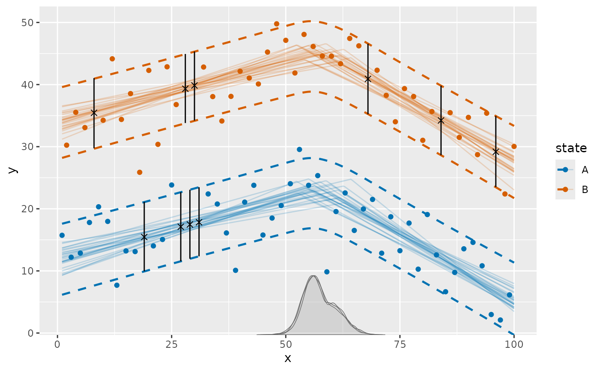
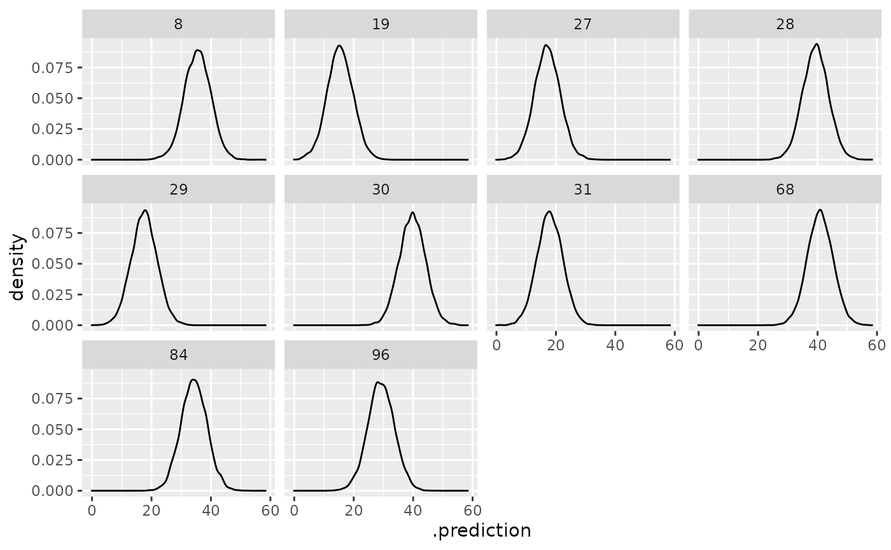

# Missing responses and imputation

`mcp` allows missing values in the response. JAGS treats the unknown
responses as latent variables and samples them together with the model
parameters. `mcp` retains those posterior imputation draws for later
use. This article shows how to inspect expected responses, posterior
imputations, and their uncertainty.

## An example with missing responses

The built-in example has a change in slope, a strong difference between
two states, scattered missing responses, and a short run of missing
responses. First, let’s fit the example and visualize it:

``` r

library(mcp)
library(dplyr)
library(ggplot2)
```

``` r

fit = mcp_example("missing")
```


The ordinary plot shows the observed responses and model estimates.
Missing responses are omitted. See below how they can be visualized.

The underlying data contain some missing responses in `y`:

``` r

fit$data |> filter(is.na(y))
```

    ##     y  x state
    ## 1  NA  8     B
    ## 2  NA 19     A
    ## 3  NA 27     A
    ## 4  NA 28     B
    ## 5  NA 29     A
    ## 6  NA 30     B
    ## 7  NA 31     A
    ## 8  NA 68     B
    ## 9  NA 84     B
    ## 10 NA 96     B

## Expected responses and predictions

[`predict()`](https://lindeloev.github.io/mcp/dev/reference/execute-mcp-model.md)
evaluates the posterior predictive distribution at the missing rows,
generating fresh simulated responses that include residual variation.
The predictions come from trends in non-missing data and what they
imply, given the observed covariates (`state` and `x`), for the missing
rows.

``` r

# Mean and 80% posterior predictive interval for missing data
imputed = predict(fit, width = 0.8) |>
  filter(is.na(y))
imputed
```

    ## # A tibble: 10 × 7
    ##        y     x state .mean   .sd .lower .upper
    ##    <dbl> <int> <fct> <dbl> <dbl>  <dbl>  <dbl>
    ##  1    NA     8 B      35.5  4.39  29.8    41.0
    ##  2    NA    19 A      15.5  4.38   9.95   21.1
    ##  3    NA    27 A      17.1  4.31  11.6    22.7
    ##  4    NA    28 B      39.3  4.34  33.8    44.9
    ##  5    NA    29 A      17.5  4.35  12.0    23.1
    ##  6    NA    30 B      39.9  4.33  34.2    45.3
    ##  7    NA    31 A      17.8  4.36  12.4    23.5
    ##  8    NA    68 B      40.9  4.47  35.2    46.6
    ##  9    NA    84 B      34.2  4.34  28.6    39.8
    ## 10    NA    96 B      29.2  4.45  23.5    34.9

[`fitted()`](https://lindeloev.github.io/mcp/dev/reference/execute-mcp-model.md)
has the same syntax as
[`predict()`](https://lindeloev.github.io/mcp/dev/reference/execute-mcp-model.md)
but returns the posterior *expected* response. Its intervals are
narrower because they do not include response variation:

``` r

# Mean and 80% posterior interval of the expected response at missing data
fitted(fit, width = 0.8) |>
  filter(is.na(y))
```

    ## # A tibble: 10 × 7
    ##        y     x state .mean   .sd .lower .upper
    ##    <dbl> <int> <fct> <dbl> <dbl>  <dbl>  <dbl>
    ##  1    NA     8 B      35.4 1.09    34.0   36.8
    ##  2    NA    19 A      15.5 0.831   14.5   16.6
    ##  3    NA    27 A      17.1 0.758   16.1   18.1
    ##  4    NA    28 B      39.4 0.758   38.4   40.3
    ##  5    NA    29 A      17.5 0.758   16.6   18.5
    ##  6    NA    30 B      39.8 0.759   38.8   40.7
    ##  7    NA    31 A      17.9 0.765   16.9   18.9
    ##  8    NA    68 B      40.9 1.16    39.5   42.5
    ##  9    NA    84 B      34.2 0.879   33.1   35.4
    ## 10    NA    96 B      29.2 1.28    27.6   30.9

## Visualize imputations on the model plot

Imputations are not added to
[`plot()`](https://lindeloev.github.io/mcp/dev/reference/plot.mcpfit.md)
automatically. Since
[`plot()`](https://lindeloev.github.io/mcp/dev/reference/plot.mcpfit.md)
returns a ggplot, it is easy to extend. Here an `×` marks the posterior
mean and a vertical line shows the central 80% imputation interval:

``` r

# Start with mcp plot with prediction interval. Use all draws for less Monte Carlo error.
plot(fit, color_by = "state", q_predict = c(0.1, 0.9)) +

  # Add imputation interval
  geom_linerange(
    data = imputed,
    aes(x = x, ymin = .lower, ymax = .upper),
    inherit.aes = FALSE,
    color = "black"
  ) +

  # Add "x" at posterior mean
  geom_point(
    data = imputed,
    aes(x = x, y = .mean),
    inherit.aes = FALSE,
    shape = 4,  # an "x"
    size = 2
  )
```



This deliberately distinguishes imputed values from the solid observed
points. You can change the interval width, marker, color, or add a
subset of the missing rows using ordinary `dplyr` and `ggplot2` code.

The plot above reduces each imputation distribution to an interval. Use
`summary = FALSE` when you need the individual draws instead. Here we
plot the imputation distribution for each missing row:

``` r

missing_draws = predict(fit, summary = FALSE) |>
  filter(is.na(y))

ggplot(missing_draws, aes(x = .prediction)) +
  geom_density() + 
  facet_wrap(~x)
```



### Making probabilistic statements about missing responses

Sometimes, the missing response is of direct interest. For example, you
may want to know the probability that a missing response is above a
threshold. You can use
[`predict()`](https://lindeloev.github.io/mcp/dev/reference/execute-mcp-model.md)
with `summary = FALSE` to get all posterior predictive draws and then
calculate probabilities of various statements. For example:

``` r

missing_draws |>
  filter(.data_row == 19) |>
  summarise(
    p_greater = mean(.prediction > 20),
    p_lower = mean(.prediction < 10),
    p_between = mean(.prediction > 10 & .prediction < 20)
  )
```

    ## # A tibble: 1 × 3
    ##   p_greater p_lower p_between
    ##       <dbl>   <dbl>     <dbl>
    ## 1     0.151   0.102     0.747

### Other continuous predictors

Plotting differs from
[`fitted()`](https://lindeloev.github.io/mcp/dev/reference/execute-mcp-model.md)
and
[`predict()`](https://lindeloev.github.io/mcp/dev/reference/execute-mcp-model.md)
in one respect: The smooth curves in
[`plot()`](https://lindeloev.github.io/mcp/dev/reference/plot.mcpfit.md)
are evaluated on data made by
[`interpolate_newdata()`](https://lindeloev.github.io/mcp/dev/reference/interpolate_newdata.md),
which keeps additional continuous predictors (i.e., predictors not
assigned an aesthetic) at their observed means by default, or at values
supplied through the `at`-argument. The plot caption reports these fixed
values.

The imputation markers above are different: `predict(fit)` evaluates the
original data, so every missing row uses its own predictor values. If
another continuous predictor is especially important, an imputation may
therefore lie away from a curve drawn at that predictor’s mean. This is
expected, just as an observed response with unusual predictor values may
lie away from that curve. Use `plot(fit, at = ...)` or
`interpolate_newdata(fit, at = ...)` or make separate plots when those
differences deserve emphasis.

## Missing data around change points

Sometimes the interest is not in recovering individual missing
responses, but in how gaps in the data affect inference about the change
points. To demonstrate this, `mcp_example("void")` takes the data from
`mcp_example("demo")` and removes the responses near both change points
(`25 < time < 42` and `70 < time < 80`). The top panel shows the fit to
the full data and the bottom panel the fit with the voids:

``` r

fit_void = mcp_example("void")
```


Notice that `mcp` can infer change points in regions with no missing
data. The greater uncertainty in the change point location between
segment 1 and 2 comes mostly from linear extrapolation between the
segments and less data. In principle, it could be known to great
precision if the segments’ trends were very well defined.

The location of the disjoined change between segment 2 and 3 is
different: the location is unknowable for disjoined segments in a void,
and the change point posterior reflects that. Any distance between data
is a void for disjoined segments. This can be seen in the uniform-like
change point posterior both for the large void (bottom panel) and the
simple between-datapoints void (top panel).

We can quantify how much of the change point posteriors is within each
actual void using
[`hypothesis()`](https://lindeloev.github.io/mcp/dev/reference/hypothesis.md):

``` r

hypothesis(fit_void, c(
  "cp_1 > 25 & cp_1 < 42",
  "cp_2 > 70 & cp_2 < 80"
))
```

    ## # A tibble: 2 × 7
    ##   hypothesis            mean  sd    lower upper  prob    BF
    ##   <chr>                 <lgl> <lgl> <lgl> <lgl> <dbl> <dbl>
    ## 1 cp_1 > 25 & cp_1 < 42 NA    NA    NA    NA    0.937    NA
    ## 2 cp_2 > 70 & cp_2 < 80 NA    NA    NA    NA    0.840    NA

## What else can be modeled?

Missing responses work with the usual `mcp` model features. For example,
you can:

- Include [continuous and categorical
  predictors](https://lindeloev.github.io/mcp/dev/articles/formulas.md)
  so imputations follow observed covariate information.
- Use [group-level
  effects](https://lindeloev.github.io/mcp/dev/articles/group_effects.md)
  so sparsely observed groups borrow information from the population and
  their available observations.
- [Model changing residual standard deviation with
  `sigma()`](https://lindeloev.github.io/mcp/dev/articles/dpar.md) so
  imputation uncertainty can vary over the predictor range.
- Use [binomial, Bernoulli, Poisson, or negative-binomial
  responses](https://lindeloev.github.io/mcp/dev/articles/families.md).
  Their imputations remain on the appropriate discrete response scale;
  binomial predictions can also be returned as rates.

The predictors required by the model must themselves be observed. `mcp`
currently imputes missing responses, not missing predictor values, and
it does not model the process that caused responses to be missing. As
with ordinary regression using incomplete outcomes, interpretation
relies on the missing responses being reasonably explained by the
observed predictors and model structure.

## Model evaluation and time-series histories

Missing rows are not treated as observed contributions to
[`log_lik()`](https://lindeloev.github.io/mcp/dev/reference/execute-mcp-model.md),
[`loo()`](https://lindeloev.github.io/mcp/dev/reference/loo.mcpfit.md),
or
[`waic()`](https://lindeloev.github.io/mcp/dev/reference/loo.mcpfit.md).
For ordinary non-AR/MA models, the remaining observed rows can still be
used for these calculations.

AR/MA models need extra care because a missing response can become part
of the history for later observations. `mcp` retains the JAGS draws so
[`fitted()`](https://lindeloev.github.io/mcp/dev/reference/execute-mcp-model.md)
and
[`predict()`](https://lindeloev.github.io/mcp/dev/reference/execute-mcp-model.md)
can reconstruct that history, but it does not currently integrate over
missing histories for pointwise likelihood calculations. Consequently,
[`log_lik()`](https://lindeloev.github.io/mcp/dev/reference/execute-mcp-model.md),
[`loo()`](https://lindeloev.github.io/mcp/dev/reference/loo.mcpfit.md),
and
[`waic()`](https://lindeloev.github.io/mcp/dev/reference/loo.mcpfit.md)
are unavailable when a missing response precedes some observed data.

The [time-series
article](https://lindeloev.github.io/mcp/dev/articles/arma.md) discusses
this. Use `predict(fit, conditional = FALSE)` or
`posterior_predict(fit, conditional = FALSE)` to generate fresh
replicated series recursively. Their histories are generated rather than
taken from the observed responses. The default predictions condition on
observed responses and retained imputations as histories, but still
generate fresh outcomes at every row.

## Original data versus new data

In AR/MA models, the retained JAGS draws belong to the missing rows in
the original fitted data and supply their histories. For the non-AR/MA
example in this article, predictions for genuinely new data are ordinary
posterior predictions, evaluated just like predictions at the missing
rows:

``` r

newdata = data.frame(
  x = c(20, 80),
  state = factor(c("A", "B"), levels = levels(fit$data$state))
)

predict(fit, newdata = newdata, width = 0.8)
```

    ## # A tibble: 2 × 6
    ##       x state .mean   .sd .lower .upper
    ##   <dbl> <fct> <dbl> <dbl>  <dbl>  <dbl>
    ## 1    20 A      15.7  4.32   10.2   21.3
    ## 2    80 B      35.9  4.38   30.3   41.5
