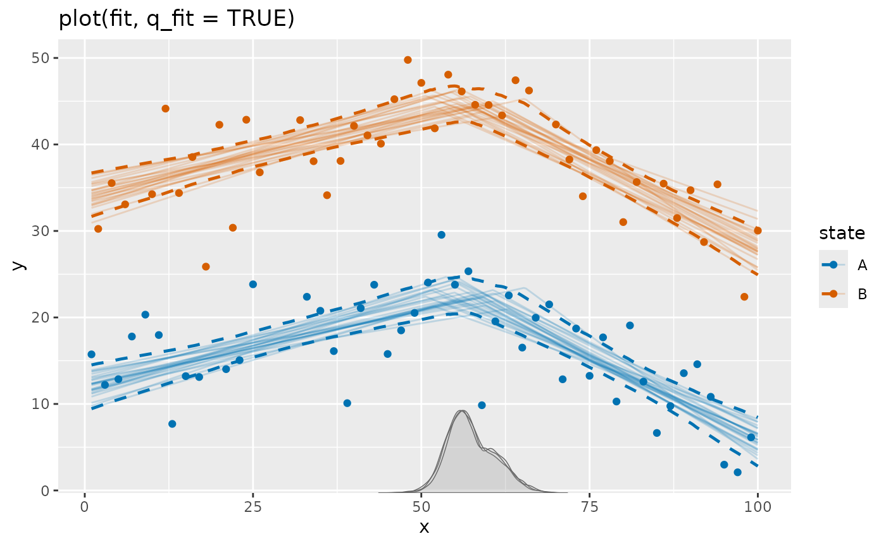

# Missing data

`mcp` allows missing values (`NA`) in the response. This article covers
two consequences of that:

1.  **Change points in voids:** Change points can be inferred in regions
    with no observed responses.
2.  **Imputing missing responses:** JAGS treats the missing responses as
    latent variables and samples them together with the model
    parameters. You can inspect expected responses with
    [`fitted()`](https://lindeloev.github.io/mcp/dev/reference/execute-mcp-model.md)
    and the imputation distribution with
    [`predict()`](https://lindeloev.github.io/mcp/dev/reference/execute-mcp-model.md).

``` r

library(mcp)
library(dplyr)
library(ggplot2)
```

## Inferring change points in voids

Sometimes the interest is not in recovering individual missing
responses, but in how gaps in the data affect inference about the change
points. To demonstrate this, `mcp_example("void")` takes the data from
`mcp_example("demo")` and sets the responses near both change points to
`NA` (`25 < time < 42` and `70 < time < 80`). The top panel shows the
fit to the full data and the bottom panel the fit with the voids:

``` r

fit_void = mcp_example("void", sample = "both")
```

    ## NA values detected in 'response'. JAGS will treat them as latent responses and impute them during sampling.



Notice that `mcp` can infer change points in regions with no observed
data. The first change point joins a plateau to a slope. Its location in
the void is mostly informed by extrapolating the two segments until they
meet, and the uncertainty is greater than in the full data because fewer
data inform these trends. In principle, it could be known to great
precision if the segments’ trends were very well defined.

The second change point is different because segment 3 is disjoined from
segment 2. There is nothing in the void that tells where the jump
happened, so the change point posterior is roughly uniform across the
void. This is true for any gap between data: the narrow gap between two
neighboring data points (top panel) also yields a uniform-like
posterior, just on a much smaller range.

We can quantify how much of each change point posterior is within its
void using
[`hypothesis()`](https://lindeloev.github.io/mcp/dev/reference/hypothesis.md).
Because we sampled the prior too (`sample = "both"`), it also returns a
Bayes factor (`BF`) for each interval, i.e., how much the data shifted
the odds of the change point being in the void:

``` r

hypothesis(fit_void, c(
  "cp_1 > 25 & cp_1 < 42",
  "cp_2 > 70 & cp_2 < 80"
))
```

    ## # A tibble: 2 × 7
    ##   hypothesis             mean    sd lower upper  prob    BF
    ##   <chr>                 <dbl> <dbl> <dbl> <dbl> <dbl> <dbl>
    ## 1 cp_1 > 25 & cp_1 < 42    NA    NA    NA    NA 0.935  46.6
    ## 2 cp_2 > 70 & cp_2 < 80    NA    NA    NA    NA 0.840  28.3

## Imputing missing responses

### An example with missing responses

The built-in example has a change in slope, a strong difference between
two states, scattered missing responses, and a short run of missing
responses:

``` r

fit = mcp_example("missing")
```

    ## NA values detected in 'y'. JAGS will treat them as latent responses and impute them during sampling.


The ordinary plot shows the observed responses and model estimates but
omits missing responses. [Below](#visualizing-imputations), we add them
to the plot. These are the rows with missing responses in `y`:

``` r

fit$data |> filter(is.na(y))
```

    ##     y  x state
    ## 1  NA  8     B
    ## 2  NA 19     A
    ## 3  NA 27     A
    ## 4  NA 28     B
    ## 5  NA 29     A
    ## 6  NA 30     B
    ## 7  NA 31     A
    ## 8  NA 68     B
    ## 9  NA 84     B
    ## 10 NA 96     B

### Expected responses and predictions

[`predict()`](https://lindeloev.github.io/mcp/dev/reference/execute-mcp-model.md)
evaluates the posterior predictive distribution at the missing rows,
generating fresh simulated responses that include residual variation.
The predictions come from trends in non-missing data and what they
imply, given the observed covariates (`state` and `x`), for the missing
rows. Without [`ar()`](https://rdrr.io/r/stats/ar.html) or `ma()` terms,
as here, these predictions have the same distribution as the JAGS
imputations, so we use them as imputations below.

``` r

# Mean and 80% posterior predictive interval for missing data
imputed = predict(fit, width = 0.8) |>
  filter(is.na(y))
imputed
```

    ## # A tibble: 10 × 7
    ##        y     x state .mean   .sd .lower .upper
    ##    <dbl> <int> <fct> <dbl> <dbl>  <dbl>  <dbl>
    ##  1    NA     8 B      35.4  4.41  29.8    41.0
    ##  2    NA    19 A      15.5  4.35   9.95   21.1
    ##  3    NA    27 A      17.1  4.34  11.6    22.6
    ##  4    NA    28 B      39.4  4.34  33.8    44.9
    ##  5    NA    29 A      17.5  4.34  12.0    23.0
    ##  6    NA    30 B      39.8  4.34  34.2    45.3
    ##  7    NA    31 A      17.9  4.34  12.4    23.4
    ##  8    NA    68 B      41.3  4.44  35.6    46.9
    ##  9    NA    84 B      34.6  4.36  29.0    40.1
    ## 10    NA    96 B      29.5  4.46  23.9    35.2

[`fitted()`](https://lindeloev.github.io/mcp/dev/reference/execute-mcp-model.md)
has the same syntax as
[`predict()`](https://lindeloev.github.io/mcp/dev/reference/execute-mcp-model.md)
but returns the posterior *expected* response. Its intervals are
narrower because they do not include response variation:

``` r

# Mean and 80% posterior interval of the expected response at missing data
fitted(fit, width = 0.8) |>
  filter(is.na(y))
```

    ## # A tibble: 10 × 7
    ##        y     x state .mean   .sd .lower .upper
    ##    <dbl> <int> <fct> <dbl> <dbl>  <dbl>  <dbl>
    ##  1    NA     8 B      35.4 1.08    34.0   36.8
    ##  2    NA    19 A      15.5 0.832   14.4   16.6
    ##  3    NA    27 A      17.1 0.761   16.1   18.1
    ##  4    NA    28 B      39.4 0.760   38.4   40.3
    ##  5    NA    29 A      17.5 0.761   16.5   18.5
    ##  6    NA    30 B      39.8 0.762   38.8   40.7
    ##  7    NA    31 A      17.9 0.768   16.9   18.9
    ##  8    NA    68 B      41.3 1.20    39.8   42.9
    ##  9    NA    84 B      34.6 0.890   33.4   35.7
    ## 10    NA    96 B      29.5 1.28    27.9   31.2

### Visualizing imputations

Imputations are not added to
[`plot()`](https://lindeloev.github.io/mcp/dev/reference/plot.mcpfit.md)
automatically. Since
[`plot()`](https://lindeloev.github.io/mcp/dev/reference/plot.mcpfit.md)
returns a ggplot, it is easy to extend. Here an `×` marks the posterior
mean and a vertical line shows the central 80% imputation interval:

``` r

# Start with mcp plot with prediction interval
plot(fit, color_by = "state", interval = "predict", width = 0.8) +

  # Add imputation interval
  geom_linerange(
    data = imputed,
    aes(x = x, ymin = .lower, ymax = .upper),
    inherit.aes = FALSE,
    color = "black"
  ) +

  # Add "x" at posterior mean
  geom_point(
    data = imputed,
    aes(x = x, y = .mean),
    inherit.aes = FALSE,
    shape = 4,  # an "x"
    size = 2
  )
```


This deliberately distinguishes imputed values from the solid observed
points. You can change the interval width, marker, color, or add a
subset of the missing rows using ordinary `dplyr` and `ggplot2` code.

The plot above reduces each imputation distribution to an interval. Use
`summary = FALSE` when you need the individual draws instead. Here we
plot the imputation distribution for each missing row:

``` r

missing_draws = predict(fit, summary = FALSE) |>
  filter(is.na(y))

ggplot(missing_draws, aes(x = .prediction)) +
  geom_density() + 
  facet_wrap(~x)
```


### Probabilistic statements about missing responses

Sometimes, the missing response is of direct interest. For example, you
may want to know the probability that a missing response is above a
threshold. You can use
[`predict()`](https://lindeloev.github.io/mcp/dev/reference/execute-mcp-model.md)
with `summary = FALSE` to get all posterior predictive draws and then
calculate probabilities of various statements. For example:

``` r

missing_draws |>
  filter(.row == 19) |>  # Row number 19 in original data
  summarise(
    p_greater = mean(.prediction > 20),
    p_lower = mean(.prediction < 10),
    p_between = mean(.prediction > 10 & .prediction < 20)
  )
```

    ## # A tibble: 1 × 3
    ##   p_greater p_lower p_between
    ##       <dbl>   <dbl>     <dbl>
    ## 1     0.146   0.105     0.749

### Imputations and other continuous predictors

Plotting differs from
[`fitted()`](https://lindeloev.github.io/mcp/dev/reference/execute-mcp-model.md)
and
[`predict()`](https://lindeloev.github.io/mcp/dev/reference/execute-mcp-model.md)
in one respect: The smooth curves in
[`plot()`](https://lindeloev.github.io/mcp/dev/reference/plot.mcpfit.md)
are evaluated on data made by
[`interpolate_newdata()`](https://lindeloev.github.io/mcp/dev/reference/interpolate_newdata.md),
which keeps additional continuous predictors (i.e., predictors not
assigned an aesthetic) at their observed means by default, or at values
supplied through the `at`-argument. The plot caption reports these fixed
values. See the [plotting
article](https://lindeloev.github.io/mcp/dev/articles/plotting.md) for
using
[`interpolate_newdata()`](https://lindeloev.github.io/mcp/dev/reference/interpolate_newdata.md)
to make your own plots.

The imputation markers above are different: `predict(fit)` evaluates the
original data, so every missing row uses its own predictor values. If
another continuous predictor is especially important, an imputation may
therefore lie away from a curve drawn at that predictor’s mean. This is
expected, just as an observed response with unusual predictor values may
lie away from that curve. Use `plot(fit, at = ...)` or
`interpolate_newdata(fit, at = ...)` or make separate plots when those
differences deserve emphasis.

## Supported models and limitations

### Supported model features

Missing responses work with the usual `mcp` model features. For example,
you can:

- Include [continuous and categorical
  predictors](https://lindeloev.github.io/mcp/dev/articles/formulas.md)
  so imputations follow observed covariate information.
- Use [group-level
  effects](https://lindeloev.github.io/mcp/dev/articles/group_effects.md)
  so sparsely observed groups borrow information from the population and
  their available observations.
- [Model changing residual standard deviation with
  `sigma()`](https://lindeloev.github.io/mcp/dev/articles/dpar.md) so
  imputation uncertainty can vary over the predictor range.
- Use [binomial, Bernoulli, Poisson, or negative-binomial
  responses](https://lindeloev.github.io/mcp/dev/articles/families.md).
  Their imputations remain on the appropriate discrete response scale;
  binomial predictions can also be returned as rates.

The predictors required by the model must themselves be observed. `mcp`
currently imputes missing responses, not missing predictor values, and
it does not model the process that caused responses to be missing. As
with ordinary regression using incomplete outcomes, interpretation
relies on the missing responses being reasonably explained by the
observed predictors and model structure.

### Model evaluation and time series

Missing rows are not treated as observed contributions to
[`log_lik()`](https://lindeloev.github.io/mcp/dev/reference/execute-mcp-model.md),
[`loo()`](https://lindeloev.github.io/mcp/dev/reference/loo.mcpfit.md),
or
[`waic()`](https://lindeloev.github.io/mcp/dev/reference/loo.mcpfit.md).
For ordinary non-AR/MA models, the remaining observed rows can still be
used for these calculations.

AR/MA models need extra care because a missing response can become part
of the history for later observations. `mcp` retains the JAGS draws so
[`fitted()`](https://lindeloev.github.io/mcp/dev/reference/execute-mcp-model.md)
and
[`predict()`](https://lindeloev.github.io/mcp/dev/reference/execute-mcp-model.md)
can reconstruct that history, but it does not currently integrate over
missing histories for pointwise likelihood calculations. Consequently,
[`log_lik()`](https://lindeloev.github.io/mcp/dev/reference/execute-mcp-model.md),
[`loo()`](https://lindeloev.github.io/mcp/dev/reference/loo.mcpfit.md),
and
[`waic()`](https://lindeloev.github.io/mcp/dev/reference/loo.mcpfit.md)
are unavailable when a missing response precedes some observed data.

The [time-series
article](https://lindeloev.github.io/mcp/dev/articles/arma.md) discusses
this. Use `predict(fit, arma = "replicate")` or
`posterior_predict(fit, arma = "replicate")` to generate fresh
replicated series recursively. Their histories are generated rather than
taken from the observed responses. The default predictions condition on
observed responses and retained imputations as histories, but still
generate fresh outcomes at every row.

### Predictions for new data

In AR/MA models, the retained JAGS draws belong to the missing rows in
the original fitted data and supply their histories. For the non-AR/MA
example in this article, predictions for genuinely new data are ordinary
posterior predictions, evaluated just like predictions at the missing
rows:

``` r

newdata = data.frame(
  x = c(20, 80),
  state = factor(c("A", "B"), levels = levels(fit$data$state))
)

predict(fit, newdata = newdata, width = 0.8)
```

    ## # A tibble: 2 × 6
    ##       x state .mean   .sd .lower .upper
    ##   <dbl> <fct> <dbl> <dbl>  <dbl>  <dbl>
    ## 1    20 A      15.7  4.35   10.2   21.3
    ## 2    80 B      36.3  4.36   30.7   41.8
