# Plotting

This article shows the plotting functions in `mcp`:
[`plot()`](https://lindeloev.github.io/mcp/dev/reference/plot.mcpfit.md)
for fitted values and predictions,
[`plot_dpar()`](https://lindeloev.github.io/mcp/dev/reference/plot.mcpfit.md)
for distributional parameters,
[`plot_pars()`](https://lindeloev.github.io/mcp/dev/reference/plot_pars.md)
for parameters, and
[`pp_check()`](https://lindeloev.github.io/mcp/dev/reference/pp_check.md)
for posterior predictive checks. All of them return `ggplot2` objects,
so they can be extended with regular `ggplot2` code. The last section
shows how to make your own plots from the same building blocks that
[`plot()`](https://lindeloev.github.io/mcp/dev/reference/plot.mcpfit.md)
uses.

We use the bundled `demo_fit`, which is a three-segment model of the
“demo” dataset:

``` r

library(mcp)
library(ggplot2)
demo_fit$model
```

    ## List of 3
    ##  $ response ~ 1
    ##  $ ~0 + time
    ##  $ ~1 + time

## The default plot

``` r

plot(demo_fit)
```

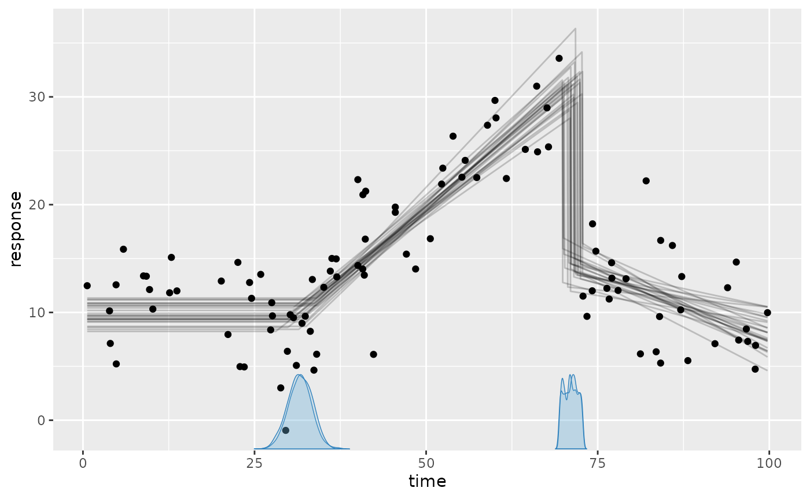

This shows:

- The black dots are the data.
- The gray lines are 25 joint posterior draws of the fitted values
  (expected response).
- The blue curves on the x-axis are the posterior densities of the
  change points, one per chain.

### Tweaking the plot

Showcasing some common arguments:

``` r

set.seed(42)  # Make lines replicable
plot(
  demo_fit,
  lines = 50,  # more fitted lines. Hide using `lines = 0`
  interval = c(
    "fitted",  # Show posterior fitted (red) interval
    "predict"  # Show posterior predictive (green) intervals
  ),
  width = 0.8, # Interval width
  cp_dens = FALSE  # Hide change point densities
)
```

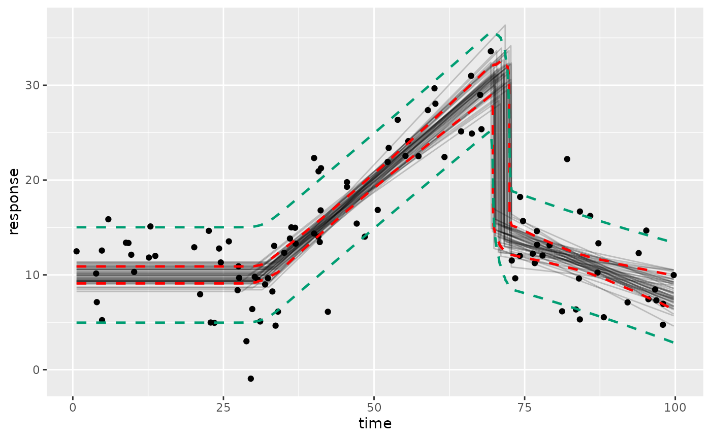

Here, the intervals are computed using `ndraws = 500` draws by default.
Set `ndraws = NULL` to use all draws, which reduces Monte Carlo error at
the cost of speed. For other quantiles, see [making your own
plots](#making-your-own-plots) below.

Use `geom_data = "line"` for time series or `geom_data = FALSE` to hide
the data.

Since the plots are `ggplot2` objects, you can add themes, labels, etc.:

``` r

plot(demo_fit) +
  theme_bw(13) +
  labs(title = "Three segments", x = "Time (s)", y = "Response (ms)")
```

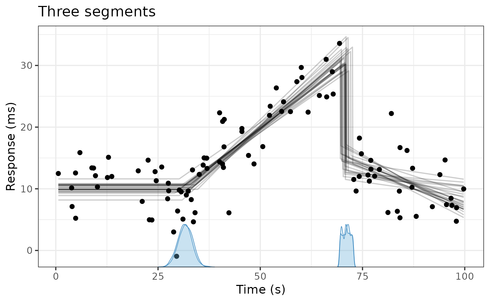

### Prior predictive

Use `prior = TRUE` to see the prior predictive instead. This is a quick
way to check what your priors imply when “put through” the model:

``` r

plot(demo_fit, prior = TRUE, lines = 100)
```

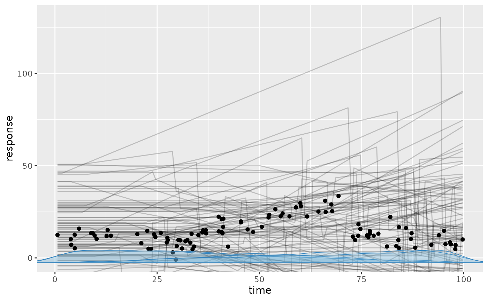

### Categorical predictors, groups, and other predictors

In models with a categorical predictor,
[`plot()`](https://lindeloev.github.io/mcp/dev/reference/plot.mcpfit.md)
draws a curve for each level and colors them automatically. Here, we use
the “multiple” example, which has a categorical predictor (`state`) and
a continuous predictor (`z`) in addition to the change-point variable
(`x`):

``` r

fit = mcp_example("multiple", plot = FALSE)
```

``` r

fit$model
```

    ## List of 3
    ##  $ y ~ 1 + x:state + z
    ##  $ ~1 + x + state
    ##  $ ~0 + I(x^2) + same(state)

``` r

plot(fit)
```

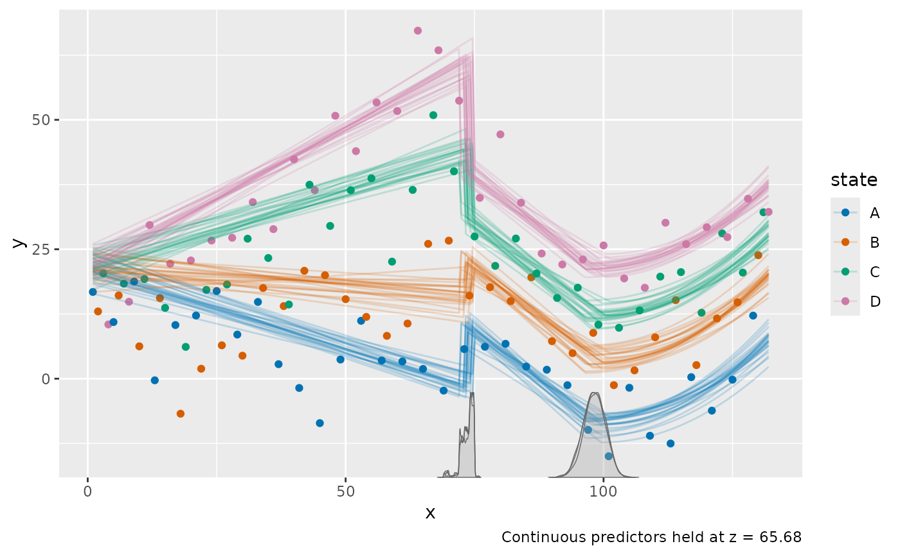

Use `color_by` and `facet_by` to choose which categorical predictors or
grouping columns to map to color and facets. For example,
`plot(fit, facet_by = "state")` shows each state in a separate panel.
With several categorical predictors, all of them must be identified by
either color or facets, unless you set `color_by = NULL`.

Additional continuous predictors (`z` here) are held at their observed
mean, as stated in the plot caption. Use `at` to evaluate at other
values:

``` r

plot(fit, facet_by = "state", at = list(z = 0), interval = "fitted")
```

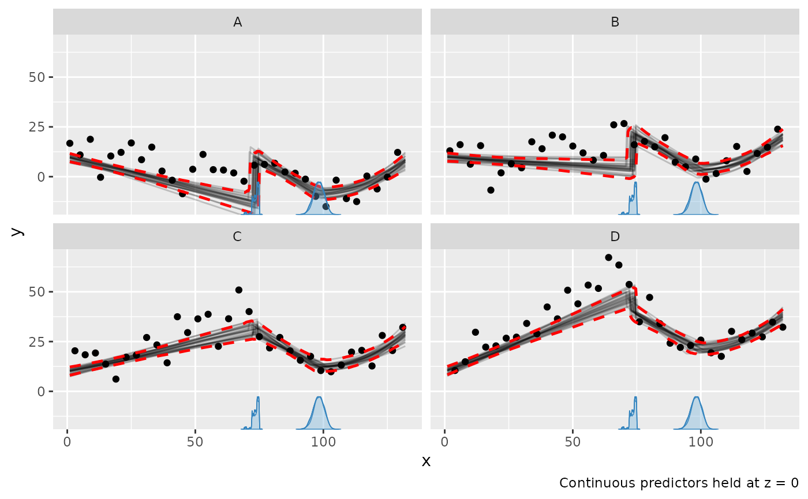

Note that the data points are not adjusted, so they are shown at their
observed `z`.

For [group-level
effects](https://lindeloev.github.io/mcp/dev/articles/group_effects.md),
use `facet_by` to show the group-specific curves, e.g.,
`plot(fit, facet_by = "id")` for a model with `(1 | id)`. Without it,
the population-level curve is shown.

### Scales

Use `scale = "linear"` to plot on the scale of the linear predictor,
e.g., the log-odds for
[`binomial()`](https://rdrr.io/r/stats/family.html) models. For
[`binomial()`](https://rdrr.io/r/stats/family.html) and
[`bernoulli()`](https://lindeloev.github.io/mcp/dev/reference/bernoulli.md)
models,
[`plot()`](https://lindeloev.github.io/mcp/dev/reference/plot.mcpfit.md)
shows success proportions by default; set `rate = FALSE` to show counts
(see the [binomial
article](https://lindeloev.github.io/mcp/dev/articles/binomial.md)).

## Distributional parameters

[`plot_dpar()`](https://lindeloev.github.io/mcp/dev/reference/plot.mcpfit.md)
plots a distributional parameter, such as `sigma`, along the
change-point variable. It takes most of the same arguments as
[`plot()`](https://lindeloev.github.io/mcp/dev/reference/plot.mcpfit.md),
but only `interval = "fitted"`. Here, we use the “sigma” example, where
the residual standard deviation changes at both change points:

``` r

fit_sigma = mcp_example("sigma", plot = FALSE)
```

``` r

fit_sigma$model
```

    ## List of 3
    ##  $ y ~ 1
    ##  $ ~0 + sigma(1 + x)
    ##  $ ~0 + x

``` r

plot_dpar(fit_sigma, dpar = "sigma", interval = "fitted")
```

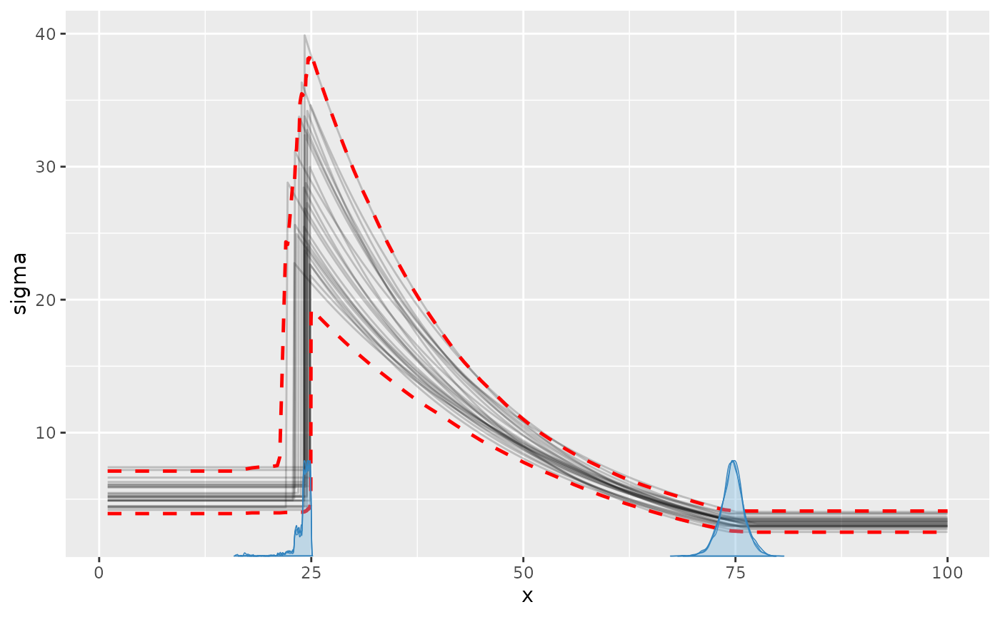

The posterior predictive interval in
[`plot()`](https://lindeloev.github.io/mcp/dev/reference/plot.mcpfit.md)
shows the same change in `sigma` on the scale of the data:

``` r

plot(fit_sigma, interval = "predict")
```

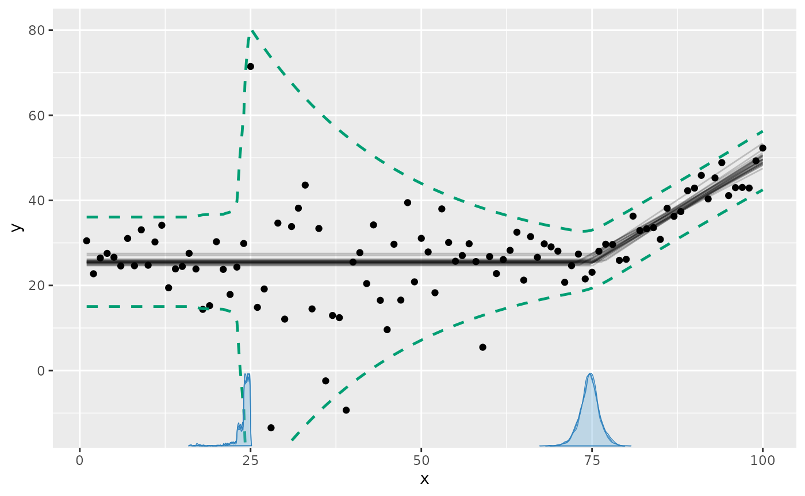

Other distributional parameters, e.g., `"ar1"` or `"shape"`, are plotted
the same way. [Read more about modeling distributional
parameters](https://lindeloev.github.io/mcp/dev/articles/dpar.md).

## Parameters

[`plot_pars()`](https://lindeloev.github.io/mcp/dev/reference/plot_pars.md)
plots the posterior (or prior with `prior = TRUE`) of parameters using
`bayesplot`. The default is a “combo” of densities and trace plots,
which is useful for checking convergence:

``` r

plot_pars(demo_fit, pars = c("cp_1", "cp_2"))
```

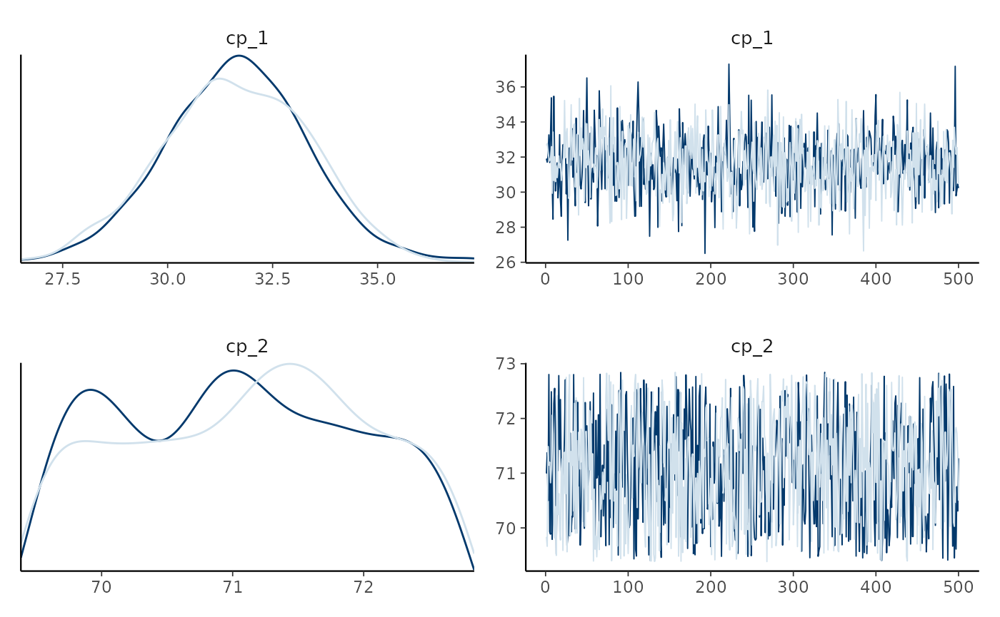

Use `type` to choose other `bayesplot::mcmc_*` plots, e.g.,
`type = "dens_overlay"`, `type = "trace"`, or `type = "hex"` (for the
joint distribution of two parameters). `pars = "population"` (default)
selects all population-level parameters and `pars = "group"` selects all
group-level deviations; `regex_pars` selects parameters by name.

## Posterior predictive checks

[`pp_check()`](https://lindeloev.github.io/mcp/dev/reference/pp_check.md)
compares the data to responses simulated from the posterior using
`bayesplot::ppc_*`:

``` r

pp_check(demo_fit)
```

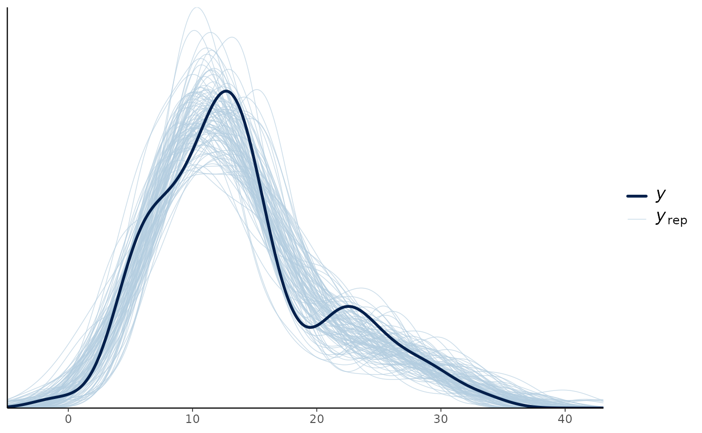

Use `type` for other checks, e.g.,
`pp_check(fit, type = "ecdf_overlay")`. Use `facet_by` to make a panel
for each level of a categorical predictor or grouping column, e.g., for
each `state` in the “multiple” example from above:

``` r

pp_check(fit, facet_by = "state")
```

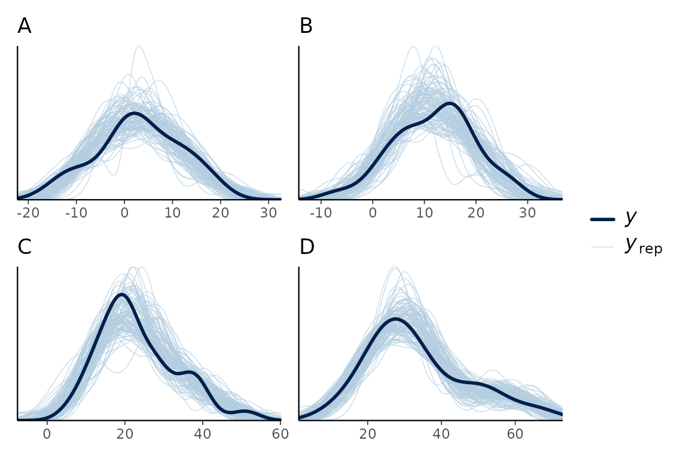

## Making your own plots

[`plot()`](https://lindeloev.github.io/mcp/dev/reference/plot.mcpfit.md)
evaluates
[`fitted()`](https://lindeloev.github.io/mcp/dev/reference/execute-mcp-model.md)
and
[`predict()`](https://lindeloev.github.io/mcp/dev/reference/execute-mcp-model.md)
on an x-grid made by
[`interpolate_newdata()`](https://lindeloev.github.io/mcp/dev/reference/interpolate_newdata.md).
This grid has extra resolution around the change points, all
combinations of categorical predictor levels, and additional continuous
predictors held at their observed means (or at `at`). You can use the
same building blocks to make any plot you want:

``` r

newdata = interpolate_newdata(demo_fit)
head(newdata)
```

    ## # A tibble: 6 × 1
    ##    time
    ##   <dbl>
    ## 1 0.619
    ## 2 1.62 
    ## 3 2.62 
    ## 4 3.62 
    ## 5 4.62 
    ## 6 5.62

For example, below is a ribbon of the 95% central interval of the fitted
values. In addition, a quantile (median) is added using
`summary = FALSE` and a “manual” summary.

``` r

# Fitted and intervals
fitted_summary = fitted(demo_fit, newdata = newdata)

# A custom quantile (here median)
fitted_median = fitted(demo_fit, newdata = newdata, summary = FALSE) |>
  dplyr::summarise(.epred = median(.epred), .by = time)

# Plot!
ggplot(fitted_summary, aes(x = time, y = .mean)) +
  geom_ribbon(aes(ymin = .lower, ymax = .upper), alpha = 0.3) +
  geom_line(linewidth = 1) +
  geom_line(aes(y = .epred), data = fitted_median, color = "red") +
  geom_point(aes(y = response), data = demo_fit$data)
```

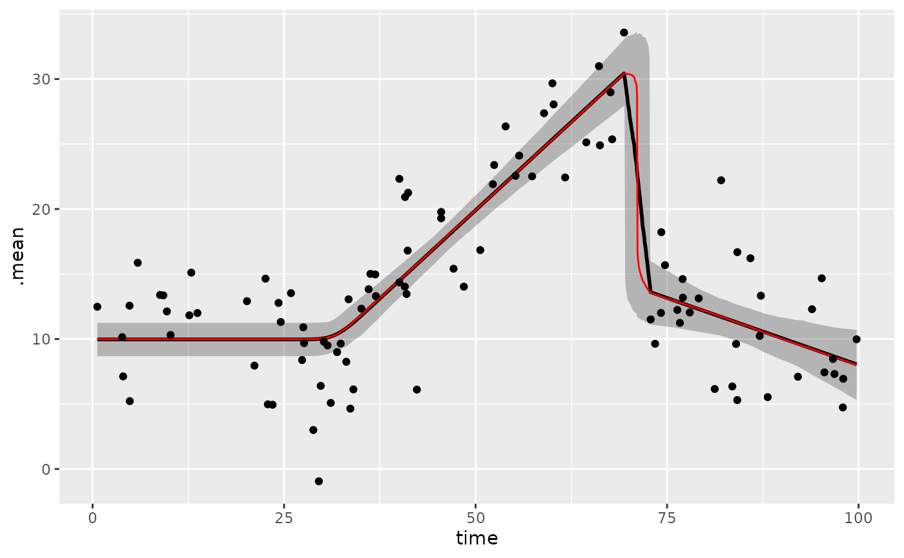

You can add the same layer to
[`plot()`](https://lindeloev.github.io/mcp/dev/reference/plot.mcpfit.md),
e.g.,
`plot(demo_fit) + geom_line(aes(x = time, y = .epred), data = fitted_median, inherit.aes = FALSE)`.
`inherit.aes = FALSE` is needed because
[`plot()`](https://lindeloev.github.io/mcp/dev/reference/plot.mcpfit.md)
maps internal columns that are not in `fitted_median`.

The draws follow `tidybayes` conventions (`.draw`, `.epred`,
`.prediction`), so you can also use `tidybayes` and `ggdist` to
summarise and plot them, e.g., multiple interval widths:

``` r

library(tidybayes)
predict(demo_fit, newdata = newdata, summary = FALSE) |>
  ggplot(aes(x = time, y = .prediction)) +
  stat_lineribbon(.width = c(0.5, 0.8, 0.95), alpha = 0.5) +
  geom_point(aes(y = response), data = demo_fit$data) +
  scale_fill_brewer()
```

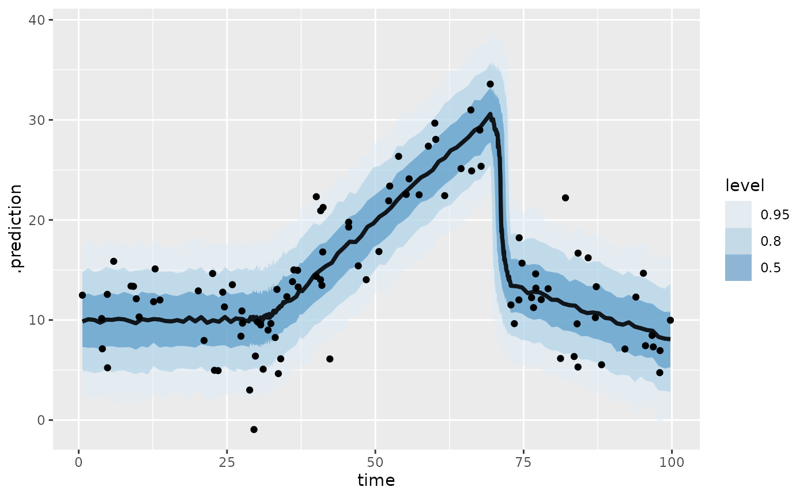

See also the [fits and predictions
article](https://lindeloev.github.io/mcp/dev/articles/predict.md) for
out-of-sample predictions and forecasting with future change points, and
the [missing responses
article](https://lindeloev.github.io/mcp/dev/articles/missing.md) for
adding imputations to
[`plot()`](https://lindeloev.github.io/mcp/dev/reference/plot.mcpfit.md).
