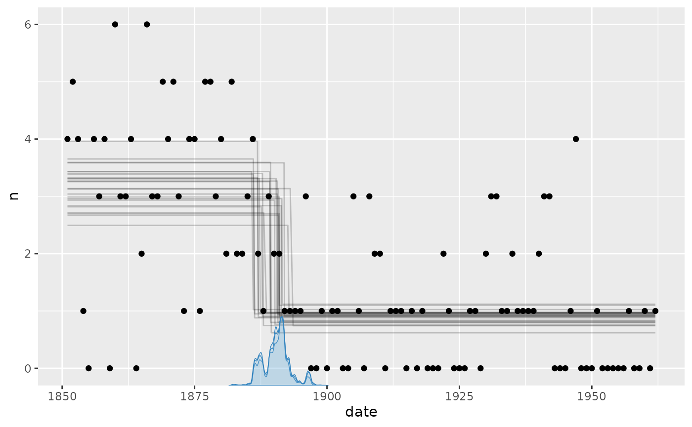
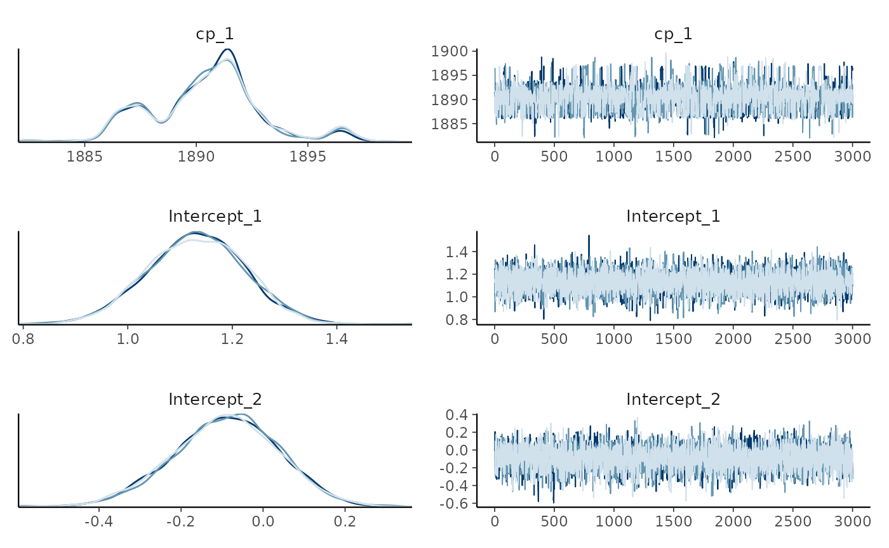
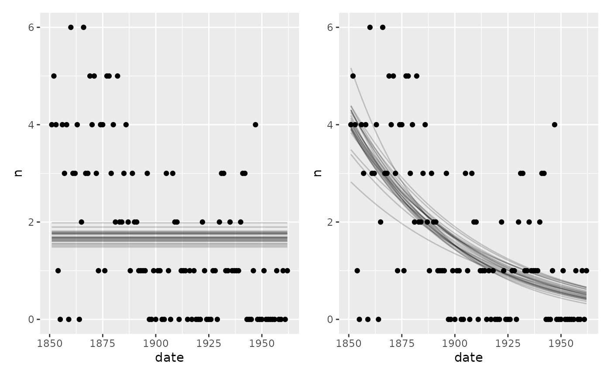

# Poisson and negative-binomial change point analysis

The Poisson and negative-binomial distributions model counts observed
within comparable units of time, space, or exposure. The worked example
below uses Poisson regression; a later section explains the additional
`shape` parameter and priors in
[`negbinomial()`](https://lindeloev.github.io/mcp/dev/reference/negbinomial.md).

## Coal mining disasters

A dataset on coal mining disasters has grown very popular in the change
point literature (available in
[`boot::coal`](https://rdrr.io/pkg/boot/man/coal.html)). It contains a
timestamp of each coal mining disaster from 1851 to 1962. By counting
the number of events within each year (fixed time frame), we have
something very Poisson-friendly. Note that years without disasters must
be included as zeros:

``` r

# Number of disasters by year, including years with zero disasters (no data rows)
year = factor(floor(boot::coal$date), levels = 1851:1962)
df = data.frame(date = 1851:1962, n = as.vector(table(year)))

# See it
head(df)
```

    ##   date n
    ## 1 1851 4
    ## 2 1852 5
    ## 3 1853 4
    ## 4 1854 1
    ## 5 1855 0
    ## 6 1856 4

The number of events (`n`) as a function of year (`date`) is typically
modeled as a change between two intercepts. This is very simple to do in
`mcp`:

``` r

library(mcp)
future::plan(future::multisession, workers = 3)
```

``` r

model = list(
  n ~ 1,  # intercept-only
  ~ 1  # intercept-only
)

fit = mcp(model, data = df, family = poisson(), par_x = "date")
```

Let us see the two intercepts (lambda in log-units) and the change point
(in years):

``` r

result = summary(fit)
result
```

    ## Family: poisson
    ## Links: mu = log
    ## Draws: 9000 (3 chains with iter = 3000)
    ## Segments:
    ##   1: n ~ 1
    ##   2: ~ 1
    ## 
    ## Change point parameters:
    ##    parameter     mean    sd    lower    upper rhat ess_bulk ess_tail
    ##  cp_1        1890.5   2.5   1886.1   1896.5   1.00     1944      990
    ## 
    ## Population-level parameters:
    ##    parameter     mean    sd    lower    upper rhat ess_bulk ess_tail
    ##  Intercept_1    1.131 0.094    0.944    1.313 1.00     4302     4741
    ##  Intercept_2   -0.09  0.13    -0.35     0.15  1.00     4472     5006

We can see that the model ran well with good convergence and large
effective sample sizes. At a first glance, the change point is estimated
to lie between the years 1886 and 1897 (95% interval).

Let us take a more direct look, using the default `mcp` plot:

``` r

plot(fit)
```



It seems to fit the data well, but we can see that the change point
probability “lumps” around particular data points. Years with a very low
number of disasters abruptly increase the probability that the change to
a lower disaster rate has taken place. The posterior distributions of
change points regularly take these “weird” forms, i.e., not
well-described by our toolbox of parameterized distributions.

We can see this more clearly if plotting the posteriors. We include a
traceplot too, just to check convergence visually.

``` r

plot_pars(fit)
```



## Priors for Poisson models

*[Brief overview of all default
priors](https://lindeloev.github.io/mcp/dev/articles/default_priors.html#summary-reference-table)*

[`poisson()`](https://rdrr.io/r/stats/family.html) defaults to
`link = 'log'`, meaning that we have to exponentiate the estimates to
get the “raw” Poisson parameter \lambda. \lambda has the nice property
of being the mean number of events. So the rate is around 3.1 disasters
per year in segment 1 and 0.91 in segment 2. Exponentiating the
posterior mean of the log-rate gives approximately the posterior median
of \lambda, not its mean. For the posterior mean, exponentiate the draws
before averaging, e.g., `mean(exp(as_draws_df(fit)$Intercept_1))`, or
use `fitted(fit)`.

The intercept prior is a normal distribution centered on the median of
`log(n)`, with zeros replaced by 0.1 (as in `brms`), and scale equal to
the maximum of 2.5 and its MAD. Replacing zeros keeps the log finite and
the minimum scale avoids an accidentally narrow prior.

Coefficients are [autoscaled as in
`rstanarm`](https://lindeloev.github.io/mcp/dev/articles/default_priors.html#default-priors-on-regression-parameters),
e.g., `dnorm(0, 2.5 / sd(column))`, and group-level SDs default to
half-normal priors. These normal priors avoid the infinite expected
counts that heavier Student-t tails imply under the log link ([read
more](https://lindeloev.github.io/mcp/dev/articles/default_priors.html#deviations)).

``` r

prior_summary(fit)
```

    ## # A tibble: 3 × 5
    ##   parameter   segment dpar  prior             bounds               
    ##   <chr>         <int> <chr> <chr>             <chr>                
    ## 1 cp_1              2 NA    dunif(1851, 1962) [1851, 1962], ordered
    ## 2 Intercept_1       1 mu    dnorm(0, 2.5)     none                 
    ## 3 Intercept_2       2 mu    dnorm(0, 2.5)     none

The default prior on the change point restricts it to the observed
range. The coefficient priors are deliberately broad defaults, so update
them with more informed priors for your particular case when possible,
e.g.:

``` r

prior = list(
  cp_1 = "dnorm(1900, 30) T(min(date), 1925)"
)
fit_with_prior = mcp(model, data = df, family = poisson(), prior = prior, par_x = "date")
```

## Negative-binomial extension

[`negbinomial()`](https://lindeloev.github.io/mcp/dev/reference/negbinomial.md)
uses log links for its conditional mean `mu` and, when modeled, its
overdispersion `shape`, where \operatorname{Var}(y) = \mu + \mu^2 /
\mathit{shape}. Its mean priors are the same as for
[`poisson()`](https://rdrr.io/r/stats/family.html).

When no `shape()` formula is supplied, `shape_1` is the shape itself
(like `sigma_1` in [`gaussian()`](https://rdrr.io/r/stats/family.html))
with an inverse-gamma(0.4, 0.3) prior, matching `brms`. It covers both
strong overdispersion and the large-shape Poisson limit.

An explicit `shape()` formula models log-shape. Harmonizing with
log-mean coefficients, its intercept and contrasts default to
`dnorm(0, 2.5)` and slopes to `dnorm(0, 2.5 / sd(column))` (group SDs
default to `dnorm(0, ...) T(0, )`). Where `brms` uses flat coefficients
and a Student-t intercept, `mcp` uses proper normal priors to avoid
heavy tails that pull shape toward extreme overdispersion. Shape
regression can be weakly identified, so informed priors may be useful.

## Modeling rates using `offset()`

When modeling event counts where exposure (e.g., person-years, area, or
population size) varies across observations, you can model rates \lambda
= \text{Count} / \text{exposure} on the log link by supplying
`offset(log(exposure))`:

``` r

# Example: Event counts over varying observation durations (as here) or population
model = list(
  events ~ 1 + year + offset(log(exposure)),  # Segment 1
  ~ 1 + year + offset(log(exposure))          # Segment 2
)

fit = mcp(model, data = df, family = poisson())  # implicit link = "log"
```

[`fitted()`](https://lindeloev.github.io/mcp/dev/reference/execute-mcp-model.md)
returns expected counts given each row’s exposure. To get expected rates
per unit of exposure, set the exposure to 1 in `newdata`, so that the
offset is \log(1) = 0:

``` r

fitted(fit, newdata = transform(df, exposure = 1))
```

This works the same way for
[`predict()`](https://lindeloev.github.io/mcp/dev/reference/execute-mcp-model.md),
which then returns predicted counts at unit exposure. The
`fitted(..., rate = TRUE)` argument does not apply to Poisson or
negative-binomial models; it is only for binomial models, where it
converts counts to proportions of trials.

Adding a categorical predictor to the model, you can also model rate
ratios. When an offset is present, `mcp` automatically shifts the
default intercept prior from centering on observed log-counts to
observed log-rates (\log(y) - \text{offset}), keeping the minimum scale
at 2.5.

> **Note on `par_x` vs. cumulative exposure:**  
> The offset is evaluated per row as local exposure for that
> observation. If `par_x` represents continuous cumulative time from an
> origin (e.g., \[0, t_i\]), using `offset(log(par_x))` does **not**
> integrate piecewise rates across prior segments; instead, the current
> segment’s rate is applied to the total duration. If your data consists
> of discrete time intervals (bins) of duration \Delta t_i, using
> `offset(log(delta_t))` is valid.

## Model comparison

Despite the popularity of this dataset, a question rarely asked is what
the evidence is that there is a change point at all. Let us fit two
models without change points and use approximate leave-one-out
cross-validation to see how the predictive performance of the two models
compare.

A flat model and a one-decay model. The intercept in `mcp` is at
`date = 0`, far from the data, so we measure the decay from the first
year (`I(date - 1851)`) to reduce the posterior correlation between
intercept and slope. This helps sampling:

``` r

# Fit an intercept-only model
fit_flat = mcp(list(n ~ 1), data = df, family=poisson(), par_x = "date")
fit_decay = mcp(list(n ~ 1 + I(date - 1851)), data = df, family = poisson(), par_x = "date")


plot(fit_flat) + plot(fit_decay)
```



Now we compute and compare the LOO ELPDs:

``` r

fit_loo = loo(fit)
```

    ## Warning: Some Pareto k diagnostic values are too high. See help('pareto-k-diagnostic') for details.

``` r

fit_flat_loo = loo(fit_flat)
fit_decay_loo = loo(fit_decay)
```

``` r

loo::loo_compare(fit_loo, fit_flat_loo, fit_decay_loo)
```

    ##   model elpd_diff se_diff p_worse       diag_diff      diag_elpd
    ##  model1       0.0     0.0      NA                 4 k_psis > 0.7
    ##  model3      -3.2     3.6    0.82 |elpd_diff| < 4               
    ##  model2     -32.9     8.3    1.00

    ## 
    ## Diagnostic flags present.
    ## See ?`loo-glossary` (sections `diag_diff` and `diag_elpd`)
    ## or https://mc-stan.org/loo/reference/loo-glossary.html.

The flat model is clearly worse, with `elpd_diff / se_diff` around 4, so
the disaster rate did decrease. The change point model is preferred over
the decay model, but the difference is smaller than its standard error.
The `diag_elpd` column also flags a few observations with high Pareto k
values in the change point model, so its PSIS-LOO estimate is less
reliable. Taken together, the data cannot clearly distinguish an abrupt
change from a gradual decay. Another approach is to look at the model
weights:

``` r

loo_list = list(fit_loo, fit_flat_loo, fit_decay_loo)
loo::loo_model_weights(loo_list, method="pseudobma")
```

    ## Method: pseudo-BMA+ with Bayesian bootstrap
    ## ------
    ##        weight
    ## model1 0.794 
    ## model2 0.000 
    ## model3 0.206

Again, the change point model is preferred and the weights show the same
ranking as implied by `loo_compare`, but the decay model retains a
non-negligible weight.

## JAGS code for the Poisson example

Here is the JAGS code for the full Poisson change-point model above.

``` r

fit$jags_code
```

    ## model {
    ##   # Change points
    ##   cp_0 = min(date)
    ##   cp_1 ~ dunif(cp_0, cp_2)  # Uniform within the observed range of date
    ##   cp_2 = max(date)
    ## 
    ##   # Priors for population-level effects
    ##   Intercept_1 ~ dnorm(0, 1/(2.5)^2)  # Robustly centered log-count intercept with a minimum scale of 2.5
    ##   Intercept_2 ~ dnorm(0, 1/(2.5)^2)  # Robustly centered log-count intercept with a minimum scale of 2.5
    ## 
    ##   # Model and likelihood
    ##   for (i_ in 1:length(date)) {
    ##     # date measured from each segment's change point
    ##     x_local_1_[i_] = min(date[i_], cp_1)
    ##     x_local_2_[i_] = min(date[i_], cp_2) - cp_1
    ##     
    ##     # Formula for mu
    ##     link_mu_[i_] =
    ##       (date[i_] >= cp_0) * (date[i_] < cp_1) * inprod(rhs_matrix_[i_, c(1)], c(Intercept_1)) * 1 + 
    ##       (date[i_] >= cp_1) * inprod(rhs_matrix_[i_, c(2)], c(Intercept_2)) * 1
    ## 
    ##     # Likelihood for family = poisson()
    ##     mu_[i_] = exp(link_mu_[i_])
    ##     n[i_] ~ dpois(mu_[i_])
    ##   }
    ## }
