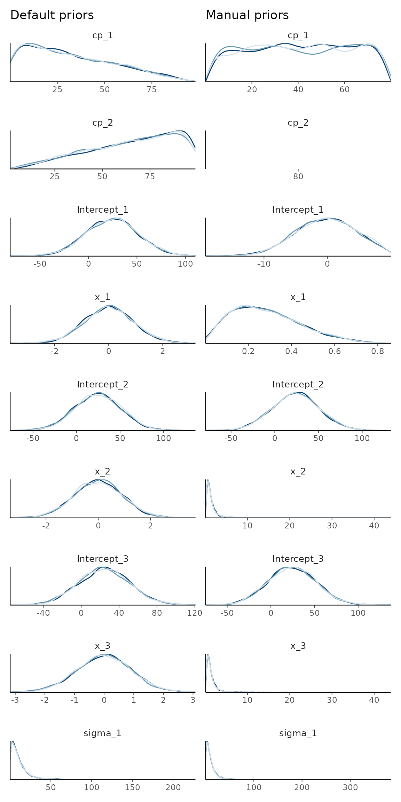
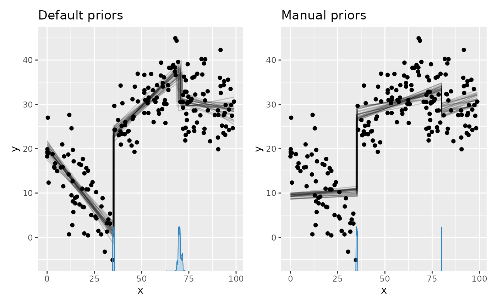
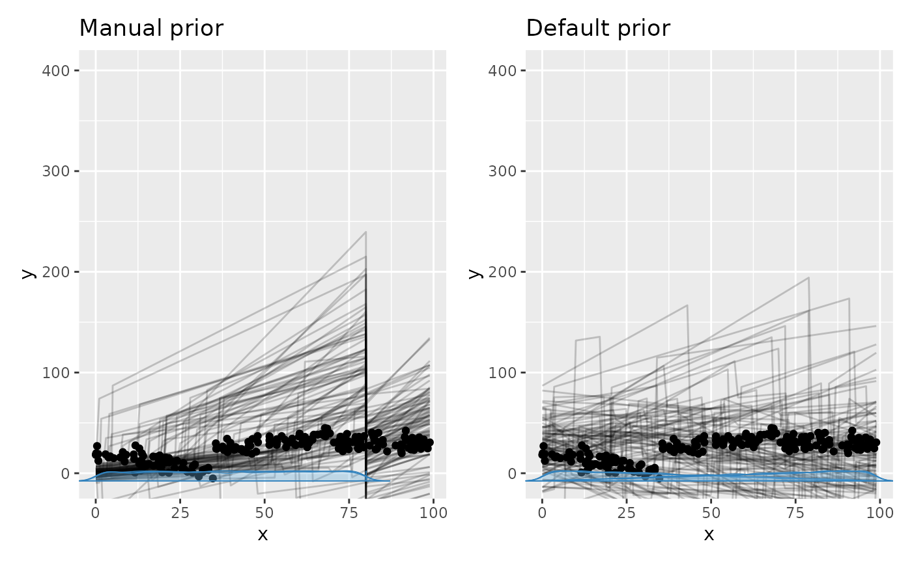

# Working with priors

*NOTE: the JAGS-specific prior interface below is likely to be
deprecated in the future, when additional backends are added beyond
JAGS.*

This article is about setting your own priors.

To learn more about priors when you do *not* set them yourself, read
more about the [mcp default
priors](https://lindeloev.github.io/mcp/dev/articles/default_priors.md).
Briefly, `mcp` assigns default priors to all parameters that you do not
set. These are the conventional defaults of `rstanarm` for intercepts
and coefficients and of `brms` for scale parameters, with `mcp`-specific
defaults for change points and autocorrelation. Inspect them using
`prior_summary(fit)`.

## Setting a prior

`mcp` takes priors in the form of a named list. The names are the
parameter names, and the values are distribution strings, fixed values,
or the names of other parameters. Here is a fairly complicated example,
to demonstrate the various ways priors can be used:

``` r

model = list(
  y ~ 1 + x,  # Intercept_1 + x_1
  ~ 1 + x,  # cp_1, Intercept_2, and x_2
  ~ 1 + x  # cp_2
)

prior = list(
  Intercept_1 = "dnorm(0, 5) T(, 10)",  # Intercept; less than 10
  x_1 = "dbeta(2, 5)",  # slope: beta with right skew
  cp_1 = "dnorm(30, 10)",  # change point around 30 (and before cp_2)
  x_2 = "dt(0, 1, 3) T(x_1, )",  # slope 2 > slope 1 and t-distributed
  cp_2 = 80,  # A constant (set; not estimated)
  x_3 = "x_2"  # same slope as x_2 (use same() instead; see below)
  # Intercept_2 and Intercept_3 not specified. Use default.
)
```

Distribution strings use JAGS names and argument order, including
[`T()`](https://rdrr.io/r/base/logical.html) truncation, so JAGS
distributions are generally allowed (see the [JAGS user
manual](https://sourceforge.net/projects/mcmc-jags/files/Manuals/4.x/jags_user_manual.pdf)).
However, they are not JAGS code: `mcp` uses conventional scales instead
of JAGS precision, i.e., SD for
[`dnorm()`](https://rdrr.io/r/stats/Normal.html), SD on the log scale
for [`dlnorm()`](https://rdrr.io/r/stats/Lognormal.html) (`sdlog` in
[`stats::dlnorm()`](https://rdrr.io/r/stats/Lognormal.html)), and scale
for [`dt()`](https://rdrr.io/r/stats/TDist.html), `ddexp()`, and
[`dlogis()`](https://rdrr.io/r/stats/Logistic.html). When generating
JAGS code, `mcp` converts these to inverse variance for
[`dnorm()`](https://rdrr.io/r/stats/Normal.html),
[`dt()`](https://rdrr.io/r/stats/TDist.html), and
[`dlnorm()`](https://rdrr.io/r/stats/Lognormal.html), and inverse scale
for `ddexp()` and [`dlogis()`](https://rdrr.io/r/stats/Logistic.html).
You can inspect the translation by comparing `fit$prior` with
`fit$jags_code`.

Other notes:

- Change points are always ordered (`cp_1 < cp_2 < ...`), whatever their
  priors. See [priors on change points](#cp_prior).

- `mcp` allows inserting data-dependent terms: for example, `min(x)`,
  `max(x)`, `mean(y)`, `median(y)`, `sd(y)`, `mad(y)`,
  `max(x) - min(x)`, `n_segments()`, and `n_cp()`. `mcp` resolves these
  expressions before generating JAGS code. The older `mcp` v0.3.4
  uppercase constants (`MINX`, `MAXX`, and so on) remain temporarily
  supported with a deprecation warning.

- You can fix any parameter to a specific value. Simply set it to a
  numerical value (as `cp_2` above). A constant is a 100% prior belief
  in that value, and it will therefore not be estimated.

- To reuse a coefficient in a later segment, prefer `same()` in the
  model, e.g., `~ 1 + same(x)` in segment 3. This reuses `x_2` instead
  of estimating `x_3`. Equating parameters in the prior (`x_3 = "x_2"`
  above) gives the same fit but keeps `x_3` as a duplicate. Read more
  about `same()` in [Understanding mcp
  formulas](https://lindeloev.github.io/mcp/dev/articles/formulas.html#reusing-coefficients-between-segments).

- You can write deterministic expressions such as
  `x_3 = "x_2 + 5 - cp_1/10"`. Since `x_3` is now deterministic given
  `x_2` and `cp_1`, this leaves one fewer free parameter to estimate.

Let us see the priors after running them through `mcp` and compare to
the default priors:

``` r

library(mcp)
df_dummy = data.frame(x = 1:100, y = 1:100)
empty_manual = mcp(model, data = df_dummy, prior = prior, sample = FALSE)
empty_default = mcp(model, data = df_dummy, sample = FALSE)

# Inspect resolved priors and their bounds
prior_summary(empty_manual)  # For more details: add verbose = TRUE
```

    ## # A tibble: 9 × 5
    ##   parameter   segment dpar  prior                   bounds           
    ##   <chr>         <int> <chr> <chr>                   <chr>            
    ## 1 cp_1              2 NA    dnorm(30, 10) T(1, 100) [1, 100], ordered
    ## 2 cp_2              3 NA    80                      none             
    ## 3 Intercept_1       1 mu    dnorm(0, 5) T(, 10)     [-Inf, 10]       
    ## 4 x_1               1 mu    dbeta(2, 5)             [0, 1]           
    ## 5 Intercept_2       2 mu    dnorm(50.5, 72.529)     none             
    ## 6 x_2               2 mu    dt(0, 1, 3) T(x_1, )    [x_1, Inf]       
    ## 7 Intercept_3       3 mu    dnorm(50.5, 72.529)     none             
    ## 8 x_3               3 mu    x_2                     none             
    ## 9 sigma_1           1 sigma dt(0, 37.1, 3) T(0, )   [0, Inf]

``` r

prior_summary(empty_default)  # For more details: add verbose = TRUE
```

    ## # A tibble: 9 × 5
    ##   parameter   segment dpar  prior                         bounds           
    ##   <chr>         <int> <chr> <chr>                         <chr>            
    ## 1 cp_1              2 NA    dunif(1, 100)                 [1, 100], ordered
    ## 2 cp_2              3 NA    dunif(1, 100)                 [1, 100], ordered
    ## 3 Intercept_1       1 mu    dnorm(50.5 - x_1 * 1, 72.529) none             
    ## 4 x_1               1 mu    dnorm(0, 2.5)                 none             
    ## 5 Intercept_2       2 mu    dnorm(50.5, 72.529)           none             
    ## 6 x_2               2 mu    dnorm(0, 2.5)                 none             
    ## 7 Intercept_3       3 mu    dnorm(50.5, 72.529)           none             
    ## 8 x_3               3 mu    dnorm(0, 2.5)                 none             
    ## 9 sigma_1           1 sigma dt(0, 37.1, 3) T(0, )         [0, Inf]

Now, let’s simulate some data from `model`. The following priors are “at
odds” with the actual data so as to show their effect.

``` r

df = data.frame(x = runif(200, 0, 100), y = 1)  # 200 datapoints between 0 and 100
df$y = empty_default$simulate(empty_default, df, 
    Intercept_1 = 20, Intercept_2 = 22, Intercept_3 = 30,  # intercepts
    x_1 = -0.5, x_2 = 0.5, x_3 = 0,  # slopes
    cp_1 = 35, cp_2 = 70,  # change points
    sigma = 5)

head(df)
```

    ##          x        y
    ## 1 91.48060 36.00483
    ## 2 93.70754 35.22376
    ## 3 28.61395  0.67698
    ## 4 83.04476 39.24241
    ## 5 64.17455 33.25341
    ## 6 51.90959 30.98237

Sample the prior and posterior.

``` r

future::plan(future::multisession, workers = 3)
fit_manual = mcp(model, data = df, sample = "both", prior = prior)
fit_default = mcp(model, data = df, sample = "both")
```

First, let’s look at the priors side by side. Notice the use of
`prior = TRUE` to show prior draws. This works in
[`plot()`](https://lindeloev.github.io/mcp/dev/reference/plot.mcpfit.md),
[`plot_pars()`](https://lindeloev.github.io/mcp/dev/reference/plot_pars.md),
and
[`summary()`](https://lindeloev.github.io/mcp/dev/reference/summary.mcpfit.md)
among others.

``` r

library(ggplot2)
pp_default = plot_pars(fit_default, type = "dens_overlay", prior = TRUE, npars = NULL) + 
  ggtitle("Default priors")

pp_manual = plot_pars(fit_manual, type = "dens_overlay", prior = TRUE, npars = NULL) +
  ggtitle("Manual priors")

pp_default + pp_manual
```



Here are the resulting posterior fits:

``` r

plot_default = plot(fit_default) + ggtitle("Default priors")

plot_manual = plot(fit_manual) + ggtitle("Manual priors")

plot_default + plot_manual
```



We see the effects of the priors:

- The intercept `Intercept_1` was truncated to be below 10.
- The slope `x_1` is restricted to the bounds of
  [`dbeta()`](https://rdrr.io/r/stats/Beta.html), i.e., between 0 and 1.
- The slopes `x_2` and `x_3` were forced to be identical.
- The change point `cp_2` was a constant, so there is no uncertainty
  there. `cp_1` is still ordered before it, i.e., its prior is
  `dnorm(30, 10)` restricted to `min(x) < cp_1 < 80`.

Adding `verbose = TRUE` reveals full details including the rule
descriptions, parameter classifications (`kind`), and whether each prior
came from the user or data-calibrated defaults:

``` r

prior_summary(fit_manual, verbose = TRUE)
```

    ## # A tibble: 9 × 9
    ##   parameter   segment dpar  prior                            bounds                     rule                                        description                                                                                     source  kind        
    ##   <chr>         <int> <chr> <chr>                            <chr>                      <chr>                                       <chr>                                                                                           <chr>   <chr>       
    ## 1 cp_1              2 NA    dnorm(30, 10) T(0.02389, 98.889) [0.02389, 98.889], ordered dnorm(30, 10) T(min(x), max(x))             User-specified prior, truncated to the observed range of x, restricted to ordered change points user    distribution
    ## 2 cp_2              3 NA    80                               none                       80                                          Fixed at 80                                                                                     user    constant    
    ## 3 Intercept_1       1 mu    dnorm(0, 5) T(, 10)              [-Inf, 10]                 dnorm(0, 5) T(, 10)                         User-specified prior                                                                            user    distribution
    ## 4 x_1               1 mu    dbeta(2, 5)                      [0, 1]                     dbeta(2, 5)                                 User-specified prior                                                                            user    distribution
    ## 5 Intercept_2       2 mu    dnorm(24.322, 26.856)            none                       dnorm(mean(y), 2.5 * sd(y))                 Mean intercept (rstanarm default)                                                               default distribution
    ## 6 x_2               2 mu    dt(0, 1, 3) T(x_1, )             [x_1, Inf]                 dt(0, 1, 3) T(x_1, )                        User-specified prior                                                                            user    distribution
    ## 7 Intercept_3       3 mu    dnorm(24.322, 26.856)            none                       dnorm(mean(y), 2.5 * sd(y))                 Mean intercept (rstanarm default)                                                               default distribution
    ## 8 x_3               3 mu    x_2                              none                       x_2                                         Same value as x_2                                                                               user    alias       
    ## 9 sigma_1           1 sigma dt(0, 9.9, 3) T(0, )             [0, Inf]                   dt(0, max(2.5, round(mad(y), 1)), 3) T(0, ) Positive residual SD calibrated on the response scale                                           default distribution

This is a contrived example. Usually setting priors manually aims to
sample the “correct” posterior.

## Prior predictive checks

Prior predictive checks are a great way to ensure that the priors are
meaningful before fitting to data. Simply set `sample = "prior"`. Let us
do it for the manual and default priors above to compare their prior
predictive space:

``` r

# Sample priors
fit_pp_manual = mcp(model, data = df, prior = prior, sample = "prior")
fit_pp_default = mcp(model, data = df, sample = "prior")

# Plot it
plot_pp_manual = plot(fit_pp_manual, lines = 100, prior = TRUE) + ylim(c(-400, 400)) + ggtitle("Manual prior")
plot_pp_default = plot(fit_pp_default, lines = 100, prior = TRUE) + ylim(c(-400, 400)) + ggtitle("Default prior")
plot_pp_manual + plot_pp_default  # using patchwork
```



You can see how the manual priors force strictly positive slopes (x_2 \>
x_1 \> 0) that compound to span a much wider vertical range than the
defaults, alongside an abrupt concerted change at the fixed change point
x = 80. In contrast, the default priors are centered on the observed
data, with zero-centered slopes and change points distributed smoothly
across the x range.

## Priors on change points

Change points are always ordered, `cp_1 < cp_2 < ... < cp_n`. Without
this, the segments could swap places between draws (“label switching”),
and the change points would not be identifiable. In `mcp`, **each change
point keeps its specified prior, restricted to ordered change points.**
When change points have group-level deviations, their locations are
additionally ordered within every group.

You saw the consequences above. The default priors specify
`dunif(min(x), max(x))` for every change point, but in the [prior
plot](#setting-a-prior), the marginal priors of `cp_1` and `cp_2` are
triangular rather than flat, because `cp_1` must be before `cp_2`.
Together, this is a flat Dirichlet prior on the segment lengths (see
[the math and more
visualizations](https://lindeloev.github.io/mcp/dev/articles/default_priors.html#change-points)).

To exemplify how mcp handles user-specified priors for change points:

``` r

# Overwrite the default priors
prior_cp = list(
  cp_1 = "dnorm(30, 10)",  # Truncated to the observed range of x
  cp_2 = "dnorm(cp_1 + 30, 10) T(cp_1 + 20, )"  # Around 30 after cp_1, but at least 20
)

# Show mcp's "understanding" of these
empty_cp = mcp(model, data = df_dummy, prior = prior_cp, sample = FALSE)
prior_summary(empty_cp)
```

    ## # A tibble: 9 × 5
    ##   parameter   segment dpar  prior                                  bounds                   
    ##   <chr>         <int> <chr> <chr>                                  <chr>                    
    ## 1 cp_1              2 NA    dnorm(30, 10) T(1, 100)                [1, 100], ordered        
    ## 2 cp_2              3 NA    dnorm(cp_1 + 30, 10) T(cp_1 + 20, 100) [cp_1 + 20, 100], ordered
    ## 3 Intercept_1       1 mu    dnorm(50.5 - x_1 * 1, 72.529)          none                     
    ## 4 x_1               1 mu    dnorm(0, 2.5)                          none                     
    ## 5 Intercept_2       2 mu    dnorm(50.5, 72.529)                    none                     
    ## 6 x_2               2 mu    dnorm(0, 2.5)                          none                     
    ## 7 Intercept_3       3 mu    dnorm(50.5, 72.529)                    none                     
    ## 8 x_3               3 mu    dnorm(0, 2.5)                          none                     
    ## 9 sigma_1           1 sigma dt(0, 37.1, 3) T(0, )                  [0, Inf]

The `bounds` column shows how `mcp` resolved the bounds of `cp_1` and
`cp_2`. The rules are:

- **Lower and upper bounds.** Priors without
  [`dunif()`](https://rdrr.io/r/stats/Uniform.html) or
  [`T()`](https://rdrr.io/r/base/logical.html) are truncated to the
  observed range of x, as for `cp_1` above. Bounds that you set are used
  unchanged, also beyond the data, e.g., `cp_2 = "dunif(90, 150)"` to
  place a change point in the future as in [this forecasting
  example](https://lindeloev.github.io/mcp/dev/articles/predict.html#forecasting-with-future-change-points).
  JAGS cannot truncate
  [`dunif()`](https://rdrr.io/r/stats/Uniform.html), so set its bounds
  as its arguments instead of using
  [`T()`](https://rdrr.io/r/base/logical.html).
- **Minimum segment lengths.** Set the previous change point plus the
  length as the lower bound, as `T(cp_1 + 20, )` above or
  `dunif(cp_1 + 20, max(x))`. An empty upper bound defaults to `max(x)`.
  Like the ordering, this is a restriction, not JAGS’s renormalizing
  truncation. Other references to change points in the bounds are
  errors. A lower bound of just the previous change point, e.g.,
  `dunif(cp_1, max(x))` as in `mcp` v0.3, is not needed and gives a
  warning.
- **Conditional priors.** Distribution parameters can refer to other
  change points, as `cp_1 + 30` above. If JAGS stops with “Slicer stuck
  at value with infinite density”, the conditional prior has
  (practically) no probability within its bounds for some values of the
  change points it refers to. Widen the prior or its bounds.
- **Regular spacing.** `prior = list(cp_1 = "dirichlet(2)")` makes short
  segments less likely and so favors evenly spaced change points away
  from the ends of the observed range. `dirichlet(1)` is the default
  prior. It applies to all change points, so it cannot be combined with
  other priors on change points. See [the
  math](https://lindeloev.github.io/mcp/dev/articles/default_priors.html#dirichlet).
- **Initial values.** All chains start at equally spaced change points,
  moved inside their bounds if needed. Set others using, e.g.,
  `mcp(..., inits = list(cp_1 = 30))`, as long as they are ordered. See
  [initial
  values](https://lindeloev.github.io/mcp/dev/articles/implementation.html#initial-values).

## JAGS code

Here is the JAGS code for `fit_manual`. See [From formulas to sampler
code](https://lindeloev.github.io/mcp/dev/articles/implementation.html#change-point-priors)
for how it implements the priors on change points.

``` r

fit_manual$jags_code
```

    ## model {
    ##   # Change points
    ##   cp_0 = min(x)
    ##   cp_1 ~ dnorm(30, 1/(10)^2) T(cp_0,cp_3)  # User-specified prior, truncated to the observed range of x, restricted to ordered change points
    ##   cp_2 = 80  # Fixed at 80
    ##   cp_3 = max(x)
    ##   cp_order_ ~ dbern(step(cp_2 - cp_1))  # Ordered change points
    ## 
    ##   # Priors for population-level effects
    ##   Intercept_1 ~ dnorm(0, 1/(5)^2) T(,10)  # User-specified prior
    ##   x_1 ~ dbeta(2, 5)  # User-specified prior
    ##   Intercept_2_end_ ~ dnorm(24.321850954171083 + x_2 * (cp_2 - cp_1), 1/(26.856367009148308)^2)   # Mean intercept (rstanarm default); sampled as the value at the segment end
    ##   Intercept_2 = Intercept_2_end_ - (x_2 * (cp_2 - cp_1))
    ##   x_2 ~ dt(0, 1/(1)^2, 3) T(x_1,)  # User-specified prior
    ##   Intercept_3_end_ ~ dnorm(24.321850954171083 + x_3 * (cp_3 - cp_2), 1/(26.856367009148308)^2)   # Mean intercept (rstanarm default); sampled as the value at the segment end
    ##   Intercept_3 = Intercept_3_end_ - (x_3 * (cp_3 - cp_2))
    ##   x_3 = x_2  # Same value as x_2
    ##   sigma_1 ~ dt(0, 1/(9.9)^2, 3) T(0,)  # Positive residual SD calibrated on the response scale
    ## 
    ##   # Model and likelihood
    ##   for (i_ in 1:length(x)) {
    ##     # x measured from each segment's change point
    ##     x_local_1_[i_] = min(x[i_], cp_1)
    ##     x_local_2_[i_] = min(x[i_], cp_2) - cp_1
    ##     x_local_3_[i_] = min(x[i_], cp_3) - cp_2
    ##     
    ##     # Formula for mu
    ##     link_mu_[i_] =
    ##       (x[i_] >= cp_0) * (x[i_] < cp_1) * inprod(rhs_matrix_[i_, c(1)], c(Intercept_1)) * 1 + 
    ##       (x[i_] >= cp_0) * (x[i_] < cp_1) * inprod(rhs_matrix_[i_, c(2)], c(x_1)) * x_local_1_[i_] + 
    ##       (x[i_] >= cp_1) * (x[i_] < cp_2) * inprod(rhs_matrix_[i_, c(3)], c(Intercept_2)) * 1 + 
    ##       (x[i_] >= cp_1) * (x[i_] < cp_2) * inprod(rhs_matrix_[i_, c(4)], c(x_2)) * x_local_2_[i_] + 
    ##       (x[i_] >= cp_2) * inprod(rhs_matrix_[i_, c(5)], c(Intercept_3)) * 1 + 
    ##       (x[i_] >= cp_2) * inprod(rhs_matrix_[i_, c(6)], c(x_3)) * x_local_3_[i_]
    ##     
    ##     # Formula for sigma
    ##     link_sigma_[i_] =
    ##       (x[i_] >= cp_0) * inprod(rhs_matrix_[i_, c(7)], c(sigma_1)) * 1
    ## 
    ##     # Likelihood for family = gaussian()
    ##     mu_[i_] = link_mu_[i_]
    ##     sigma_[i_] = max(1e-05, link_sigma_[i_])
    ##     y[i_] ~ dnorm(mu_[i_], 1 / sigma_[i_]^2)
    ##   }
    ## }
