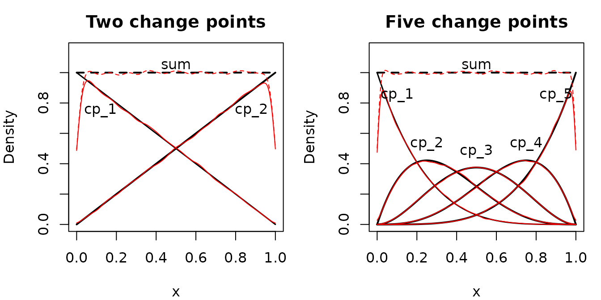

# Working with priors

*NOTE: the JAGS-specific prior interface below is likely to be
deprecated in the future, when additional backends are added beyond
JAGS.*

`mcp`’s default priors use established defaults where possible:
[`rstanarm`](https://mc-stan.org/rstanarm/articles/priors.html) for
intercepts and coefficients, and
[`brms`](https://paulbuerkner.com/brms/reference/set_prior.html) for
scale parameters such as `sigma` and group-level SDs. Change points
(including their group-level SDs) and autocorrelation have
`mcp`-specific defaults, and a few other deviations are [documented
here](https://lindeloev.github.io/mcp/dev/articles/default_priors.html#deviations).

## Setting a prior

`mcp` takes priors in the form of a named list. The names are the
parameter names, and the values are distribution strings, fixed values,
or the names of other parameters. Here is a fairly complicated example,
to demonstrate the various ways priors can be used:

``` r

model = list(
  y ~ 1 + x,  # Intercept_1 + x_1
  ~ 1 + x,  # cp_1, Intercept_2, and x_2
  ~ 1 + x  # cp_2
)

prior = list(
  Intercept_1 = "dnorm(0, 5) T(, 10)",  # Intercept; less than 10
  x_1 = "dbeta(2, 5)",  # slope: beta with right skew
  cp_1 = "dunif(min(x), cp_2)",  # change point between smallest x and cp_2
  x_2 = "dt(0, 1, 3) T(x_1, )",  # slope 2 > slope 1 and t-distributed
  cp_2 = 80,  # A constant (set; not estimated)
  x_3 = "x_2"  # same slope as x_2 (use same() instead; see below)
  # Intercept_2 and Intercept_3 not specified. Use default.
)
```

Distribution strings use JAGS names and argument order, including
[`T()`](https://rdrr.io/r/base/logical.html) truncation, so JAGS
distributions are generally allowed (see the [JAGS user
manual](https://sourceforge.net/projects/mcmc-jags/files/Manuals/4.x/jags_user_manual.pdf)).
However, they are not JAGS code: `mcp` uses conventional scales instead
of JAGS precision, i.e., SD for
[`dnorm()`](https://rdrr.io/r/stats/Normal.html), SD on the log scale
for [`dlnorm()`](https://rdrr.io/r/stats/Lognormal.html) (`sdlog` in
[`stats::dlnorm()`](https://rdrr.io/r/stats/Lognormal.html)), and scale
for [`dt()`](https://rdrr.io/r/stats/TDist.html), `ddexp()`, and
[`dlogis()`](https://rdrr.io/r/stats/Logistic.html). When generating
JAGS code, `mcp` converts these to inverse variance for
[`dnorm()`](https://rdrr.io/r/stats/Normal.html),
[`dt()`](https://rdrr.io/r/stats/TDist.html), and
[`dlnorm()`](https://rdrr.io/r/stats/Lognormal.html), and inverse scale
for `ddexp()` and [`dlogis()`](https://rdrr.io/r/stats/Logistic.html).
You can inspect the translation by comparing `fit$prior` with
`fit$jags_code`.

Other notes:

- Default population-level change-point priors are ordered. For user
  priors, `mcp` adds truncation (e.g., `T(cp_1, )`) only when the prior
  has neither explicit truncation nor an inherently bounded form such as
  [`dunif()`](https://rdrr.io/r/stats/Uniform.html) or `dirichlet()`.
  User-specified population-level bounds are kept unchanged. When change
  points have group-level deviations, their realized locations are
  constrained to remain ordered within every group.

- `mcp` allows inserting data-dependent values: for example, `min(x)`,
  `max(x)`, `mean(y)`, `median(y)`, `sd(y)`, `mad(y)`,
  `max(x) - min(x)`, `n_segments()`, and `n_cp()`. `mcp` resolves these
  expressions before generating JAGS code. The older `mcp` v0.3.4
  uppercase constants (`MINX`, `MAXX`, and so on) remain temporarily
  supported with a deprecation warning.

- You can fix any parameter to a specific value. Simply set it to a
  numerical value (as `cp_2` above). A constant is a 100% prior belief
  in that value, and it will therefore not be estimated.

- To share a coefficient between segments, prefer `same()` in the model,
  e.g., `~ 1 + same(x)` in segment 3. This reuses `x_2` instead of
  estimating `x_3`. Equating parameters in the prior (`x_3 = "x_2"`
  above) gives the same fit but keeps `x_3` as a duplicate. Read more
  about `same()` in [Understanding mcp
  formulas](https://lindeloev.github.io/mcp/dev/articles/formulas.html#sharing-coefficients-between-segments).

- You can write deterministic expression such as
  `x_3 = "x_2 + 5 - cp_1/10"`. Since `x_3` is now deterministic given
  `x_2` and `cp_1`, this leaves one fewer free parameter to estimate.

Let us see the priors after running them through `mcp` and compare to
the default priors:

``` r

library(mcp)
df_dummy = data.frame(x = 1:100, y = 1:100)
empty_manual = mcp(model, data = df_dummy, prior = prior, sample = FALSE)
empty_default = mcp(model, data = df_dummy, sample = FALSE)

# Inspect resolved priors and bounds
prior_summary(empty_manual)  # For more details: add verbose = TRUE
```

    ## # A tibble: 9 × 5
    ##   parameter   segment dpar  prior                                         bounds        
    ##   <chr>         <int> <chr> <chr>                                         <chr>         
    ## 1 cp_1              2 NA    uniform(min = cp_0, max = cp_2)               [min(x), cp_2]
    ## 2 cp_2              3 NA    80                                            none          
    ## 3 Intercept_1       1 mu    normal(mean = 0, sd = 5)                      [-Inf, 10]    
    ## 4 x_1               1 mu    beta(shape1 = 2, shape2 = 5)                  [0, 1]        
    ## 5 Intercept_2       2 mu    normal(mean = 50.5, sd = 72.529)              none          
    ## 6 x_2               2 mu    student_t(df = 3, location = 0, scale = 1)    [x_1, Inf]    
    ## 7 Intercept_3       3 mu    normal(mean = 50.5, sd = 72.529)              none          
    ## 8 x_3               3 mu    x_2                                           none          
    ## 9 sigma_1           1 sigma student_t(df = 3, location = 0, scale = 37.1) [0, Inf]

``` r

prior_summary(empty_default)  # For more details: add verbose = TRUE
```

    ## # A tibble: 9 × 5
    ##   parameter   segment dpar  prior                                         bounds        
    ##   <chr>         <int> <chr> <chr>                                         <chr>         
    ## 1 cp_1              2 NA    dirichlet(alpha = 1)                          [min(x), cp_2]
    ## 2 cp_2              3 NA    dirichlet(alpha = 1)                          [cp_1, max(x)]
    ## 3 Intercept_1       1 mu    normal(mean = 50.5 - x_1 * 1, sd = 72.529)    none          
    ## 4 x_1               1 mu    normal(mean = 0, sd = 2.5)                    none          
    ## 5 Intercept_2       2 mu    normal(mean = 50.5, sd = 72.529)              none          
    ## 6 x_2               2 mu    normal(mean = 0, sd = 2.5)                    none          
    ## 7 Intercept_3       3 mu    normal(mean = 50.5, sd = 72.529)              none          
    ## 8 x_3               3 mu    normal(mean = 0, sd = 2.5)                    none          
    ## 9 sigma_1           1 sigma student_t(df = 3, location = 0, scale = 37.1) [0, Inf]

Now, let’s simulate some data from `model`. The following priors are “at
odds” with the actual data so as to show their effect.

``` r

df = data.frame(x = runif(200, 0, 100), y = 1)  # 200 datapoints between 0 and 100
df$y = empty_default$simulate(empty_default, df, 
    Intercept_1 = 20, Intercept_2 = 22, Intercept_3 = 30,  # intercepts
    x_1 = -0.5, x_2 = 0.5, x_3 = 0,  # slopes
    cp_1 = 35, cp_2 = 70,  # change points
    sigma = 5)

head(df)
```

    ##          x        y
    ## 1 91.48060 36.00483
    ## 2 93.70754 35.22376
    ## 3 28.61395  0.67698
    ## 4 83.04476 39.24241
    ## 5 64.17455 33.25341
    ## 6 51.90959 30.98237

Sample the prior and posterior.

``` r

future::plan(future::multisession, workers = 3)
fit_manual = mcp(model, data = df, sample = "both", prior = prior)
fit_default = mcp(model, data = df, sample = "both")
```

First, let’s look at the priors side by side. Notice the use of
`prior = TRUE` to show prior samples. This works in
[`plot()`](https://lindeloev.github.io/mcp/dev/reference/plot.mcpfit.md),
[`plot_pars()`](https://lindeloev.github.io/mcp/dev/reference/plot_pars.md),
and
[`summary()`](https://lindeloev.github.io/mcp/dev/reference/summary.mcpfit.md)
among others.

``` r

library(ggplot2)
pp_default = plot_pars(fit_default, type = "dens_overlay", prior = TRUE, npars = NULL) + 
  ggtitle("Default priors")

pp_manual = plot_pars(fit_manual, type = "dens_overlay", prior = TRUE, npars = NULL) +
  ggtitle("Manual priors")

pp_default + pp_manual
```


Here are the resulting posterior fits:

``` r

plot_default = plot(fit_default) + ggtitle("Default priors")

plot_manual = plot(fit_manual) + ggtitle("Manual priors")

plot_default + plot_manual
```


We see the effects of the priors:

- The intercept `Intercept_1` was truncated to be below 10.
- The slope `x_1` is bound to be non-negative (because `dbeta`).
- The slopes `x_2` and `x_3` were forced to be identical.
- The change point `cp_2` was a constant, so there is no uncertainty
  there.

Adding `verbose = TRUE` reveals full details including the rule
descriptions, parameter classifications (`kind`), and whether each prior
came from the user or data-calibrated defaults:

``` r

prior_summary(fit_manual, verbose = TRUE)
```

    ## # A tibble: 9 × 9
    ##   parameter   segment dpar  prior                                        bounds         rule                                                                description                                           source  kind        
    ##   <chr>         <int> <chr> <chr>                                        <chr>          <chr>                                                               <chr>                                                 <chr>   <chr>       
    ## 1 cp_1              2 NA    uniform(min = cp_0, max = cp_2)              [min(x), cp_2] uniform(min = min(x), max = cp_2)                                   User-specified prior                                  user    distribution
    ## 2 cp_2              3 NA    80                                           none           80                                                                  Fixed at 80                                           user    constant    
    ## 3 Intercept_1       1 mu    normal(mean = 0, sd = 5)                     [-Inf, 10]     normal(mean = 0, sd = 5)                                            User-specified prior                                  user    distribution
    ## 4 x_1               1 mu    beta(shape1 = 2, shape2 = 5)                 [0, 1]         beta(shape1 = 2, shape2 = 5)                                        User-specified prior                                  user    distribution
    ## 5 Intercept_2       2 mu    normal(mean = 24.322, sd = 26.856)           none           normal(mean = mean(y), sd = 2.5 * sd(y))                            Mean intercept (rstanarm default)                     default distribution
    ## 6 x_2               2 mu    student_t(df = 3, location = 0, scale = 1)   [x_1, Inf]     student_t(df = 3, location = 0, scale = 1)                          User-specified prior                                  user    distribution
    ## 7 Intercept_3       3 mu    normal(mean = 24.322, sd = 26.856)           none           normal(mean = mean(y), sd = 2.5 * sd(y))                            Mean intercept (rstanarm default)                     default distribution
    ## 8 x_3               3 mu    x_2                                          none           x_2                                                                 Same value as x_2                                     user    alias       
    ## 9 sigma_1           1 sigma student_t(df = 3, location = 0, scale = 9.9) [0, Inf]       student_t(df = 3, location = 0, scale = max(2.5, round(mad(y), 1))) Positive residual SD calibrated on the response scale default distribution

This is a contrived example. Usually setting priors manually aims to
sample the “correct” posterior.

## Prior predictive checks

Prior predictive checks are a great way to ensure that the priors are
meaningful before fitting to data. Simply set `sample = "prior"`. Let us
do it for the manual and default priors above to compare their prior
predictive space:

``` r

# Sample priors
fit_pp_manual = mcp(model, data = df, prior = prior, sample = "prior")
fit_pp_default = mcp(model, data = df, sample = "prior")

# Plot it
plot_pp_manual = plot(fit_pp_manual, lines = 100, prior = TRUE) + ylim(c(-400, 400)) + ggtitle("Manual prior")
plot_pp_default = plot(fit_pp_default, lines = 100, prior = TRUE) + ylim(c(-400, 400)) + ggtitle("Default prior")
plot_pp_manual + plot_pp_default  # using patchwork
```


You can see how the manual priors force strictly positive slopes (x_2 \>
x_1 \> 0) that compound to span a much wider vertical range than the
defaults, alongside an abrupt concerted change at the fixed change point
x = 80. In contrast, the default priors are centered on the observed
data, with zero-centered slopes and change points distributed smoothly
across the x range.

## Default priors on change points

Change point locations must lie within the observed range
`[min(x), max(x)]` and maintain strict order `cp_1 < cp_2 < ... < cp_n`.
Without this rule, change point locations would be unidentifiable and
label switching would occur.

The default prior on all change points in `mcp` is **uniform order
statistics** (`dirichlet(1)`), which treats any set of ordered change
points as equally likely anywhere in the observed interval
`[min(x), max(x)]`. See below for a visualization. Some properties of
this prior:

- **Single change point:** For 1 change point, this reduces to the
  uniform prior in the observed range: \text{cp}\_1 \sim
  \text{Beta}(1, 1) \equiv \text{Uniform}(\min(x), \max(x)).
- **Multiple change points:** For N \ge 2, change points are evenly
  spaced on average: \mathbb{E}\[\text{cp}\_j\] = \min(x) + \frac{j}{N +
  1} (\max(x) - \min(x)) For example, with 2 change points, prior means
  are at 33% and 67% of the data range. With 5 change points, they are
  at 16.7%, 33.3%, 50%, 66.7%, and 83.3%.
- **Symmetry and flat sum:** The prior is symmetric under reflection
  (flipping x leaves prior probabilities unchanged), and the sum of
  prior densities across all change points is uniform across the entire
  data range.
- **Increasing informativeness with segment count:** For any given
  range, introducing more change points makes the prior for each change
  point more effectively informative because they are “squeezed” more
  together (as shown in the figure below).

The plot below compares these theoretical Dirichlet distributions (black
lines) with the sampled prior distributions (red lines) for 2 and 5
change points:



Note on implementation: Under the hood, `mcp` samples this as sorted
uniform draws on the observed x-range, which JAGS samples efficiently.
Other `dirichlet(alpha)` priors use a sequential stick-breaking Beta
chain (z_j \sim \text{Beta}(\alpha, (N - j + 1)\alpha), \text{cp}\_j =
\text{cp}\_{j-1} + z_j(\max(x) - \text{cp}\_{j-1})). See [From formulas
to sampler
code](https://lindeloev.github.io/mcp/dev/articles/implementation.md).

The [Dirichlet
distribution](https://en.wikipedia.org/wiki/Dirichlet_distribution)
places a joint prior on positive segment spacings that sum to the
observed x-range. This construction also underlies monotonic effects in
`brms` ([Bürkner & Charpentier,
2020](https://doi.org/10.1111/bmsp.12195)).

For group-level change points, e.g., `cp((1 | id))`, the SD `cp_1_id_sd`
has a half-normal default prior with a scale of a quarter of the
expected interval in which each group’s change point can vary. With one
change point, this is `dnorm(0, (max(x) - min(x)) / 4) T(0, )`. See
[default priors on group-level change
points](https://lindeloev.github.io/mcp/dev/articles/default_priors.html#group-level-change-points)
for the justification.

### Regularizing change points: `dirichlet(alpha)`

To adjust the spacing regularity of change points, specify
`dirichlet(alpha)` for all change points:

``` r

prior = list(
  cp_1 = "dirichlet(2)",
  cp_2 = "dirichlet(2)"
)
```

The number in parentheses is a common \alpha concentration parameter
(all change points must share the same \alpha):

- \alpha = 1 (default): completely flat uniform order statistics as
  shown above.
- \alpha \> 1 (e.g. 2, 5): penalizes change points from occurring close
  to each other or the limits of the data range, favoring more evenly
  spaced segments.
- \alpha \< 1 (e.g. 0.5): favors clustering and permits change points to
  occur close together.

### Manual priors on change points

You can customize change point priors as shown in the initial example.
Beware that the nature of the priors changes when truncation is applied;
use `plot_pars(fit, prior = TRUE)` to inspect the realized prior
distributions.

For an otherwise unbounded user prior such as `cp_2 = "dnorm(40, 10)"`,
`mcp` automatically adds default bounds equivalent to
`cp_2 = "dnorm(40, 10) T(cp_1, max(x))"`. An explicit truncation,
including `T(,)`, or a [`dunif()`](https://rdrr.io/r/stats/Uniform.html)
prior is used unchanged. Relaxing the order can cause label-switching
between segments and make sampling difficult, so inspect the resulting
prior carefully.

## Default priors

`mcp` assigns default priors to all parameters that you do not set in
`mcp(..., prior = list())`. Inspect them using `prior_summary(fit)`. The
article on [default
priors](https://lindeloev.github.io/mcp/dev/articles/default_priors.md)
explains how they are chosen, with a [summary
table](https://lindeloev.github.io/mcp/dev/articles/default_priors.html#summary-reference-table)
and the [deviations from `rstanarm` and
`brms`](https://lindeloev.github.io/mcp/dev/articles/default_priors.html#deviations).
Note that for a factor without an intercept, e.g., `y ~ 0 + state`, each
factor level’s coefficient is an intercept and gets the intercept prior.

## JAGS code

Here is the JAGS code for `fit_manual`:

``` r

fit_manual$jags_code
```

    ## model {
    ##   # Change points
    ##   cp_0 = min(x)
    ##   cp_1 ~ dunif(cp_0, cp_2)  # User-specified prior
    ##   cp_2 = 80  # Fixed at 80
    ##   cp_3 = max(x)
    ## 
    ##   # Priors for population-level effects
    ##   Intercept_1 ~ dnorm(0, 1/(5)^2) T(,10)  # User-specified prior
    ##   x_1 ~ dbeta(2, 5)  # User-specified prior
    ##   Intercept_2_end_ ~ dnorm(24.321850954171083 + x_2 * (cp_2 - cp_1), 1/(26.856367009148308)^2)   # Mean intercept (rstanarm default); sampled as the value at the segment end
    ##   Intercept_2 = Intercept_2_end_ - (x_2 * (cp_2 - cp_1))
    ##   x_2 ~ dt(0, 1/(1)^2, 3) T(x_1,)  # User-specified prior
    ##   Intercept_3_end_ ~ dnorm(24.321850954171083 + x_3 * (cp_3 - cp_2), 1/(26.856367009148308)^2)   # Mean intercept (rstanarm default); sampled as the value at the segment end
    ##   Intercept_3 = Intercept_3_end_ - (x_3 * (cp_3 - cp_2))
    ##   x_3 = x_2  # Same value as x_2
    ##   sigma_1 ~ dt(0, 1/(9.9)^2, 3) T(0,)  # Positive residual SD calibrated on the response scale
    ## 
    ##   # Model and likelihood
    ##   for (i_ in 1:length(x)) {
    ##     # par_x local to each segment
    ##     x_local_1_[i_] = min(x[i_], cp_1)
    ##     x_local_2_[i_] = min(x[i_], cp_2) - cp_1
    ##     x_local_3_[i_] = min(x[i_], cp_3) - cp_2
    ##     
    ##     # Formula for mu
    ##     link_mu_[i_] =
    ##       (x[i_] >= cp_0) * (x[i_] < cp_1) * inprod(rhs_matrix_[i_, c(1)], c(Intercept_1)) * 1 + 
    ##       (x[i_] >= cp_0) * (x[i_] < cp_1) * inprod(rhs_matrix_[i_, c(2)], c(x_1)) * x_local_1_[i_] + 
    ##       (x[i_] >= cp_1) * (x[i_] < cp_2) * inprod(rhs_matrix_[i_, c(3)], c(Intercept_2)) * 1 + 
    ##       (x[i_] >= cp_1) * (x[i_] < cp_2) * inprod(rhs_matrix_[i_, c(4)], c(x_2)) * x_local_2_[i_] + 
    ##       (x[i_] >= cp_2) * inprod(rhs_matrix_[i_, c(5)], c(Intercept_3)) * 1 + 
    ##       (x[i_] >= cp_2) * inprod(rhs_matrix_[i_, c(6)], c(x_3)) * x_local_3_[i_]
    ##     
    ##     # Formula for sigma
    ##     link_sigma_[i_] =
    ##       (x[i_] >= cp_0) * inprod(rhs_matrix_[i_, c(7)], c(sigma_1)) * 1
    ## 
    ##     # Likelihood for family = gaussian()
    ##     mu_[i_] = link_mu_[i_]
    ##     sigma_[i_] = max(1e-05, link_sigma_[i_])
    ##     y[i_] ~ dnorm(mu_[i_], 1 / sigma_[i_]^2)
    ##   }
    ## }
