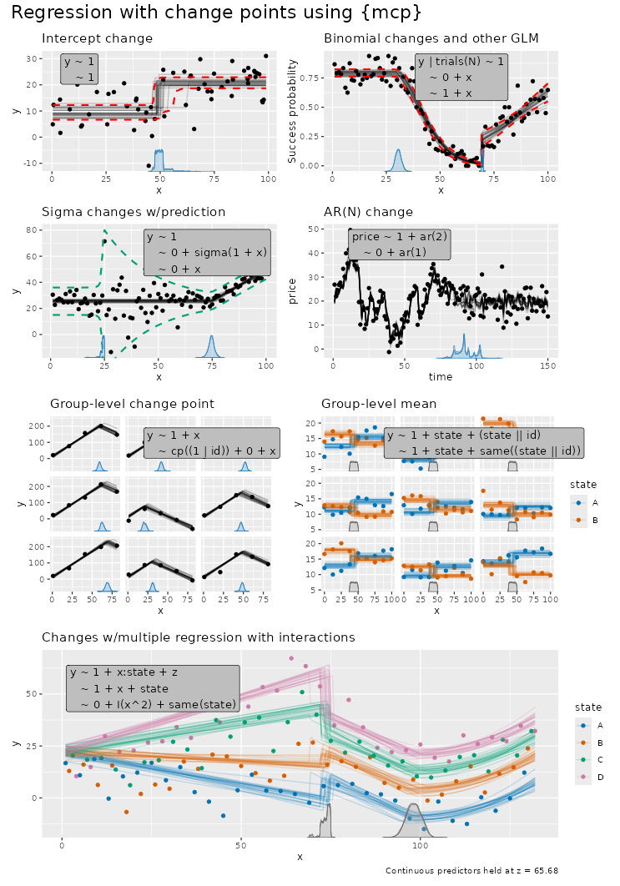

```{r, include = FALSE}
if (requireNamespace("pkgload", quietly = TRUE)) {
  pkgload::load_all(export_all = FALSE, quiet = TRUE)
}
set.seed(42)
```

`mcp` takes a list of formulas, and defines the change point as the point on the x-axis where the data shifts from being generated by one formula to the next. So with `N` formulas, you have `N - 1` change points. A list with just one formula thus corresponds to normal regression with 0 change points.

The formulas are called "segments" because they divide the (observed) x-axis into `N` segments. Here are some examples:




# Formula format for segments

The first segment has the format `response ~ predictor`. Later segments use the same response, so they are one-sided, `~ predictor`, and each starts at a change point that can be modeled using `cp()`, e.g., `~ cp((1 | id)) + 0 + x`. `cp()` is the change-point part of the formula and the rest is the predictor part, which works like in `lm()`/`glm()`/`brms::brm()`.

**1. Response (segment 1 only):**

- `y ~ ...`: Standard continuous, binary, or count response (Gaussian, Bernoulli, Poisson, negative binomial).
- `successes | trials(total) ~ ...`: Binomial response (`family = binomial()`).
- `y | weights(w) ~ ...`: Observation log-likelihood weights (multiplies each observation's log-likelihood contribution by `w > 0`; affects posterior inference and `log_lik()`, but not predictions).
- `y | trials(total) + weights(w) ~ ...`: Combine response auxiliaries using `+`.

**2. Change-point part (`cp()`, segments 2+):**

- `~ x` (i.e., `cp()` not included): Population-level change point (default). Same as `~ cp(1) + x`.
- `~ cp((1 | id)) + x`: Group-level change-point deviations around the population-level change point ([read more](../articles/group_effects.html)). The intercept is implicit, so this is the same as `cp(1 + (1 | id))`.

**3. Predictor part (all segments):**

- `~ 1 + x`: Disjoined slope with a new segment intercept.
- `~ 0 + x`: Joined slope (no new intercept).
- `~ 1`: Plateau (intercept only, no slope).
- `~ x:state + z + (1 | id)`: Other variables, interactions, and group-level effects ([read more](../articles/group_effects.html)).
- `+ sigma(1 + x)` or `shape(0 + state)`: Distributional parameters on the link scale. Together with each AR/MA lag (`ar1`, `ma1`, ...), these are the `dpar`s in `mcp`, since each has its own segmented linear predictor ([read more](../articles/dpar.html)).
- `+ ar(1)` or `ma(2, 1 + x)`: Autoregressive and moving-average time-series residuals on the link scale; include them in every segment where they apply ([read more](../articles/arma.html)).

`mcp` is heavily inspired by `brms` which again is inspired by [`lme4::lmer()`](https://cran.r-project.org/web/packages/lme4/index.html) which extends `lm()` and `glm()`. [Here is a bit of history](https://twitter.com/jonaslindeloev/status/1117760777249853440) on that.


# How segments connect

Here is the demo model from the [README](../index.html), which ships already fitted as [`demo_fit`](../reference/demo_fit.html):

```{r, fig.alt = "Fitted mcp model with a plateau, a joined slope, and a disjoined slope."}
library(mcp)
model = list(
  response ~ 1,  # Plateau (Intercept_1)
  ~ 0 + time,    # Joined slope (time_2)
  ~ 1 + time     # Disjoined slope (Intercept_3, time_3)
)
plot(demo_fit)
```

Segment 2 continues from where the plateau left off, while segment 3 starts afresh with a new intercept. Three rules govern this (with `x` as the change-point variable, i.e., `time` above):

1. **Only included terms get coefficients.**\
   A segment includes the terms in its formula, plus an intercept unless removed with `0 +`. Each included term gets a new coefficient (`x_2`, `stateB_2`) or reuses an existing one with [`same()`](#reusing-coefficients-between-segments).
2. **x-terms are measured from the change point.**\
   `x`, `x:z`, `state:x`, and `I(x^2)` start at zero at the segment's change point and stop growing at the next change point (they plateau). See the [math below](#modeling-slope-change-points).
3. **Joined or disjoined.**\
   Without an intercept (`0 + ...`), a segment is *joined*: it continues from where the earlier intercept and x-terms left off. With an intercept, it is *disjoined* and starts afresh.

The same rules apply separately to `sigma()`, `shape()`, `ar()`, and `ma()`. 

`sigma` and `shape` are required by the likelihood, so they include an intercept in segment 1. Per rule 3, they are joined in later segments that do not include them.

Segment 2+ starts at a change point, so it always includes a change-point intercept (`cp_1`, `cp_2`, ...), which cannot be removed. Use `cp()` to add terms to it, e.g., `cp((1 | id))` for [group-level change points](../articles/group_effects.html).


## Joining applies to the intercept and x-terms

Other terms, such as `z`, `state`, and `(1 | id)`, end at the change point unless included again. So a joined segment can still start with a jump, as it does for the two values of `z` below. We use `fit$simulate()` to compute predictions for chosen parameter values:

```{r, fig.alt = "Two parallel lines, one per value of z, which jump onto a single shared line at the change point x = 20."}
model = list(
  y ~ 1 + x + z,  # Intercept_1, x_1, z_1
    ~ 0 + x       # Joined x_2; z is not included
)
df = expand.grid(x = seq(0, 40, by = 0.5), z = c(-1, 1), y = 0)
fit = mcp(model, data = df, par_x = "x", sample = FALSE)

df$y = fit$simulate(fit, df, cp_1 = 20, Intercept_1 = 0, x_1 = 1, z_1 = 5, x_2 = -1, sigma_1 = 1, .type = "fitted")
plot(y ~ x, data = df, col = factor(z))  # Red: z = 1. Black: z = -1
```

To keep `z` in segment 2, include it again: `~ 0 + x + same(z)` reuses `z_1` whereas `~ 0 + x + z` estimates a new `z_2`.

Conversely, a joined segment can depend on a variable it does not include: in `list(y ~ 1 + x:z, ~ 0)`, the slope in segment 1 differs by `z`, so the plateau in segment 2 does too.


## Examples: Included terms and parameter names

New coefficients are named after their segment: `x_1`, `x_2`, etc. Interactions join their parts with a dot, e.g., `x:stateB` gives `x.stateB_1`. Change points are `cp_1`, `cp_2`, etc.; `cp_1` separates segments 1 and 2. In these examples, the change-point variable is `x`; set `mcp(..., par_x = "x")` if mcp does not automatically select the correct change-point variable.

```{r, eval=FALSE, R.options = list(width = 9999)}
# 1. Slopes: joined or disjoined
model = list(
  y ~ 1 + x,  # Intercept_1, x_1
    ~ 0 + x,  # At cp_1: Joined slope (x_2)
    ~ 1 + x,  # At cp_2: Disjoined slope (Intercept_3, x_3)
    ~ 0       # At cp_3: Joined plateau (no new coefficients)
)

# 2. Factors, other variables, and interactions
model = list(
  y ~ 1 + x:state + z,  # Intercept_1, by-state slopes (x.stateA_1, ...), z_1
    ~ 1 + x + state,    # At cp_1: Disjoined (Intercept_2, x_2, stateB_2, ...); z not included
    ~ 0 + x             # At cp_2: Joined slope (x_3); state not included
)

# 3. Group-level effects in the predictor part
model = list(
  y ~ 1 + x + (1 | id),  # Intercept_1, x_1, group intercept deviations
    ~ 0 + x + (1 | id),  # At cp_1: Joined slope (x_2); new group deviations and SD
    ~ 0 + x              # At cp_2: Joined slope (x_3); (1 | id) not included
)

# 4. Group-level change points in cp()
model = list(
  y ~ 1 + x,                 # Intercept_1, x_1
    ~ cp((1 | id)) + 0 + x,  # At cp_1, group-level by id (cp_1_id): Joined slope (x_2)
    ~ 1                      # At cp_2: Disjoined plateau (Intercept_3)
)

# 5. Distributional parameters and AR/MA
model = list(
  y ~ 1 + x + sigma(1 + x) + ar(1), # Intercept_1, x_1; log-SD slope (sigma_Intercept_1, sigma_x_1); AR(1) (ar1_1)
    ~ 0 + x + ar(1, 1 + x),  # At cp_1: Joined slope (x_2); sigma joined plateau; new AR(1) (ar1_2, ar1_x_2)
    ~ 0 + sigma(1),          # At cp_2: Joined mu plateau; new sigma_Intercept_3; AR not included
    ~ 0 + ma(2)              # At cp_3: Joined mu plateau; sigma joined; MA(2) (ma1_4, ma2_4)
)
```

## Reusing coefficients between segments

To reuse a coefficient instead of estimating a new one, include `same(term)`. The coefficient keeps its source name:

```{r, eval=FALSE}
model = list(
  y ~ 1 + x + z + (1|id),
    ~ 0 + x + state + same(z),   # Reuse z_1; other coefficients are new
    ~ 1 + same(x + z),           # Reuse x_2 and z_1
    ~ 0 + same(x, as = 1) + same(state, as = 2), # Reuse x_1 and segment 2 factor coding/coefficients
    ~ 0 + same((1|id), as = 1),  # Reuse segment 1 group deviations and SD
    ~ 1 + sigma(0 + x),          # New log-SD slope sigma_x_6, joined to initial sigma_Intercept_1
    ~ 0 + sigma(1 + same(x))     # New log-SD intercept sigma_Intercept_7; reuse sigma_x_6
)
```

`same()` refers to the preceding segment by default; use `as` to pick an earlier segment. It works for factors (`same(state)`), group-level effects (`same((1 | id))` reuses deviations and SD), and inside distributional parameters (`sigma(0 + same(x))`). Reused x-terms are still measured from the current change point.

Reused coefficients are estimated jointly from all segments where they are included, not fitted in one segment and copied to another.

## Inspect coefficients

[`mcp_pars()`](../reference/mcp_pars.html) lists the parameters that follow from the rules above. You can use it before sampling:

```{r}
model = list(
  y ~ 1 + x:state + z,         # Intercept_1, by-state slopes, z_1
    ~ 1 + x + state + same(z), # Intercept_2, x_2, state contrasts; reuse z_1
    ~ 0 + same(x)              # Joined; reuse x_2
)
fit = mcp(model, data = mcp_example_data("multiple"), par_x = "x", sample = FALSE)
mcp_pars(fit)
```

Thanks to `same()`, there is no `z_2` or `x_3`.


## Some clarifications on formula behavior

Factors use ordinary R formula coding: with treatment coding, `1 + state` gives contrasts to a reference level, while `0 + state` gives coefficients for all levels. In segment 1, these are the intercepts of each level; in a joined segment, they are jumps from where the earlier segment left off. A predictor group-level effect such as `(1 | id)` applies where it is included. A change-point group-level effect applies only at the change point where it is included; it does not introduce group-level effects in the predictor part.

Only bare `x`, powers such as `I(x^2)`, and their interactions are x-terms. Other transformations, such as `sin(x)` and `poly(x, 2)`, use the original values of `x`, as in `lm()`, and do not join:

```r
list(
  y ~ 1,                        # Intercept_1
    ~ 1 + sin(x) + x + I(x^2)   # sin(x) uses x; x and I(x^2) are measured from cp_1
)
```

Offsets have fixed coefficients: include `offset(log(exposure))` in every segment (or in every `ar()`/`ma()` term). Read more about offsets in [Poisson and Negative Binomial models](../articles/poisson.html).


# Multiple regression and categorical predictors

Here is the model from the overview plot at the top of this page, with an extra plateau segment:

```{r}
# Define model with multiple predictors
model = list(
  y ~ 1 + x:state + z, # Segment 1: by-state slopes on x, and z
  ~ 1 + x + state,     # Segment 2: shared slope on x, by-state intercepts
  ~ 0 + I(x^2),        # Segment 3: joined quadratic; state not included
  ~ 1                  # Segment 4: shared intercept for all states
)

# Load data and inspect parameters without sampling
ex = mcp_example("multiple", sample = FALSE)
fit = mcp(model, data = ex$data, par_x = "x", sample = FALSE)
mcp_pars(fit)
```

Key features of multiple regression models in `mcp`:

- **Common change points across categories**: The change points `cp_1` and `cp_2` are estimated as single locations shared across all levels of `state`. (If you instead want category-specific change-point locations that deviate per group, use group-level effects like `cp((1|group))`; see [group-level effects](../articles/group_effects.html)).
- **Parameter names across segments**: In segment 1, `x.stateA_1` through `x.stateD_1` represent separate slopes for each level of `state`. In segment 2, `stateB_2`, `stateC_2`, and `stateD_2` represent intercept offsets relative to the reference level `stateA`. A variable such as `z` must be included in each segment where it applies.
- **Plotting and prediction**: Visualize by state using `plot(fit, color_by = "state")` or `plot(fit, facet_by = "state")`. By default, other numeric variables (like `z`) are held at their mean automatically by `interpolate_newdata()`, or can be set explicitly via `plot(fit, color_by = "state", at = list(z = 0))`. See the [plotting article](../articles/plotting.html) for more.

# Relative changes between segments

Coefficients in `mcp` represent the absolute values within each segment (e.g., `time_2` is the slope in segment 2 and `time_3` is the slope in segment 3). Relative changes between segments, such as changes in slope, jumps at change points, and distances between change points, are derived quantities. You can use `hypothesis()` for quick estimates or use `as_draws_df()` to work with the distribution.

First, using `hypothesis()`:

```{r, R.options = list(width = 9999)}
hypothesis(demo_fit, "time_3 > time_2")
```

The estimate reflects the difference `time_3 - time_2` (how much steeper or flatter the slope became in segment 3), along with its credibility interval, posterior probability, and directional Bayes factor. [Read more about hypothesis testing in the comparison article](../articles/comparison.html). Here, the estimate is negative, so the slope is smaller in segment 3 than in segment 2, with great certainty (`prob = 0`).

If you need the full posterior distribution of the change (e.g., for `quantile()`, `hist()`, or plotting with `ggplot2`), extract draws, e.g., using `as_draws_df()`, and compute the change in each draw:

```{r, R.options = list(width = 9999)}
draws = as_draws_df(demo_fit) |>
  dplyr::mutate(
    slope_change = time_3 - time_2,                               # Change in slope at cp_2
    jump = Intercept_3 - (Intercept_1 + time_2 * (cp_2 - cp_1)),  # Jump at cp_2 (segment 3 start minus segment 2 end)
    cp_distance = cp_2 - cp_1                                     # Length of segment 2
  )

posterior::subset_draws(draws, variable = c("slope_change", "jump", "cp_distance")) |>
  posterior::summarise_draws()
```

Because the change points differ between draws, the jump/change is evaluated exactly at the change point in each draw. `fitted()` cannot do this, since `newdata` fixes `x` while the change point varies, so a fitted value near `cp_2` mixes draws from before and after the change point.

You can now use these columns directly with base R functions like `quantile(draws$jump, c(0.025, 0.975))` and `hist(draws$cp_distance)`.

The same applies to all other dpars, e.g., `sigma`, `shape`, and `ar1`. For example, `sigma_Intercept_3 - sigma_Intercept_2` is the change in log-SD with `sigma(1)` in both segments, so `exp()` of it is the ratio of the residual SDs. Similarly, `ar1_3 - ar1_2` is the change in the lag-1 autoregressive coefficient. Use `mcp_pars(fit)` to see the parameter names of a model.


# Modeling slope change points

Mathematically, an `mcp` model divides the change-point variable $x$ into $K$ segments separated by ordered change points $\tau_1 < \dots < \tau_{K-1}$. In each segment $k \in \{1, \dots, K\}$, the linear predictor $\eta_i$ on the link scale measures $x$ from the change point $\tau_{k-1}$:

$$\eta_i = \alpha_k + \beta_{k,1} \, (x_i - \tau_{k-1}) \quad (\text{with } \tau_0 = 0)$$

where $\alpha_k$ is the value at the start of segment $k$:

$$\alpha_k = \begin{cases}
\beta_{k,0}, & \text{disjoined } (\sim \texttt{1 + x}, \text{ or } k = 1) \\
\alpha_{k-1} + \beta_{k-1,1} (\tau_{k-1} - \tau_{k-2}), & \text{joined } (\sim \texttt{0 + x})
\end{cases}$$

That is, a disjoined segment starts at its own intercept $\beta_{k,0}$, while a joined segment continues from where segment $k-1$ left off.

Here, $\beta_{k,1}$ is the slope on $x$ in segment $k$. Intercepts and slopes are absolute values (not changes relative to preceding segments). Other variables (e.g., `+ z + state`) add $\sum_j \gamma_{k,j} z_{j,i}$ in the segments where they are included. They use their original values and are not part of $\alpha_k$, which is why they can make a joined segment start with a jump.

See how `mcp` implements this model for the sampler in [From formulas to sampler code](../articles/implementation.html).
